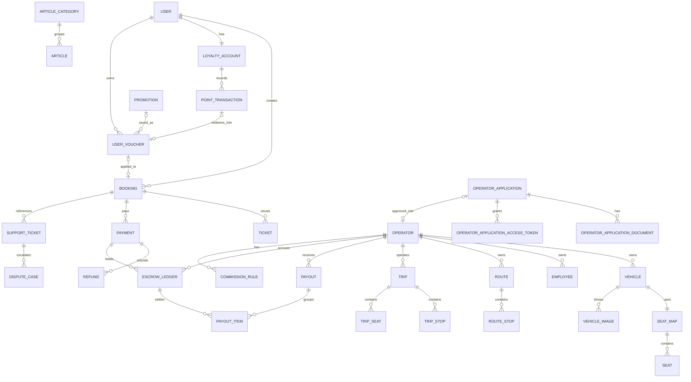

# 04. Database Design - Hệ thống đặt vé xe khách

## 1. Thông tin tài liệu

### 1.1. Metadata

| Thuộc tính    | Giá trị                     |
| ------------- | --------------------------- |
| Tên tài liệu  | Database Design             |
| Mã tài liệu   | 04-database-design          |
| Dự án         | Marketplace-Ve-Xe-Nhanh     |
| Trạng thái    | Review                      |
| Người viết    | Nguyễn Hồng Khanh, AI Agent |
| Người duyệt   | Nguyễn Hồng Khanh           |
| Ngày tạo      | 11/05/2026                  |
| Ngày cập nhật | 27/10/2026                  |

### 1.2. Lịch sử thay đổi

| Phiên bản | Ngày       | Người cập nhật | Nội dung thay đổi                                                                                                                                                                                                                                                                                                                                                                                                                                                                                                                                                                                                                                                                                                                                                                                            |
| --------- | ---------- | -------------- | ------------------------------------------------------------------------------------------------------------------------------------------------------------------------------------------------------------------------------------------------------------------------------------------------------------------------------------------------------------------------------------------------------------------------------------------------------------------------------------------------------------------------------------------------------------------------------------------------------------------------------------------------------------------------------------------------------------------------------------------------------------------------------------------------------------ |
| v0.1      | 11/05/2026 | AI Agent       | Tạo bản nháp Database Design từ SRS/HLD                                                                                                                                                                                                                                                                                                                                                                                                                                                                                                                                                                                                                                                                                                                                                                      |
| v0.2      | 25/05/2026 | AI Agent       | Align owner module theo `context/DOMAIN-MAP`; đóng DB-OQ-02 (fare snapshot) và DB-OQ-04 (audit MongoDB); chốt SeatHold TTL 10 phút                                                                                                                                                                                                                                                                                                                                                                                                                                                                                                                                                                                                                                                                           |
| v0.3      | 25/05/2026 | AI Agent       | Cập nhật tham chiếu SRS v1.15 → v1.20; cập nhật số mục DOMAIN-MAP sau khi §5 "Refactor radar" được xóa. Không thay đổi nội dung normative.                                                                                                                                                                                                                                                                                                                                                                                                                                                                                                                                                                                                                                                                   |
| v0.7      | 19/09/2026 | AI Agent       | **TASK-IAM-004 (MFA TOTP)**: thêm `mfa_credentials` (secret TOTP chỉ lưu AES-256-GCM, `last_totp_counter` chống replay, unique `(subject_type, subject_id)`, CHECK không cho `PASSENGER`) + `mfa_backup_codes` (chỉ hash SHA-256, `used_at` single-use, unique `(credential_id, code_hash)`) — cả hai **RLS chỉ cho ngữ cảnh `system`** (xoá được credential = login sau quay về enrollment chỉ bằng mật khẩu); thêm `auth_sessions.mfa_verified_at` và giá trị `MFA_REQUIRED` cho `SessionRevokeReason`. §5 + §7.                                                                                                                                                                                                                                                                                           |
| v0.8      | 22/09/2026 | AI Agent       | **TASK-IAM-005 Q3/Q4/Q6/Q8:** `operator_accounts` và `employee_accounts` thêm contact email, cờ đổi mật khẩu lần đầu, hạn mật khẩu tạm và `auth_epoch`; legacy không bị force-change. `auth_sessions.auth_epoch` chụp phiên bản lúc phát, guard so lại trên mỗi request nội bộ để chặn session cũ khi Redis post-revoke lỗi. `operator_login_names` khóa unique `(operator_id, username)` xuyên Owner/Employee, trigger giữ registry và RLS `ENABLE+FORCE`; `operatorSlug` immutable và Owner có compound FK `(operator_id, operator_slug)`. Migration kiểm collision/backfill trước khi thêm constraint.                                                                                                                                                                                                    |
| v0.11     | 28/09/2026 | AI Agent       | **ADR-017 amend / TASK-IAM-006 (Khanh chốt 28/09):** §7 thêm CHECK tiền tố username — Employee bắt buộc `nv.` + `[a-z0-9._-]{2,61}`, Owner cấm `nv.` (không phân biệt hoa/thường); ghi chú migration đổi tên Employee hiện có và ba điều kiện dừng (Owner dùng `nv.`, quá 64 ký tự, trùng sau khi đổi). Registry `operator_login_names` không đổi.                                                                                                                                                                                                                                                                                                                                                                                                                                                           |
| v0.12     | 29/09/2026 | AI Agent       | **Loyalty VXN Plus / ví voucher / bài viết (Khanh chốt 29/09/2026, SRS v1.21):** §5.2 thêm `loyalty_accounts`, `loyalty_point_transactions`, `user_vouchers`, `articles`, `article_categories`; §6 ERD; §7 unique / CHECK / index + RLS cấp Platform; §8 transaction đổi điểm / cộng điểm / voucher + entry `PLATFORM_FUNDED_DISCOUNT`; §9 retention; §10 `DB-MIG-07` seed. Trạng thái Approved → **Review**.                                                                                                                                                                                                                                                                                                                                                                                                |
| v0.13     | 30/09/2026 | AI Agent       | **A2 — đăng ký nhà xe theo closed enrollment (Khanh duyệt 30/09/2026, SRS v1.23)**: §5.2 thêm `operator_applications`, `operator_application_documents`, `operator_application_access_tokens` (cấp Platform, chưa có tenant); §6 ERD; §7 unique / index / RLS; §8 transaction duyệt hồ sơ gọi `provisionOperatorOwner`; §9 retention. Giữ trạng thái Review.                                                                                                                                                                                                                                                                                                                                                                                                                                                 |
| v0.14     | 30/09/2026 | AI Agent       | **TASK-IAM-006 — hiện thực migration `20260930010000_split_employee_login`:** §7 ghi rõ Employee bị đổi tên được tăng `auth_epoch` + `version` như PATCH username ở app (phiên cũ hết hiệu lực, đăng nhập lại bằng tên mới). Giữ trạng thái Review.                                                                                                                                                                                                                                                                                                                                                                                                                                                                                                                                                          |
| v0.10     | 26/09/2026 | AI Agent       | **TASK-TRN-002** (Khanh duyệt Q1–Q8): thêm `stop_point_proposals`; ràng buộc `stop_points`, `routes`, `route_stops` (nguồn điểm XOR, sequence unique, FK ghép tenant) và RLS đề xuất khoá state machine phía tenant. §5.2 + §7.                                                                                                                                                                                                                                                                                                                                                                                                                                                                                                                                                                              |
| v0.15     | 30/09/2026 | AI Agent       | **TASK-TRN-003** (Khanh duyệt Q1–Q6 ngày 30/09/2026): §7 ràng buộc `trips` (FK ghép route/xe, CHECK giờ đến sau giờ đi, EXCLUDE `trips_vehicle_no_overlap` bằng `btree_gist` — không có thời gian đệm quay đầu), `trip_stops`, `trip_seats` (index `(trip_id, status)` thay `status` đơn lẻ) + RLS. Migration `20260930100000_add_trip`. Giữ trạng thái Review.                                                                                                                                                                                                                                                                                                                                                                                                                                              |
| v0.16     | 30/09/2026 | AI Agent       | **TASK-TRN-005** (Khanh chốt Q1 = PA1, Q4 = Mongo): §7 ràng buộc `fares` (một bảng giá / tuyến, FK ghép route, RLS) và `fare_rules` (giá `BIGINT` ≥ 0, loại xe / loại chỗ / khung giờ khởi hành tuỳ chọn, EXCLUDE chống trùng phạm vi); **không có bảng lịch sử giá** — lịch sử = Mongo `audit_event` (`targetType = fare`). Giữ trạng thái Review.                                                                                                                                                                                                                                                                                                                                                                                                                                                          |
| v0.17     | 30/09/2026 | AI Agent       | **TASK-TRN-005 (review):** §7 `fare_rules` thêm CHECK trần giá `price <= 100.000.000` khớp API (dòng ghi thẳng DB vượt 2^53 làm xem bảng giá / chuyến trả 500). Giữ trạng thái Review.                                                                                                                                                                                                                                                                                                                                                                                                                                                                                                                                                                                                                       |
| v0.18     | 30/09/2026 | AI Agent       | **TASK-TRN-006** (Khanh chốt Q1–Q8): §7 `trips` thêm `online_sale_cutoff_minutes` (mặc định 60, CHECK 0–1440) + `status_reason`; `trip_seats` — khóa / mở ghế thủ công, giữ ghế khóa theo `seat_code` khi đổi xe. Giữ trạng thái Review.                                                                                                                                                                                                                                                                                                                                                                                                                                                                                                                                                                     |
| v0.19     | 03/10/2026 | AI Agent       | **Hình ảnh phương tiện (Khanh chốt 03/10/2026, SRS v1.32):** §5.2 Transport thêm bảng `vehicle_images`; §6 ERD; §7 ràng buộc (FK ghép, tối đa 8 ảnh qua `position` 0–7, CHECK loại / dung lượng, RLS); §8 thay bộ ảnh trong một transaction; §9 xóa cứng ảnh. Giữ trạng thái Review.                                                                                                                                                                                                                                                                                                                                                                                                                                                                                                                         |
| v0.20     | 04/10/2026 | AI Agent       | **Phân loại xe và loại chỗ (Khanh chốt 04/10/2026, SRS v1.33):** §5.2 + §7 `vehicle_types` thêm `form` (`vehicle_form`) + `class` (`vehicle_class`), seed 6 loại xe (mã `LIMOUSINE` cũ → `SEATER_LIMOUSINE`); enum `seat_type` thêm `BED_DOUBLE`, `CABIN`, `CABIN_DOUBLE` cho `seats`, `trip_seats`, `fare_rules`. `vehicles` và `fare_rules` không đổi cấu trúc. Giữ trạng thái Review.                                                                                                                                                                                                                                                                                                                                                                                                                     |
| v0.21     | 04/10/2026 | AI Agent       | **Đối chiếu Figma nhà xe (Khanh chốt 04/10/2026):** §7 `vehicle_images` thêm `caption` (tối đa 60 ký tự, cho phép NULL — BR-76). `deckCount`, `inUse`, `seatMapLocked` của API là giá trị tính, không thêm cột. Giữ trạng thái Review.                                                                                                                                                                                                                                                                                                                                                                                                                                                                                                                                                                       |
| v0.22     | 04/10/2026 | AI Agent       | **Thiết kế lại điểm dừng (Khanh chốt 04/10/2026, SRS v1.35):** §7 `stop_points_catalog` (CHECK loại, `legal_basis`), `stop_points` (CHECK loại `OFFICE` / `REST_STOP`, trạng thái `SUSPENDED` + lý do, tenant không tự đặt / gỡ), `stop_point_proposals` (CHECK loại, `legal_basis`), `route_stops` + `trip_stops` (`allow_pickup` / `allow_dropoff`); §8 duyệt đề xuất trong một transaction. Giữ trạng thái Review.                                                                                                                                                                                                                                                                                                                                                                                        |
| v0.23     | 05/10/2026 | AI Agent       | **Hiện thực `TASK-TRN-012` (Khanh chốt 05/10/2026: tìm không dấu):** §7 — `stop_points` và `stop_points_catalog` thêm cột sinh `search_text` (tên + địa chỉ, chữ thường, bỏ dấu; extension `unaccent`, hàm `vxn_search_text`); `stop_points`: lý do khóa có khi và chỉ khi `SUSPENDED` (tối đa 500 ký tự), nhà xe không xóa cứng được (DELETE chỉ scope `platform` / `system`); `stop_point_proposals.legal_basis` không rỗng. Ràng buộc loại / `legal_basis` của `stop_points_catalog` để `TASK-ADM-004` thêm. Giữ trạng thái Review.                                                                                                                                                                                                                                                                       |
| v0.24     | 13/10/2026 | AI Agent       | **Đưa `TASK-TRN-003` về repo chính:** migration `20261013010000_add_trip` (cùng nội dung bản `20260930100000_add_trip` của repo bản sao, đặt lại thứ tự sau `20261005020000_redesign_stop_points`) — `trip_stops` có thêm `allow_pickup` / `allow_dropoff` NOT NULL và CHECK `trip_stops_pickup_dropoff_by_role` (điểm đầu chỉ đón, điểm cuối chỉ trả, giống `route_stops`). `online_sale_cutoff_minutes`, `status_reason` có khi port `TASK-TRN-006`. Giữ trạng thái Review.                                                                                                                                                                                                                                                                                                                                |
| v0.25     | 13/10/2026 | AI Agent       | **Đưa `TASK-TRN-005` về repo chính:** migration `20261013020000_add_fare` gộp `add_fare` + `fare_price_cap` của repo bản sao; hai ràng buộc EXCLUDE của `fare_rules` đổi loại chỗ sang số bằng `CASE` đủ 5 giá trị (BR-78, `TASK-TRN-010`) thay cho bản chỉ có `SEAT` / `BED`. Giữ trạng thái Review.                                                                                                                                                                                                                                                                                                                                                                                                                                                                                                        |
| v0.26     | 14/10/2026 | AI Agent       | **Đưa `TASK-TRN-006` về repo chính:** migration `20261014010000_trip_sale_lifecycle` (đổi tên từ `20260930130000_…` của repo bản sao để xếp sau `add_fare`; nội dung như v0.18 — `trips.online_sale_cutoff_minutes`, `trips.status_reason`, CHECK hủy phải có lý do). Không đổi thiết kế. Giữ trạng thái Review.                                                                                                                                                                                                                                                                                                                                                                                                                                                                                             |
| v0.27     | 14/10/2026 | AI Agent       | **`TASK-TRN-009` (ảnh phương tiện):** migration `20261014020000_add_vehicle_images` — bảng `vehicle_images` đúng §7 (FK ghép RESTRICT, unique `object_key` và `(vehicle_id, position)`, CHECK vị trí / dung lượng / loại, RLS `tenant_isolation`); chú thích thêm điều kiện không toàn khoảng trắng. Giữ trạng thái Review.                                                                                                                                                                                                                                                                                                                                                                                                                                                                                  |
| v0.28     | 14/10/2026 | AI Agent       | **`TASK-OPR-001` (đăng ký nhà xe):** migration `20261014030000_add_operator_applications` — ba bảng `operator_applications*` đúng §7; thêm CHECK có `submitted_at` khi đã gửi, email chữ thường, giấy tờ 1 byte – 10 MB chỉ PDF / JPEG / PNG, unique một giấy tờ mỗi loại, token sống tối đa 30 ngày; RLS policy `platform_only` (`app_rls_allows(NULL)`). Giữ trạng thái Review.                                                                                                                                                                                                                                                                                                                                                                                                                            |
| v0.29     | 15/10/2026 | AI Agent       | **`TASK-ADM-001` (duyệt hồ sơ nhà xe):** migration `20261015010000_operator_application_review` — `operator_applications` thêm `reviewed_at`, `reviewed_by`, `approval_idempotency_key` + CHECK + index `bank_account_number` (§7); §8 ghi khóa idempotency lưu cùng transaction duyệt, `kyc_documents` / `bank_accounts` chưa làm. Giữ trạng thái Review.                                                                                                                                                                                                                                                                                                                                                                                                                                                   |
| v0.30     | 15/10/2026 | AI Agent       | **`TASK-ADM-004`:** migration `20261015020000_admin_stop_points` — `stop_points_catalog.legal_basis` + CHECK loại / căn cứ + index `(province_id, type, status)` đúng §7 (phần `TASK-TRN-012` để lại). Giữ trạng thái Review.                                                                                                                                                                                                                                                                                                                                                                                                                                                                                                                                                                                |
| v0.31     | 17/10/2026 | AI Agent       | **Đợt hoàn thiện Admin + Operator OS (Khanh 16/10/2026: "Tự thiết kế + code", chờ Khanh duyệt):** migration `20261016010000_add_articles` (`TASK-CNT-001`, `CNT-001-todo.md`), `20261016020000_account_management` (khóa nhà xe / hành khách, vòng đời tài khoản Platform — `ADM-001-accounts-todo.md`), `20261016030000_operator_profile_kyc` + `20261016040000_operator_profile_tenant_update` (hồ sơ công khai, `kyc_documents`, `bank_accounts`, nhà xe tự sửa thông tin công khai — `OPR-001b-todo.md`), `20261016050000_platform_policies` (`policy_versions`, `commission_rules`, `fare_bands` + dữ liệu nền giữ chỗ 10 phút / chi trả T+3 / hoa hồng 5% — `ADM-001-policy-todo.md`). §7 thêm các dòng tương ứng; §8 ghi chép KYC + tài khoản nhận tiền vào transaction duyệt. Giữ trạng thái Review. |
| v0.32     | 17/10/2026 | AI Agent       | **Phần không cần đặt vé (Khanh 17/10/2026, chờ duyệt):** migration `20261017010000_trip_schedules` (`trip_schedules`, `trips.schedule_id` + `service_date` — `TRN-007-todo.md`), `20261017020000_employee_assignments` (`employee_assignments` — `EMP-001-todo.md`), `20261017030000_content_pages` (`content_pages` — `ADM-003-content-todo.md`). §7 thêm các dòng tương ứng. Giữ trạng thái Review.                                                                                                                                                                                                                                                                                                                                                                                                        |
| v0.33     | 19/10/2026 | AI Agent       | **Sáu phần tiếp theo (Khanh 19/10/2026, chờ duyệt):** migration `20261019020000_trip_operations` (`trips.departed_at` / `completed_at` / `payout_eligible_at` — `EMP-002-todo.md`), `20261019030000_payment_reconciliation` (`payments.provider_checked_at` — `RECON-todo.md`), `20261019040000_support_trust` (khiếu nại / tranh chấp / tệp / đánh giá — `TRUST-001-todo.md`), `20261019050000_promotions` (`PROM-001-todo.md`), `20261019060000_loyalty` + `20261019060100_loyalty_seed` (`LOY-001-admin-todo.md`). §7 thêm các dòng tương ứng. Giữ trạng thái Review.                                                                                                                                                                                                                                     |
| v0.34     | 21/10/2026 | AI Agent       | **Phân quyền theo từng tài khoản (`TASK-IAM-007`, chờ duyệt):** migration `20261021010000_account_permissions` — `OperatorRole.OPERATOR_MANAGER`, `platform_accounts.permissions` + `operator_accounts.permissions` (JSONB) + CHECK theo vai trò.                                                                                                                                                                                                                                                                                                                                                                                                                                                                                                                                                            |
| v0.35     | 27/10/2026 | AI Agent       | **Chỉ mục liên hệ của booking (Khanh 27/10/2026, chờ duyệt):** migration `20261027010000_booking_contact_lookup_indexes` thêm `bookings(contact_email, created_at DESC)` cho tra cứu vé khách vãng lai theo email (12 tháng, mới nhất trước) và `bookings(contact_phone, created_at DESC)` cho tra theo SĐT liên hệ. `contact_email` luôn lưu chữ thường.                                                                                                                                                                                                                                                                                                                                                                                                                                                    |
| v0.36     | 27/10/2026 | AI Agent       | **Mã truy cập phụ của booking (Khanh 27/10/2026, chờ duyệt):** migration `20261027020000_booking_access_grants` — bảng `booking_access_grants` (`booking_id`, `operator_id`, `token_hash` unique, `expires_at`, FK ghép tới `bookings`, RLS `tenant_isolation`): cấp sau khi khách vãng lai xác minh OTP tra cứu vé, dùng như `X-Booking-Token` để xem đơn / vé, hủy vé, gửi khiếu nại tới hết phiên tra cứu; chỉ lưu SHA-256; cấp mới dọn mã đã hết hạn của đơn. |
| v0.37     | 28/10/2026 | AI Agent       | **Thời gian chạy gắn với tuyến (Khanh 27/10/2026, chờ duyệt):** `route_stops` thêm `measured_duration_seconds` (số hệ thống tính, CHECK `route_stops_measured_duration_consistent`: điểm đầu NULL, điểm sau ≥ 0) — `duration_seconds_from_previous` là số đang dùng (nhà xe chỉnh hoặc số hệ thống). Migration `20261027040000_route_leg_duration_override` chép số cũ sang cột mới. `trips.arrival_at` do máy chủ tính = giờ đi + `routes.total_duration_seconds`; `trip_schedules.duration_minutes` chỉ còn là bản chụp lúc lưu lịch. Giữ trạng thái Review. |
| v0.37     | 27/10/2026 | AI Agent       | **Logo nhà xe (FR-OPR-02; Khanh 27/10/2026, tự thiết kế — chờ duyệt):** §7 thêm dòng migration `20261027030000_operator_logo` — `operator_profiles.logo_object_key` (khóa object kho công khai, unique, nhà xe tự sửa qua `tenant_update_public`). |
| v0.9      | 25/09/2026 | AI Agent       | **TASK-CAT-001 + TASK-TRN-001** (Khanh duyệt Q): catalog 5 bảng không `operator_id`, RLS đọc tự do / ghi chỉ platform-system, FK ghép phường–tỉnh; Transport thêm bảng nối `vehicle_amenities`; `vehicles`/`seats` dùng FK ghép `(…, operator_id)` chặn gắn chéo tenant; seat map unique tên trong tenant, ghế unique mã + vị trí. §5.2 + §7.                                                                                                                                                                                                                                                                                                                                                                                                                                                                |
| v0.6      | 18/09/2026 | AI Agent       | **DB-PRIN-01** khớp hiện thực TASK-IAM-003: policy so **text** (id tenant là uuid chuỗi, bản cũ ghi `::bigint` sai kiểu), hàm `app_rls_allows()` đọc GUC `app.scope` (`tenant`/`platform`/`system`, không set → 0 row); app chạy bằng role riêng không superuser/BYPASSRLS, migrate/seed bằng owner qua `MIGRATION_DATABASE_URL`. RLS bật trên `operator_accounts`, `employee_accounts` (tenant đọc/ghi), `auth_sessions` (tenant chỉ đọc, `system` ghi), `operator_profiles` (ai cũng đọc, platform/system ghi); FK account → `operator_profiles` đổi sang RESTRICT.                                                                                                                                                                                                                                        |
| v0.5      | 16/09/2026 | AI Agent       | **§7**: bổ sung index cho `auth_sessions` khi hiện thực TASK-IAM-002 — thêm **index `family_id` đứng riêng** (revoke-family tra theo `family_id` một mình; index composite `(user_ref, family_id)` có `user_ref` đứng đầu nên không phục vụ được, thiếu nó là seq-scan cả bảng đúng lúc phát hiện reuse) và index `operator_id` (chuẩn bị RLS ở IAM-003 + revoke hàng loạt khi Operator bị suspend). Không đổi nội dung normative nào khác.                                                                                                                                                                                                                                                                                                                                                                  |
| v0.4      | 01/06/2026 | AI Agent       | **Sprint 5 Rework** — reset paradigm theo **ADR-011 Hybrid-A**: operational = PostgreSQL 16 + Prisma 5 (bảng quan hệ); audit = MongoDB 7 + Mongoose cluster RIÊNG (chỉ `audit_event` + `system_log`). Money = `BIGINT` VND; multi-tenant = guard + Postgres RLS; field linh hoạt = `JSONB`. **Đóng DB-OQ-01** (SeatHold = Redis thuần `SET NX EX 600` per ADR-015, bỏ bảng seat_holds v1) + **DB-OQ-04** (Mongo cluster RIÊNG per ADR-011) + **DB-OQ-05** (storage R2 per ADR-018; KYC production location → OQ-21). Refine DB-OQ-03 (escrow accounting model). Reframe §4 nguyên tắc, §5 bảng/collection, §7 index, §8 transaction/lock, §10 migration.                                                                                                                                                     |

---

## 2. Mục lục

1. Thông tin tài liệu
2. Mục lục
3. Giới thiệu
4. Nguyên tắc dữ liệu
5. Mô hình lưu trữ Hybrid-A
6. Quan hệ dữ liệu mức cao
7. Index và constraint
8. Transaction, lock và idempotency
9. Retention, archive và soft delete
10. Migration strategy
11. Open Questions / TBD

---

## 3. Giới thiệu

Tài liệu này mô tả thiết kế dữ liệu mức database cho hệ thống. Theo **ADR-011** (Layer 4, chốt 25/05/2026), v1 dùng kiến trúc **Hybrid-A**: toàn bộ dữ liệu operational nằm ở **PostgreSQL 16** (truy cập qua **Prisma 5**); riêng audit/log nằm ở **MongoDB 7** trên một **cluster RIÊNG** (truy cập qua **Mongoose 8**). Bản nháp này định hướng bảng/collection, ownership, index, constraint, lock và transaction boundary; chi tiết field hoàn thiện ở LLD.

### 3.1. Tài liệu tham chiếu

| Tài liệu                             | Vai trò                                                                                                                                                             |
| ------------------------------------ | ------------------------------------------------------------------------------------------------------------------------------------------------------------------- |
| `01-srs-he-thong-dat-ve-xe-khach.md` | Entity groups §9.2, state enum §17, FR/BR ràng buộc dữ liệu                                                                                                         |
| `02-hld-he-thong-dat-ve-xe-khach.md` | Data ownership mức cao §9, tích hợp ngoài §13                                                                                                                       |
| `10-architecture-decision-record.md` | **ADR-011** (Hybrid-A DB), **ADR-015** (Redis seat hold), **ADR-017** (identity + RLS), **ADR-018** (R2 storage), **ADR-019** (payment dedup), **ADR-022** (payout) |
| `03-lld-he-thong-dat-ve-xe-khach.md` | Service ↔ table/collection ownership (rework Sprint 5)                                                                                                              |
| `context/DOMAIN-MAP.md`              | Entity groups §2, state enum §5, tenant boundary §6                                                                                                                 |
| `context/GLOSSARY.md`                | Đặt tên entity, attribute, state                                                                                                                                    |
| `context/PROJECT-STATE.md`           | OQ đã đóng ràng buộc thiết kế (seat hold 10min, fare snapshot, escrow T+3, commission 5%) + OQ-21 KYC storage production                                            |

---

## 4. Nguyên tắc dữ liệu

| ID         | Nguyên tắc                                                                                                                                                                                                                                                                                                                                                                                                                                                                                                                                                                                                                                                                                                                                                                                                                                                                                                                                                                                                                                                                                                                                                                                                                                                                            |
| ---------- | ------------------------------------------------------------------------------------------------------------------------------------------------------------------------------------------------------------------------------------------------------------------------------------------------------------------------------------------------------------------------------------------------------------------------------------------------------------------------------------------------------------------------------------------------------------------------------------------------------------------------------------------------------------------------------------------------------------------------------------------------------------------------------------------------------------------------------------------------------------------------------------------------------------------------------------------------------------------------------------------------------------------------------------------------------------------------------------------------------------------------------------------------------------------------------------------------------------------------------------------------------------------------------------- |
| DB-PRIN-01 | Dữ liệu theo Operator phải có cột `operator_id`; lọc tenant qua app guard **và** Postgres RLS. Mỗi tenant table: `ENABLE` + **`FORCE ROW LEVEL SECURITY`** + policy `USING (app_rls_allows(operator_id)) WITH CHECK (app_rls_allows(operator_id))` — hàm đọc GUC `app.scope` (`tenant` → `operator_id = current_setting('app.operator_id', true)`, so **text** vì id là uuid chuỗi; `platform`/`system` → toàn bộ; không set → **false**, fail-closed). App set GUC bằng `set_config(..., true)` (transaction-local) qua `PrismaService.withScope` với `DbScope` có brand do `TenantGuard` trao; `withTenant/withPlatform/withSystem` chỉ cho `iam/auth`, `iam/session`, `iam/role`, `database` (ESLint `system-db-context`). RLS là **lớp chặn cuối** (policy không dùng được index) — service vẫn lọc `operator_id` tường minh. Production từ chối khởi động nếu role vượt được RLS hoặc bảng tenant chưa FORCE RLS. FK tới bảng tenant dùng **RESTRICT** (cascade chạy với quyền owner, vượt RLS). **App DB role KHÔNG được owner/superuser/BYPASSRLS** (nếu không RLS bị bypass): app chạy bằng role riêng (`DATABASE_URL`, script `db:app-role`), migrate/seed bằng owner (`MIGRATION_DATABASE_URL`) — defense-in-depth (ADR-011, ADR-017). _Cập nhật 18/09/2026, TASK-IAM-003._ |
| DB-PRIN-02 | Booking, Ticket, Payment, Refund, EscrowLedger và Payout phải truy vết hai chiều (state history + reconciliation).                                                                                                                                                                                                                                                                                                                                                                                                                                                                                                                                                                                                                                                                                                                                                                                                                                                                                                                                                                                                                                                                                                                                                                    |
| DB-PRIN-03 | Booking và Ticket phải lưu snapshot dữ liệu (fare, policy, promotion) tại thời điểm mua; snapshot không bị ghi đè khi nguồn đổi.                                                                                                                                                                                                                                                                                                                                                                                                                                                                                                                                                                                                                                                                                                                                                                                                                                                                                                                                                                                                                                                                                                                                                      |
| DB-PRIN-04 | Không xóa cứng dữ liệu giao dịch trong production (soft delete/archive). Audit lưu Mongo cluster RIÊNG, **append-only** qua REVOKE UPDATE/DELETE cho app DB user (ADR-011).                                                                                                                                                                                                                                                                                                                                                                                                                                                                                                                                                                                                                                                                                                                                                                                                                                                                                                                                                                                                                                                                                                           |
| DB-PRIN-05 | Index phải phục vụ query chính: search trip, tenant query, booking lookup, payment reconciliation, reporting.                                                                                                                                                                                                                                                                                                                                                                                                                                                                                                                                                                                                                                                                                                                                                                                                                                                                                                                                                                                                                                                                                                                                                                         |
| DB-PRIN-06 | Mọi cột tiền = VND kiểu **`BIGINT`** (đơn vị đồng, integer-only); tính % (commission) trong app bằng `Decimal.js`. **Cấm** `float`/`double` cho amount (ADR-009, ADR-011).                                                                                                                                                                                                                                                                                                                                                                                                                                                                                                                                                                                                                                                                                                                                                                                                                                                                                                                                                                                                                                                                                                            |
| DB-PRIN-07 | Module operational chỉ dùng **Prisma (Postgres)**; chỉ module `audit/` dùng **Mongoose (Mongo)**. ESLint cấm cross-import driver. Không join cross-DB — audit event snapshot sẵn reference data (`actor_role`, `target_entity_type`, `operator_id`) tại write-time.                                                                                                                                                                                                                                                                                                                                                                                                                                                                                                                                                                                                                                                                                                                                                                                                                                                                                                                                                                                                                   |
| DB-PRIN-08 | Field linh hoạt (seat layout config, KYC metadata, dispute evidence list) lưu cột **`JSONB`** trong Postgres — giữ ACID, không tách sang Mongo.                                                                                                                                                                                                                                                                                                                                                                                                                                                                                                                                                                                                                                                                                                                                                                                                                                                                                                                                                                                                                                                                                                                                       |
| DB-PRIN-09 | File nhị phân (KYC document, attachment, payment-proof) **không lưu trong DB**; chỉ lưu metadata + object key tham chiếu **Cloudflare R2** (ADR-018).                                                                                                                                                                                                                                                                                                                                                                                                                                                                                                                                                                                                                                                                                                                                                                                                                                                                                                                                                                                                                                                                                                                                 |

---

## 5. Mô hình lưu trữ Hybrid-A

### 5.1. Phân bố hai kho dữ liệu

| Kho         | Engine / ORM                                                 | Phạm vi dữ liệu                                                                                                                                                        | Reporting                                                                                    |
| ----------- | ------------------------------------------------------------ | ---------------------------------------------------------------------------------------------------------------------------------------------------------------------- | -------------------------------------------------------------------------------------------- |
| Operational | PostgreSQL 16 + Prisma 5                                     | Toàn bộ entity nghiệp vụ: Identity, Operator/KYC, Catalog, Transport, Trip, Booking/Ticket, Payment/Escrow/Payout, Promotion, Operation, Support, Notification, Policy | Postgres CTE + materialized view + async refresh job (BullMQ) cho structured business report |
| Audit       | MongoDB 7 + Mongoose 8 (cluster RIÊNG, Atlas SG / self-host) | Chỉ `audit_event` + `system_log` (time-series, append-only)                                                                                                            | Mongo aggregation cho audit-style query nội bộ                                               |

**Reporting cross-DB**: không live-join giữa 2 kho. Báo cáo nghiệp vụ structured chạy hoàn toàn trên Postgres; audit query chạy trên Mongo; enrich qua snapshot-at-write (DB-PRIN-07). OLAP nặng (ClickHouse) defer post-v1 nếu volume analytics đòi (đóng nhánh follow-up ADR-011 hệ quả 6).

**SeatHold không phải bảng v1**: giữ ghế = key Redis `SET seat:{tripId}:{seatId}:hold {bookingId} NX EX 600` (ADR-015). Bảng Postgres `seat_hold` (hybrid lock) defer LLD — chỉ thêm nếu đo được race condition production.

### 5.2. Bảng Postgres (operational) theo nhóm

| Nhóm                                   | Bảng dự kiến (snake_case)                                                                                                                                                           | Chủ sở hữu module (target)                                         | Ghi chú                                                                                                                                                                                                                                                                                                                                    |
| -------------------------------------- | ----------------------------------------------------------------------------------------------------------------------------------------------------------------------------------- | ------------------------------------------------------------------ | ------------------------------------------------------------------------------------------------------------------------------------------------------------------------------------------------------------------------------------------------------------------------------------------------------------------------------------------ |
| Identity                               | `users`, `operator_accounts`, `employee_accounts`, `operator_login_names`, `platform_accounts`, `auth_sessions`, `mfa_credentials`, `mfa_backup_codes`                              | `iam/` (auth, user, session, role)                                 | 3 namespace identity (Passenger Email / Operator `{slug}/{username}` / Platform `platform/{username}`), Account-separate (ADR-017). RBAC 8-role = enum hardcoded v1 (chưa cần bảng `permissions`). `auth_sessions` giữ opaque refresh token 30d (rotation + family)                                                                        |
| Operator KYC                           | `operator_applications`, `operator_application_documents`, `operator_application_access_tokens`, `operator_profiles`, `kyc_documents`, `bank_accounts`, `operator_status_histories` | `operator/`, `operator-kyc/`                                       | Hồ sơ đăng ký (`operator_applications*`) là dữ liệu cấp Platform **chưa có** `operator_id`; khi duyệt mới tạo `operator_profiles` + Owner và chép giấy tờ / tài khoản nhận tiền sang tenant (BR-75). `kyc_documents` chỉ lưu metadata + R2 object key; file ở R2 private bucket (ADR-018). `bank_accounts` verified phục vụ payout (OQ-19) |
| Catalog                                | `provinces`, `wards`, `legacy_administrative_mappings`, `stop_points_catalog`, `vehicle_types`, `amenities`, `content_pages`                                                        | `catalog/`                                                         | Dữ liệu chuẩn Platform, KHÔNG `operator_id`; `stop_points_catalog` tách khỏi `stop_points` Operator-owned. `vehicle_types` mang `form` + `class` (BR-77). `stop_points_catalog` = điểm dừng dùng chung: bến xe, điểm dừng đón trả, trạm dừng nghỉ (BR-38)                                                                                  |
| Transport Resource                     | `vehicles`, `vehicle_amenities`, `vehicle_images`, `seat_maps`, `seats`, `routes`, `route_stops`, `stop_points`, `stop_point_proposals`                                             | `vehicle/`, `route/`, `stop-point/`                                | Operator-owned, BẮT BUỘC `operator_id` + RLS. Seat layout config dùng `JSONB`. `stop_points` riêng chỉ gồm văn phòng trung chuyển + trạm dừng nghỉ (BR-38). Toạ độ stop-point cache distance/duration Goong (ADR-027). Ảnh xe = R2 object key bucket public (ADR-018)                                                                      |
| Trip & Inventory                       | `trips`, `trip_stops`, `trip_seats`, `fares`, `fare_rules`                                                                                                                          | `trip/`, `fare/`, `seat-hold/`                                     | SeatHold = Redis (ADR-015), không bảng v1. Fare collection riêng, snapshot vào booking (OQ-08)                                                                                                                                                                                                                                             |
| Booking & Ticket                       | `bookings`, `passenger_infos`, `tickets`, `ticket_qr_tokens`, `booking_status_histories`, `booking_access_grants` (chờ duyệt 27/10/2026)                                                                                            | `booking/`, `ticket/`                                              | Booking snapshot bắt buộc (fare, policy, promotion). QR token lưu hash, không plaintext                                                                                                                                                                                                                                                    |
| Promotion                              | `promotions`, `promotion_rules`, `promotion_redemptions`, `promotion_usage_limits`, `user_vouchers`                                                                                 | `promotion/`                                                       | PromotionRedemption snapshot vào booking. `user_vouchers` = ví voucher của User (nguồn `LOYALTY_REDEMPTION` giá trị cố định VND hoặc `SAVED_PROMOTION` tham chiếu promotion); không `operator_id`                                                                                                                                          |
| Loyalty                                | `loyalty_accounts`, `loyalty_point_transactions`                                                                                                                                    | `loyalty/`                                                         | Cấp Platform, KHÔNG `operator_id`. Sổ điểm append-only; `loyalty_accounts.available_points` là số dư cache cập nhật cùng transaction. Hạng = enum `membership_tier`; mốc / hệ số / tỷ lệ lưu `policy_versions` loại `LOYALTY` (`JSONB`, Zod)                                                                                               |
| Content                                | `articles`, `article_categories`                                                                                                                                                    | `content/`                                                         | Dữ liệu Platform, KHÔNG `operator_id`; nội dung Markdown; ảnh bìa = R2 object key bucket public (ADR-018). `content_pages` (catalog) giữ nguyên cho trang tĩnh                                                                                                                                                                             |
| Payment / Escrow / Payout / Commission | `payments`, `refunds`, `escrow_ledgers`, `commission_rules`, `payouts`, `payout_items`, `reconciliation_records`                                                                    | `payment/`, `refund/`, `escrow/`, `payout/`, `commission/`         | Idempotency dedup `(provider, provider_txn_id)` (ADR-019). EscrowLedger append-only in-house (ADR-005). Commission mặc định 5% + override (OQ-18). Payout T+3 manual confirm (OQ-16, ADR-022). Amount = `BIGINT`                                                                                                                           |
| Operation                              | `employee_assignments`, `manifests`, `check_in_events`, `journey_logs`, `incident_reports`                                                                                          | `employee/`, `manifest/`, `check-in/`, `journey-log/`, `incident/` | Mobile offline/sync cần version/conflict field (employee_mobile, ADR-028)                                                                                                                                                                                                                                                                  |
| Support & Trust                        | `support_tickets`, `complaints`, `reviews`, `dispute_cases`, `attachments`, `operator_scorecards`                                                                                   | `support/`, `complaint/`, `review/`, `dispute/`, `scorecard/`      | `attachments` lưu metadata + R2 object key (ADR-018); DisputeCase final-arbiter Admin (MQ-03)                                                                                                                                                                                                                                              |
| Notification                           | `notifications`, `notification_deliveries`, `notification_preferences`                                                                                                              | `notification/`                                                    | Delivery theo kênh: email Resend + push FCM/APNs + sms-noop (ADR-020/028). Log delivery audit → Mongo `system_log`                                                                                                                                                                                                                         |
| Policy                                 | `policy_versions`, `policy_snapshots`                                                                                                                                               | `policy/`                                                          | PolicySnapshot không ghi đè hồi tố                                                                                                                                                                                                                                                                                                         |

### 5.3. Collection Mongo (audit cluster RIÊNG)

| Collection    | Loại                     | Nội dung                                                                                                                                               | Ghi chú                                                        |
| ------------- | ------------------------ | ------------------------------------------------------------------------------------------------------------------------------------------------------ | -------------------------------------------------------------- |
| `audit_event` | Time-series, append-only | Thao tác nhạy cảm: `actor_id`, `actor_role`, `action`, `target_type`, `target_id`, `before`, `after`, `reason`, `operator_id` (snapshot), `created_at` | Owner `audit/`. Append-only qua REVOKE UPDATE/DELETE (ADR-011) |
| `system_log`  | Time-series, append-only | Sự kiện hệ thống: notification delivery log, webhook/integration log, job log                                                                          | Phục vụ tra soát vận hành; retention độc lập operational       |

---

## 6. Quan hệ dữ liệu mức cao

> Audit (`audit_event`, `system_log`) nằm ở Mongo cluster riêng, không có quan hệ khóa ngoại với Postgres — liên kết qua giá trị snapshot (`target_type`, `target_id`, `operator_id`).

---

## 7. Index và constraint

| Bảng / Collection                                                                                      | Index / constraint dự kiến                                                                                                                                                                                                                                                                                                                                                                                                                                                                                                                                                                                                                                                                                                                                                                                                                                                                | Mục đích                                                                                                                                                                                                                                                                                                                                                                                                                                                                            |
| ------------------------------------------------------------------------------------------------------ | ----------------------------------------------------------------------------------------------------------------------------------------------------------------------------------------------------------------------------------------------------------------------------------------------------------------------------------------------------------------------------------------------------------------------------------------------------------------------------------------------------------------------------------------------------------------------------------------------------------------------------------------------------------------------------------------------------------------------------------------------------------------------------------------------------------------------------------------------------------------------------------------- | ----------------------------------------------------------------------------------------------------------------------------------------------------------------------------------------------------------------------------------------------------------------------------------------------------------------------------------------------------------------------------------------------------------------------------------------------------------------------------------- | --- | --- | -------------------------------------------------------------------------------------------------------------------------------------------------------------------------------------------------------------------------------------------------------------------------------------------------------------------------------------------------------------------------- | ------------------------------------------------------------------------------------------------------------------------------------------- |
| `users`                                                                                                | unique `email`                                                                                                                                                                                                                                                                                                                                                                                                                                                                                                                                                                                                                                                                                                                                                                                                                                                                            | Đăng ký/đăng nhập Passenger                                                                                                                                                                                                                                                                                                                                                                                                                                                         |
| `operator_accounts`                                                                                    | unique `(operator_slug, username)`; CHECK `operator_accounts_username_not_employee_prefix`: `lower(username)` không bắt đầu bằng `nv.`                                                                                                                                                                                                                                                                                                                                                                                                                                                                                                                                                                                                                                                                                                                                                    | Login Owner (`/auth/operator/login`); Owner không thể mang tiền tố của Employee (v0.11)                                                                                                                                                                                                                                                                                                                                                                                             |
| `employee_accounts`                                                                                    | unique `(operator_id, username)`; CHECK `employee_accounts_username_employee_prefix`: `username ~ '^nv\.[a-z0-9._-]{2,61}$'`                                                                                                                                                                                                                                                                                                                                                                                                                                                                                                                                                                                                                                                                                                                                                              | Login Employee (`/auth/employee/login`); tiền tố `nv.` + chữ thường, tổng 5–64 ký tự (v0.11)                                                                                                                                                                                                                                                                                                                                                                                        |
| `operator_login_names`                                                                                 | primary key `(operator_id, username)` xuyên Owner/Employee, unique `(account_type, account_id)`, FORCE RLS                                                                                                                                                                                                                                                                                                                                                                                                                                                                                                                                                                                                                                                                                                                                                                                | Một username không thể bị Owner/Employee dùng trùng trong cùng tenant; registry do trigger quản lý                                                                                                                                                                                                                                                                                                                                                                                  |
| `platform_accounts`                                                                                    | unique `username`                                                                                                                                                                                                                                                                                                                                                                                                                                                                                                                                                                                                                                                                                                                                                                                                                                                                         | Login Platform-side namespace                                                                                                                                                                                                                                                                                                                                                                                                                                                       |
| `auth_sessions`                                                                                        | index `(user_ref, family_id)`, **index `family_id`**, unique `refresh_token_hash`, index `expires_at`, index `operator_id`                                                                                                                                                                                                                                                                                                                                                                                                                                                                                                                                                                                                                                                                                                                                                                | Refresh rotation + family invalidation (ADR-017). `family_id` đứng riêng là **bắt buộc**: revoke-family tra theo `family_id` một mình, index composite có `user_ref` đứng đầu không phục vụ được (bổ sung v0.5, TASK-IAM-002)                                                                                                                                                                                                                                                       |
| `mfa_credentials`                                                                                      | unique `(subject_type, subject_id)`, CHECK `subject_type <> 'PASSENGER'`, RLS `system`                                                                                                                                                                                                                                                                                                                                                                                                                                                                                                                                                                                                                                                                                                                                                                                                    | TOTP Owner/PlatformAdmin/PlatformSupport (ADR-017, TASK-IAM-004). Secret chỉ lưu AES-256-GCM; `last_totp_counter` BIGINT cập nhật compare-and-set chống dùng lại cùng time-step (v0.7)                                                                                                                                                                                                                                                                                              |
| `mfa_backup_codes`                                                                                     | unique `(credential_id, code_hash)`, index `(credential_id, used_at)`, FK CASCADE → `mfa_credentials`, RLS `system`                                                                                                                                                                                                                                                                                                                                                                                                                                                                                                                                                                                                                                                                                                                                                                       | 10 backup code single-use: chỉ lưu hash, `used_at` set compare-and-set (v0.7)                                                                                                                                                                                                                                                                                                                                                                                                       |
| `stop_points_catalog`                                                                                  | CHECK `type` ∈ {`BUS_STATION`, `PICKUP_POINT`, `REST_STOP`} (không có `OFFICE`); `legal_basis` tối đa 300 ký tự, bắt buộc với `BUS_STATION` / `PICKUP_POINT`; index `(province_id, type, status)`; FK ghép phường–tỉnh, CHECK toạ độ; RLS đọc tự do / ghi chỉ `platform` / `system`                                                                                                                                                                                                                                                                                                                                                                                                                                                                                                                                                                                                       | Điểm dừng dùng chung do Admin lập hoặc tạo khi duyệt đề xuất (BR-38); là địa danh cho tìm chuyến theo vị trí (BR-80). Dữ liệu mẫu dev phải điền căn cứ giả lập `TASK-ADM-004`: migration `20261015020000_admin_stop_points` hiện thực CHECK `stop_points_catalog_shared_type`, `stop_points_catalog_legal_basis_present` và index `(province_id, type, status)`; còn điểm `OFFICE` trong danh mục thì migration dừng; bến xe / điểm đón trả có từ trước ghi căn cứ "Chưa khai (…)". |
| `vehicle_types`                                                                                        | unique `code`; `form` enum `vehicle_form` (`SEATER` / `SLEEPER` / `CABIN`) NOT NULL; `class` enum `vehicle_class` (`STANDARD` / `LIMOUSINE`) NOT NULL; RLS đọc tự do / ghi chỉ `platform` / `system`                                                                                                                                                                                                                                                                                                                                                                                                                                                                                                                                                                                                                                                                                      | Loại xe = dòng xe chuẩn mang hai thuộc tính độc lập (BR-77). Seed 6 dòng: `SEATER`, `SLEEPER`, `CABIN`, `SEATER_LIMOUSINE`, `SLEEPER_LIMOUSINE`, `CABIN_LIMOUSINE`. `vehicles` và `fare_rules` vẫn tham chiếu `vehicle_type_id` nên giá theo loại xe không đổi cấu trúc                                                                                                                                                                                                             |
| `vehicles`                                                                                             | unique `(operator_id, plate_number)` + RLS `operator_id`; FK ghép `(seat_map_id, operator_id)` → `seat_maps`                                                                                                                                                                                                                                                                                                                                                                                                                                                                                                                                                                                                                                                                                                                                                                              | Tránh trùng xe trong Operator; không gắn seat map tenant khác                                                                                                                                                                                                                                                                                                                                                                                                                       |
| `vehicle_amenities`                                                                                    | PK `(vehicle_id, amenity_id)`, FK ghép `(vehicle_id, operator_id)` → `vehicles`, FK `amenity_id` → `amenities` RESTRICT + RLS                                                                                                                                                                                                                                                                                                                                                                                                                                                                                                                                                                                                                                                                                                                                                             | Tiện ích của xe từ catalog (TASK-TRN-001)                                                                                                                                                                                                                                                                                                                                                                                                                                           |
| `vehicle_images`                                                                                       | FK ghép `(vehicle_id, operator_id)` → `vehicles` RESTRICT; unique `object_key`; unique `(vehicle_id, position)`; `caption` 1–60 ký tự, không toàn khoảng trắng, cho phép NULL; CHECK `position` 0–7 (tối đa 8 ảnh / xe), `size_bytes` 1–5.242.880, `content_type` ∈ {`image/jpeg`, `image/png`, `image/webp`} + RLS                                                                                                                                                                                                                                                                                                                                                                                                                                                                                                                                                                       | Ảnh công khai của xe (BR-76): `object_key` trỏ R2 public, `position` nhỏ nhất là ảnh đại diện. Thay bộ ảnh = xóa + ghi lại trong một transaction (FK RESTRICT nên service tự xóa). Admin gỡ ảnh qua scope `platform`                                                                                                                                                                                                                                                                |
| `stop_points` / `stop_point_proposals`                                                                 | Điểm riêng: unique `(operator_id, name)`, FK ghép phường–tỉnh, CHECK toạ độ, CHECK `type` ∈ {`OFFICE`, `REST_STOP`}, `status` thêm `SUSPENDED` (Admin khóa) với CHECK `suspension_reason` có khi và chỉ khi `SUSPENDED` (không rỗng, tối đa 500 ký tự) + RLS theo lệnh (scope tenant không ghi được dòng `SUSPENDED`, không đặt được `SUSPENDED`, không DELETE — xóa cứng chỉ scope `platform` / `system`); cột sinh `search_text` = `vxn_search_text(name                                                                                                                                                                                                                                                                                                                                                                                                                                |                                                                                                                                                                                                                                                                                                                                                                                                                                                                                     | ' ' |     | address)`(chữ thường, bỏ dấu, extension`unaccent`) phục vụ tìm `q`, `stop_points_catalog`có cột tương tự. Đề xuất: CHECK`type` ∈ {`BUS_STATION`, `PICKUP_POINT`}, `legal_basis` NOT NULL (không rỗng, tối đa 300 ký tự), CHECK trạng thái nhất quán (`REJECTED`có lý do,`APPROVED`có`catalog_stop_point_id`); RLS cho tenant chỉ tạo/ghi `PENDING`và chỉ sửa bản`REJECTED` | Điểm riêng dùng ngay trong tenant; Operator không tự duyệt được đề xuất (TASK-TRN-002). Loại điểm và khóa theo BR-38 / BR-81 (TASK-TRN-012) |
| `routes` / `route_stops`                                                                               | `routes` unique `(operator_id, name)`; `route_stops` unique `(route_id, sequence)`, CHECK đúng một nguồn (`catalog_stop_point_id` XOR `stop_point_id`), không lặp điểm trong route, `allow_pickup` / `allow_dropoff` BOOLEAN NOT NULL với CHECK theo vai trò (`ORIGIN`: đón, không trả; `DESTINATION`: trả, không đón), FK ghép `(route_id, operator_id)` và `(stop_point_id, operator_id)` + RLS                                                                                                                                                                                                                                                                                                                                                                                                                                                                                         | Route theo thứ tự; khoảng cách/thời gian Goong lưu trên từng chặng (ADR-027) — `measured_duration_seconds` = số hệ thống tính, `duration_seconds_from_previous` = số đang dùng (nhà xe chỉnh tay 1–1440 phút hoặc số hệ thống; tổng ≤ 7 ngày, chờ duyệt 27/10/2026); quyền đón / trả theo BR-79, phần phụ thuộc loại điểm kiểm ở service                                                                                                                                                                                                                                                                                                                                   |
| `seat_maps` / `seats`                                                                                  | `seat_maps` unique `(operator_id, name)`; `seats` unique `(seat_map_id, code)` + `(seat_map_id, deck, row, column)`, FK ghép `(seat_map_id, operator_id)` + RLS; `seats.type` enum `seat_type` = `SEAT` / `BED` / `BED_DOUBLE` / `CABIN` / `CABIN_DOUBLE`                                                                                                                                                                                                                                                                                                                                                                                                                                                                                                                                                                                                                                 | Sơ đồ ghế do nhà xe tự cấu hình, dùng chung nhiều xe. Chỗ đôi (`*_DOUBLE`) sức chứa 2, còn lại 1 (BR-78); tầng = `deck`, số tầng của xe suy từ `layout`                                                                                                                                                                                                                                                                                                                             |
| `trips`                                                                                                | FK ghép `(route_id, operator_id)` → `routes`, `(vehicle_id, operator_id)` → `vehicles` (xe được để trống khi `DRAFT`); CHECK `arrival_at > departure_at`; `online_sale_cutoff_minutes` INT mặc định 60, CHECK 0–1440 (AS-20, TRN-006); `status_reason` TEXT (lý do lần đổi trạng thái gần nhất, hủy bắt buộc — tối đa 500 ký tự); **EXCLUDE** `trips_vehicle_no_overlap` (GiST, extension `btree_gist` ở schema `extensions`): cùng `(operator_id, vehicle_id)` không chồng `tsrange(departure_at, arrival_at, '[)')` với chuyến khác chưa `CANCELLED` — không có thời gian đệm quay đầu; có `operator_id` để dòng gắn nhầm xe tenant khác báo lỗi FK chứ không lộ lịch xe; index `(operator_id, departure_at)`, `route_id` + RLS                                                                                                                                                         | BR-14 giữ ở DB kể cả khi hai request đồng thời (TASK-TRN-003)                                                                                                                                                                                                                                                                                                                                                                                                                       |
| `trip_stops`                                                                                           | unique `(trip_id, sequence)`, CHECK đúng một nguồn điểm (catalog XOR riêng), điểm đầu là `ORIGIN`, `allow_pickup` / `allow_dropoff` BOOLEAN NOT NULL với CHECK `trip_stops_pickup_dropoff_by_role` theo vai trò (`ORIGIN`: đón, không trả; `DESTINATION`: trả, không đón), FK ghép `(trip_id, operator_id)` và `(stop_point_id, operator_id)` + RLS                                                                                                                                                                                                                                                                                                                                                                                                                                                                                                                                       | Chép từ `route_stops` lúc tạo/sửa chuyến, kèm `planned_at` và `allow_pickup` / `allow_dropoff` (BR-79)                                                                                                                                                                                                                                                                                                                                                                              |
| `trip_seats`                                                                                           | unique `(trip_id, seat_code)`, index `(trip_id, status)`, FK ghép `(trip_id, operator_id)` + RLS                                                                                                                                                                                                                                                                                                                                                                                                                                                                                                                                                                                                                                                                                                                                                                                          | Bản chụp `seats` của SeatMap lúc gắn xe (gồm loại chỗ 5 giá trị, BR-78); trạng thái ghế theo chuyến. Operator khóa / mở ghế `AVAILABLE ↔ BLOCKED` (TRN-006); đổi xe khi còn ghế `BLOCKED` giữ theo `seat_code`                                                                                                                                                                                                                                                                      |
| `fares`                                                                                                | unique `route_id` (một bảng giá / tuyến), unique `(id, operator_id)`, FK ghép `(route_id, operator_id)` → `routes` + RLS                                                                                                                                                                                                                                                                                                                                                                                                                                                                                                                                                                                                                                                                                                                                                                  | Bảng giá của tuyến (TASK-TRN-005, Q1 = PA1); lịch sử thay đổi ở Mongo `audit_event` (Q4)                                                                                                                                                                                                                                                                                                                                                                                            |
| `fare_rules`                                                                                           | FK ghép `(fare_id, operator_id)` → `fares`, FK `vehicle_type_id` → `vehicle_types` RESTRICT; CHECK `0 <= price <= 100.000.000` (`BIGINT` VND, trần khớp API — migration `20261013020000_add_fare`), CHECK khung giờ đủ cả hai đầu hoặc bỏ trống cả hai, `valid_to > valid_from`; **EXCLUDE** `fare_rules_base_unique` (rule không khung giờ: một dòng / loại xe × loại chỗ, "mọi loại" tính là một giá trị) + `fare_rules_window_no_overlap` (rule có khung giờ cùng phạm vi không chồng `tsrange(valid_from, valid_to, '[)')`) + RLS                                                                                                                                                                                                                                                                                                                                                     | Rule cụ thể hơn thắng khi tính giá (LLD). `seat_type` dùng chung enum 5 giá trị nên chỗ đôi có giá riêng (BR-78). Trong hai ràng buộc EXCLUDE, loại chỗ được đổi sang số bằng `CASE` ("mọi loại" = 0, mỗi loại một số riêng) vì ép `enum::text` không dùng được trong ràng buộc; thêm giá trị vào enum `SeatType` thì phải sửa `CASE`                                                                                                                                               |
| `bookings`                                                                                             | unique `booking_code`, index `(user_id, created_at)`, `(operator_id, status)`, `(contact_email, created_at DESC)`, `(contact_phone, created_at DESC)` (chờ duyệt 27/10/2026) + RLS                                                                                                                                                                                                                                                                                                                                                                                                                                                                                                                                                                                                                                                                                                        | Tra cứu (cả tra cứu vé khách vãng lai theo email / SĐT liên hệ), lịch sử, tenant query                                                                                                                                                                                                                                                                                                                                                                                              |
| `tickets`                                                                                              | unique `ticket_code`, unique `qr_token_hash`                                                                                                                                                                                                                                                                                                                                                                                                                                                                                                                                                                                                                                                                                                                                                                                                                                              | Vé và check-in                                                                                                                                                                                                                                                                                                                                                                                                                                                                      |
| `payments`                                                                                             | unique `payment_code`, **unique `(provider, provider_txn_id)`**                                                                                                                                                                                                                                                                                                                                                                                                                                                                                                                                                                                                                                                                                                                                                                                                                           | Idempotency callback dedup (ADR-019)                                                                                                                                                                                                                                                                                                                                                                                                                                                |
| `refunds`                                                                                              | unique `refund_code`, index `(payment_id, status)`                                                                                                                                                                                                                                                                                                                                                                                                                                                                                                                                                                                                                                                                                                                                                                                                                                        | Đối soát hoàn tiền                                                                                                                                                                                                                                                                                                                                                                                                                                                                  |
| `escrow_ledgers`                                                                                       | index `(operator_id, created_at)`, `(booking_id, payment_id)`                                                                                                                                                                                                                                                                                                                                                                                                                                                                                                                                                                                                                                                                                                                                                                                                                             | Ledger và payout                                                                                                                                                                                                                                                                                                                                                                                                                                                                    |
| `payouts`                                                                                              | unique `(operator_id, period)`, index `status`                                                                                                                                                                                                                                                                                                                                                                                                                                                                                                                                                                                                                                                                                                                                                                                                                                            | Chống payout trùng kỳ (ADR-022)                                                                                                                                                                                                                                                                                                                                                                                                                                                     |
| `loyalty_accounts`                                                                                     | unique `user_id`, CHECK `available_points >= 0`, cột `version` (optimistic lock); RLS: chỉ scope `platform` / `system` (scope `tenant` bị chặn)                                                                                                                                                                                                                                                                                                                                                                                                                                                                                                                                                                                                                                                                                                                                           | Một tài khoản / User; Operator không đọc loyalty                                                                                                                                                                                                                                                                                                                                                                                                                                    |
| `loyalty_point_transactions`                                                                           | unique `idempotency_key`; index `(account_id, created_at desc)`, `(account_id, type, expires_at)`; CHECK dấu `points` theo `type` (`EARN` > 0; `REDEEM` / `EXPIRE` / `REVERSAL` < 0; `ADJUST` ≠ 0); append-only (REVOKE UPDATE/DELETE cho app role); RLS như `loyalty_accounts`                                                                                                                                                                                                                                                                                                                                                                                                                                                                                                                                                                                                           | Chống cộng / đổi trùng; lịch sử điểm; job hết hạn                                                                                                                                                                                                                                                                                                                                                                                                                                   |
| `user_vouchers`                                                                                        | partial unique `(user_id, promotion_id)` WHERE `source = SAVED_PROMOTION`; partial unique `booking_id` WHERE `booking_id IS NOT NULL`; CHECK nguồn (`LOYALTY_REDEMPTION` ⇒ `discount_amount > 0` và `promotion_id IS NULL`; `SAVED_PROMOTION` ⇒ `promotion_id` NOT NULL); CHECK `status IN (RESERVED, USED)` ⇔ `booking_id IS NOT NULL`; index `(user_id, status, expires_at)`; RLS như `loyalty_accounts`                                                                                                                                                                                                                                                                                                                                                                                                                                                                                | Không lưu trùng mã; một voucher ↔ tối đa một booking                                                                                                                                                                                                                                                                                                                                                                                                                                |
| `articles` / `article_categories`                                                                      | `articles` unique `slug`, index `(status, published_at desc)`, `(category_id, status, published_at desc)`, CHECK `status = PUBLISHED` ⇒ `published_at` NOT NULL; `article_categories` unique `slug`; RLS đọc tự do / ghi chỉ `platform` / `system` (như catalog)                                                                                                                                                                                                                                                                                                                                                                                                                                                                                                                                                                                                                          | Trang Khám phá; tìm kiếm v1 dùng `ILIKE` tiêu đề / tóm tắt, thêm `pg_trgm` khi đo chậm                                                                                                                                                                                                                                                                                                                                                                                              |
| `operator_applications`                                                                                | unique `application_code`; unique `operator_id` (nullable, set khi `APPROVED`); index `(status, submitted_at)`, `contact_email`, `tax_code` (phát hiện trùng, không unique); CHECK `status = APPROVED` ⇔ `operator_id` NOT NULL; RLS chỉ scope `platform` / `system`. `TASK-ADM-001` (chờ duyệt): `reviewed_at` + `reviewed_by` (lần quyết định gần nhất, CHECK đi cùng nhau và bắt buộc khi `NEEDS_INFO` / `APPROVED` / `REJECTED`), `approval_idempotency_key` (CHECK có ⇔ `APPROVED`), index `bank_account_number`                                                                                                                                                                                                                                                                                                                                                                     | Hàng đợi duyệt; mỗi hồ sơ tối đa một Operator                                                                                                                                                                                                                                                                                                                                                                                                                                       |
| `operator_application_documents`                                                                       | FK `application_id`; lưu metadata + R2 object key (private bucket), không lưu file; RLS như `operator_applications`; `TASK-OPR-001`: unique `(application_id, type)` — mỗi loại giấy tờ một bản, CHECK 1 byte – 10 MB, chỉ PDF / JPEG / PNG                                                                                                                                                                                                                                                                                                                                                                                                                                                                                                                                                                                                                                               | Giấy tờ KYC trước khi có tenant                                                                                                                                                                                                                                                                                                                                                                                                                                                     |
| `operator_application_access_tokens`                                                                   | unique `token_hash` (SHA-256, không lưu token gốc); index `(application_id, revoked_at)`; `expires_at` bắt buộc; RLS như `operator_applications`                                                                                                                                                                                                                                                                                                                                                                                                                                                                                                                                                                                                                                                                                                                                          | Link bảo mật: một hồ sơ, có hạn dùng, thu hồi khi cấp link mới hoặc hồ sơ kết thúc                                                                                                                                                                                                                                                                                                                                                                                                  |
| `operator_profiles` (bổ sung, chờ duyệt)                                                               | Thêm `suspended_reason` / `suspended_at` + CHECK `(status = SUSPENDED) = (suspended_reason IS NOT NULL)`; `legal_name`, `tax_code`, `hotline`, `public_email`, `address`, `description` (≤ 1000), `approved_at` chép từ hồ sơ khi duyệt; policy `tenant_update_public` + trigger `operator_profiles_tenant_columns` (tenant chỉ sửa tên hiển thị / hotline / email / địa chỉ / mô tả)                                                                                                                                                                                                                                                                                                                                                                                                                                                                                                     | Admin tạm khóa có lý do (UC-23 A6); nhà xe tự sửa thông tin công khai mà không đổi được trạng thái / pháp lý (UC-11 bước 2)                                                                                                                                                                                                                                                                                                                                                         |
| `users`, `platform_accounts` (bổ sung, chờ duyệt)                                                      | `users.status` (`account_status`, mặc định `ACTIVE`) + `locked_reason` / `locked_at` + index; `platform_accounts`: `contact_email` unique, `auth_epoch`, `credential_delivery_pending`, `password_change_required`, `temporary_password_expires_at`, `locked_reason` / `locked_at`, `created_by`, CHECK tên đăng nhập (`NOT VALID` cho dữ liệu cũ)                                                                                                                                                                                                                                                                                                                                                                                                                                                                                                                                        | Admin khóa hành khách / tài khoản quản trị; cấp tài khoản quản trị bằng mật khẩu tạm (FR-IAM-08, FR-ADM-02/03)                                                                                                                                                                                                                                                                                                                                                                      |
| `platform_accounts`, `operator_accounts` (`TASK-IAM-007`, chờ duyệt)                                   | Migration `20261021010000_account_permissions`: enum `OperatorRole` thêm `OPERATOR_MANAGER` (tài khoản quản lý dùng Operator OS, cùng bảng + registry tên đăng nhập với Owner); cột `permissions` JSONB (mảng mã quyền) ở cả hai bảng. `platform_accounts`: `NULL` = đủ quyền tick được của vai trò (tài khoản cũ / seed), CHECK là mảng. `operator_accounts`: CHECK `(role = 'OPERATOR_OWNER') = (permissions IS NULL)` — Owner luôn đủ quyền, tài khoản quản lý luôn mang danh sách. RLS `tenant_isolation` giữ nguyên                                                                                                                                                                                                                                                                                                                                                                  | Phân quyền theo từng tài khoản (FR-IAM-07)                                                                                                                                                                                                                                                                                                                                                                                                                                          |
| `provinces`, `wards`, `legacy_administrative_mappings` (`TASK-CAT-001`, PR #46 / #48, chờ duyệt)       | Migration `20261021010000_administrative_units_metadata`: `provinces` + `wards` thêm `level` (cấp hành chính), `decree` (văn bản pháp lý) và cột sinh `search_text` = `vxn_search_text(name)` (tìm không dấu); chuyển mã 3 phường mẫu dev cũ (`90001..90003`) sang mã chính thức để giữ FK. Migration `20261021020000_legacy_administrative_mappings`: bảng ánh xạ đơn vị hành chính trước sáp nhập 2025 (`legacy_province_code/name`, `legacy_district_name`, `legacy_ward_name` → `province_id` + `ward_id`, `notes`, `search_text` sinh từ tên cũ); unique `(legacy_province_code, legacy_district_name, legacy_ward_name)`, index `province_id`, `ward_id`; FK ghép `(ward_id, province_id)` → `wards(id, province_id)` RESTRICT; ENABLE + FORCE RLS kiểu catalog (`public_read`, ghi chỉ scope platform / system), có trong `RLS_TABLES`. Dữ liệu nạp bằng `db:seed:catalog` (RB-08) | Danh mục hành chính sau sáp nhập (34 tỉnh, 3.321 xã) + tra theo địa danh cũ                                                                                                                                                                                                                                                                                                                                                                                                         |
| `operator_profiles` — logo (`TASK-OPR-001` / `TASK-MKT-001`, tự thiết kế 27/10/2026, chờ duyệt) | Migration `20261027030000_operator_logo`: cột `logo_object_key` TEXT nullable + unique — chỉ lưu khóa object ở kho **công khai** (ADR-018, dạng `operator-logos/{operator_id}/{uuid}.{ext}`, đuôi jpg / png / webp do server sinh), địa chỉ CDN do API ghép. Nhà xe tự đổi / gỡ qua policy `tenant_update_public` (trigger `operator_profiles_tenant_columns` chặn theo danh sách cột cấm nên cột mới sửa được). Đổi / gỡ logo khóa dòng `FOR NO KEY UPDATE` để hai lần đổi đồng thời xếp hàng; object cũ bị xóa sau commit. Chưa có job dọn logo mồ côi (khác ảnh xe) | Logo nhà xe (FR-OPR-02) cho trang nhà xe, thẻ nhà xe đối tác |
| `kyc_documents` (chờ duyệt)                                                                            | FK `operator_id` RESTRICT; unique `object_key`; unique `(operator_id, type)` (enum dùng chung với hồ sơ đăng ký); CHECK PDF / JPEG / PNG, 1 byte – 10 MB; RLS `tenant_isolation`                                                                                                                                                                                                                                                                                                                                                                                                                                                                                                                                                                                                                                                                                                          | Giấy tờ KYC của nhà xe đã duyệt (metadata + khóa R2 private); bản nhà xe tự tải lên dưới `operator-kyc/{operatorId}/`, job dọn mồ côi 03:45                                                                                                                                                                                                                                                                                                                                         |
| `bank_accounts` (chờ duyệt)                                                                            | enum `bank_account_status` (`PENDING` / `VERIFIED` / `REJECTED` / `REPLACED`); CHECK số tài khoản 6–20 chữ số; CHECK `REJECTED` ⇒ có `review_note`; partial unique một `VERIFIED` + một `PENDING` mỗi nhà xe; RLS: tenant đọc + chỉ chèn `PENDING`, xác minh / từ chối / xóa chỉ `platform` / `system`                                                                                                                                                                                                                                                                                                                                                                                                                                                                                                                                                                                    | Tài khoản nhận tiền đã xác minh dùng cho chi trả (OQ-19, BR-37); đổi tài khoản = yêu cầu chờ Admin xác minh                                                                                                                                                                                                                                                                                                                                                                         |
| `policy_versions` (chờ duyệt)                                                                          | enum `policy_type` (`CANCELLATION` / `SEAT_HOLD` / `PAYOUT`), `policy_version_status` (`DRAFT` / `PUBLISHED` / `CANCELLED`); `rules` JSONB (Zod theo loại); unique `(type, COALESCE(operator_id,''), version)`; partial unique `(type, COALESCE(operator_id,''), effective_from)` WHERE `PUBLISHED`; CHECK bản kích hoạt có hiệu lực + lý do; CHECK giữ chỗ / chi trả chỉ cấp nền tảng; RLS đọc tự do, ghi `platform` / `system`                                                                                                                                                                                                                                                                                                                                                                                                                                                          | Chính sách có phiên bản, không áp ngược (AS-23, BR-07, OQ-13); seed giữ chỗ 10 phút, chi trả T+3                                                                                                                                                                                                                                                                                                                                                                                    |
| `commission_rules` (chờ duyệt)                                                                         | `rate_bps` INT 0–10000 (phần vạn, không float); `effective_from` / `effective_to` (không gồm) CHECK to > from; enum `policy_rule_status`; CHECK hủy có lý do; RLS tenant đọc mức mặc định + của mình, ghi `platform` / `system`; chống chồng thời gian bằng khóa dòng `operator_profiles` trong service                                                                                                                                                                                                                                                                                                                                                                                                                                                                                                                                                                                   | Hoa hồng mặc định 5% (seed) + mức riêng theo nhà xe (BR-31, OQ-18)                                                                                                                                                                                                                                                                                                                                                                                                                  |
| `fare_bands` (chờ duyệt)                                                                               | `min_price` / `max_price` BIGINT (ít nhất một, 0–100.000.000, sàn ≤ trần); `effective_to > effective_from`; CHECK hủy có lý do; index `(status, effective_to)`; RLS đọc tự do, ghi `platform` / `system`                                                                                                                                                                                                                                                                                                                                                                                                                                                                                                                                                                                                                                                                                  | Khung giá trần / sàn theo dịp — chỉ cảnh báo nhà xe (FR-ADM-09, OQ-17)                                                                                                                                                                                                                                                                                                                                                                                                              |
| `articles` / `article_categories` (hiện thực, chờ duyệt)                                               | `TASK-CNT-001`: cột `content_markdown`, `cover_image_key`, `featured`, `view_count`; seed 5 chuyên mục; lượt xem cộng ở ngữ cảnh `system` (`database/article-views.ts`)                                                                                                                                                                                                                                                                                                                                                                                                                                                                                                                                                                                                                                                                                                                   | Bài viết + chuyên mục (FR-ADM-18..19)                                                                                                                                                                                                                                                                                                                                                                                                                                               |
| `trip_schedules` (chờ duyệt)                                                                           | Tenant + RLS `tenant_isolation`; FK ghép `(route_id, operator_id)`, `(vehicle_id, operator_id)`; CHECK `departure_minute` 0–1439 (giờ VN), `duration_minutes` 1–10080, `days_of_week` 1–127 (bit 0 = thứ Hai), `end_date − start_date` 0–92, ngừng bán 0–1440; index `(operator_id, end_date)`                                                                                                                                                                                                                                                                                                                                                                                                                                                                                                                                                                                            | Lịch chuyến lặp lại (FR-OPS-07) — `TASK-TRN-007`                                                                                                                                                                                                                                                                                                                                                                                                                                    |
| `trips` (bổ sung, chờ duyệt)                                                                           | `schedule_id` + `service_date` (DATE, giờ VN), CHECK cùng có / cùng `null`; **UNIQUE `(schedule_id, service_date)`**; FK ghép `(schedule_id, operator_id)`                                                                                                                                                                                                                                                                                                                                                                                                                                                                                                                                                                                                                                                                                                                                | Chạy lại lịch không sinh trùng ngày, kể cả đồng thời                                                                                                                                                                                                                                                                                                                                                                                                                                |
| `employee_assignments` (chờ duyệt)                                                                     | Tenant + RLS; `role` (`EmployeeRole`); **UNIQUE `(trip_id, role)`**; FK ghép `(trip_id, operator_id)`, `(employee_id, operator_id)` (thêm unique `employee_accounts(id, operator_id)`); index `employee_id`                                                                                                                                                                                                                                                                                                                                                                                                                                                                                                                                                                                                                                                                               | Phân công tài xế cho chuyến (UC-16) — chống trùng giờ ở service (khoá dòng nhân viên) — `TASK-EMP-001`                                                                                                                                                                                                                                                                                                                                                                              |
| `content_pages` (hiện thực, chờ duyệt)                                                                 | Platform, không `operator_id`; enum `ContentPageType` (`FAQ` / `BANNER` / `PAGE`), `ContentPlacement`, `ContentPageStatus` (`DRAFT` / `PUBLISHED`); unique `slug`; CHECK vị trí theo loại, đường dẫn ↔ trang tĩnh, ảnh ↔ banner, liên kết chỉ banner, `published_at` ↔ đang hiển thị; RLS đọc tự do, ghi `platform` / `system`                                                                                                                                                                                                                                                                                                                                                                                                                                                                                                                                                            | Banner, câu hỏi thường gặp, trang tĩnh (FR-ADM-13) — `TASK-ADM-003`                                                                                                                                                                                                                                                                                                                                                                                                                 |
| `trips` (bổ sung EMP-002, chờ duyệt)                                                                   | `departed_at`, `completed_at`, `payout_eligible_at` (= hoàn thành thực tế + chu kỳ chi trả); tạo kỳ chi trả dùng `COALESCE(trips.payout_eligible_at, escrow_ledgers.eligible_at)`                                                                                                                                                                                                                                                                                                                                                                                                                                                                                                                                                                                                                                                                                                         | BR-32 theo giờ hoàn thành thực tế                                                                                                                                                                                                                                                                                                                                                                                                                                                   |
| `payments` (bổ sung, chờ duyệt)                                                                        | `provider_checked_at` + index `(status, expires_at)`                                                                                                                                                                                                                                                                                                                                                                                                                                                                                                                                                                                                                                                                                                                                                                                                                                      | Job đối soát tra cổng không lặp trong 30 phút (FR-BTP-17)                                                                                                                                                                                                                                                                                                                                                                                                                           |
| `support_tickets`, `support_messages`, `support_attachments` (chờ duyệt)                               | Tenant + RLS `tenant_isolation`, FK ghép booking; unique `ticket_code` (`KN-YYYYMMDD-NNN`, sequence), index `(status, last_message_at)`, `(operator_id, shared_with_operator_at)`; CHECK định dạng mã / độ dài / người gửi; tệp: unique `object_key`, ≤ 10 MB, PDF / JPEG / PNG, đúng một chủ sở hữu (tin nhắn hoặc sự kiện tranh chấp)                                                                                                                                                                                                                                                                                                                                                                                                                                                                                                                                                   | Khiếu nại theo đơn (FR-NSR-06..08) — `TASK-TRUST-001`                                                                                                                                                                                                                                                                                                                                                                                                                               |
| `dispute_cases`, `dispute_events` (chờ duyệt)                                                          | Tenant + RLS; unique `dispute_code` (`DC-NNNNNN`), unique `support_ticket_id` (một tranh chấp / khiếu nại); index `(status, response_due_at)`; CHECK quyết định ↔ số tiền ↔ đã giải quyết, yêu cầu minh chứng có bên nhận                                                                                                                                                                                                                                                                                                                                                                                                                                                                                                                                                                                                                                                                 | Tranh chấp, Vé Xe Nhanh phân xử cuối (FR-DSP-01..08)                                                                                                                                                                                                                                                                                                                                                                                                                                |
| `reviews` (chờ duyệt)                                                                                  | Tenant + RLS; unique `booking_id` (một đánh giá / đơn); CHECK `rating` 1–5, độ dài bình luận / phản hồi / lý do báo / lý do ẩn; index `(operator_id, status, created_at)`                                                                                                                                                                                                                                                                                                                                                                                                                                                                                                                                                                                                                                                                                                                 | BR-18, BR-55                                                                                                                                                                                                                                                                                                                                                                                                                                                                        |
| `promotion_permissions`, `promotions`, `promotion_participations`, `promotion_redemptions` (chờ duyệt) | Unique `promotions.code` (toàn hệ thống); CHECK phạm vi ↔ `operator_id`, mức giảm / trần / đơn tối thiểu / cửa sổ / lượt; quyền: nhà xe chỉ đọc, chỉ platform ghi; khuyến mãi: nhà xe đọc nền tảng + của mình, ghi của mình; unique `promotion_redemptions.booking_id`; hàm `promotion_claim` / `promotion_release` (SECURITY DEFINER) giữ / trả lượt nguyên tử                                                                                                                                                                                                                                                                                                                                                                                                                                                                                                                           | BR-46/47, LLD-OQ-07 — `TASK-PROM-001`                                                                                                                                                                                                                                                                                                                                                                                                                                               |
| `loyalty_accounts`, `loyalty_point_transactions` (chờ duyệt)                                           | Platform, không `operator_id`; RLS chỉ scope `platform` / `system`; `available_points ≥ 0`; sổ điểm **append-only** (trigger chặn UPDATE / DELETE); CHECK dấu điểm theo loại (`EARN` > 0, `REDEEM` / `EXPIRE` < 0, `REVERSAL` ≤ 0, `ADJUST` ≠ 0 + lý do); unique `idempotency_key`; cột `tier` (hạng lúc ghi), `basis_amount` BIGINT, `policy_version`, `expires_at`; `loyalty_accounts.expired_through`; enum `loyalty_point_type`, `loyalty_tier`                                                                                                                                                                                                                                                                                                                                                                                                                                       | BR-65..70 — `TASK-LOY-001`                                                                                                                                                                                                                                                                                                                                                                                                                                                          |
| `policy_versions` (bổ sung, chờ duyệt)                                                                 | enum `policy_type` thêm `LOYALTY`; seed phiên bản 1 VXN Plus                                                                                                                                                                                                                                                                                                                                                                                                                                                                                                                                                                                                                                                                                                                                                                                                                              | FR-LOY-10, LLD-OQ-06                                                                                                                                                                                                                                                                                                                                                                                                                                                                |
| `audit_event` (Mongo)                                                                                  | index `(actor_id, created_at)`, `(target_type, target_id)`, time-series `created_at`                                                                                                                                                                                                                                                                                                                                                                                                                                                                                                                                                                                                                                                                                                                                                                                                      | Truy xuất audit                                                                                                                                                                                                                                                                                                                                                                                                                                                                     |

> Mọi bảng Operator-owned (nhóm Transport, Trip, Booking, Payment...) gắn **RLS policy** theo `operator_id` ngoài unique/index trên.

> **Tách login Owner/Employee (ADR-017 amend 28/09/2026, TASK-IAM-006).** Registry `operator_login_names` giữ nguyên nên username vẫn duy nhất xuyên Owner/Employee trong một Operator. Migration thêm hai CHECK trên phải: (1) đổi username Employee hiện có thành `nv.` + `lower(username)` và đồng bộ registry; account bị đổi tên tăng `auth_epoch` + `version` như PATCH username ở app, nên phiên cũ hết hiệu lực; (2) **dừng cả migration kèm thông báo rõ** nếu có Owner đang dùng tiền tố `nv.` (mọi kiểu hoa/thường), nếu tên sau khi đổi dài quá 64 ký tự, hoặc nếu hai username trùng nhau sau khi đổi trong cùng Operator (vd `Driver01` và `driver01`). Trước khi migrate production: kiểm không có Owner nào dùng `nv.`; nếu đã có Employee thì báo họ username mới.

---

## 8. Transaction, lock và idempotency

| Nghiệp vụ               | Cơ chế bắt buộc                                                                                                                                                                                                                                                                      | Ghi chú                                                                                                                                                                                                                                                                                                                                                                              |
| ----------------------- | ------------------------------------------------------------------------------------------------------------------------------------------------------------------------------------------------------------------------------------------------------------------------------------ | ------------------------------------------------------------------------------------------------------------------------------------------------------------------------------------------------------------------------------------------------------------------------------------------------------------------------------------------------------------------------------------ |
| SeatHold                | **Redis** `SET seat:{tripId}:{seatId}:hold {bookingId} NX EX 600` (10 phút)                                                                                                                                                                                                          | Atomic + auto-release; verify ownership trong Lua `EVAL` lúc create booking (ADR-015)                                                                                                                                                                                                                                                                                                |
| Create booking          | Postgres transaction: verify Redis hold ownership → tạo booking trong 1 boundary                                                                                                                                                                                                     | Không tạo booking nếu hold hết hạn / đổi chủ                                                                                                                                                                                                                                                                                                                                         |
| Escrow chain            | Postgres transaction + savepoint: Booking + Payment + EscrowEntry + CommissionEntry trong 1 txn (no saga); booking có voucher đổi điểm ghi thêm entry `PLATFORM_FUNDED_DISCOUNT` + voucher `USED` + redemption cùng txn (BR-73)                                                      | Money correctness (ADR-011)                                                                                                                                                                                                                                                                                                                                                          |
| Payment callback        | Idempotency dedup unique `(provider, provider_txn_id)`                                                                                                                                                                                                                               | Không ghi tiền trùng (ADR-019, FR-BTP-08)                                                                                                                                                                                                                                                                                                                                            |
| Ticket issuance         | Idempotent theo booking item / passenger / seat                                                                                                                                                                                                                                      | Không tạo trùng ticket                                                                                                                                                                                                                                                                                                                                                               |
| Refund                  | Idempotency theo refund request / provider refund id                                                                                                                                                                                                                                 | Không hoàn tiền trùng                                                                                                                                                                                                                                                                                                                                                                |
| Payout                  | Ledger-based; BullMQ cron concurrency 1 + idempotent per `(operator_id, period)`                                                                                                                                                                                                     | Chống payout trùng (ADR-016, ADR-022)                                                                                                                                                                                                                                                                                                                                                |
| Loyalty earn            | Idempotent `earn:{bookingId}` (unique) + cập nhật số dư cùng txn; `REVERSAL` theo `reversal:{refundId}`                                                                                                                                                                              | Không cộng / thu hồi trùng (BR-66, BR-67)                                                                                                                                                                                                                                                                                                                                            |
| Đổi điểm                | `SELECT … FOR UPDATE` `loyalty_accounts` + insert `REDEEM` + insert `user_vouchers` trong 1 txn; `Idempotency-Key` → `idempotency_key`                                                                                                                                               | Không âm số dư, không tạo 2 voucher (BR-71)                                                                                                                                                                                                                                                                                                                                          |
| Voucher                 | Đổi trạng thái compare-and-set (`UPDATE … WHERE status = …`) cùng txn create booking / payment callback / booking expiry                                                                                                                                                             | Một voucher không giữ cho hai booking (BR-72)                                                                                                                                                                                                                                                                                                                                        |
| Hết hạn điểm            | BullMQ cron concurrency 1; `expire:{accountId}:{date}`                                                                                                                                                                                                                               | Chạy lại không trừ thêm (BR-70)                                                                                                                                                                                                                                                                                                                                                      |
| Duyệt hồ sơ nhà xe      | 1 Postgres transaction: `provisionOperatorOwner` (tạo `operator_profiles` + `operator_accounts` mật khẩu tạm) + chép giấy tờ sang `kyc_documents` + tạo `bank_accounts` + set `operator_id`, `APPROVED` + thu hồi token; `Idempotency-Key`; email thông tin đăng nhập gửi sau commit | Không tạo 2 Operator cho một hồ sơ (BR-75); gửi mail lỗi → `credential_delivery_pending` (IAM-005). `TASK-ADM-001`: khóa idempotency lưu cùng transaction ở `approval_idempotency_key`; `TASK-OPR-001b` (chờ duyệt): cùng transaction chép thông tin pháp lý / công khai sang `operator_profiles`, giấy tờ sang `kyc_documents` (cùng khóa object) và tạo `bank_accounts` `VERIFIED` |
| Thay bộ ảnh xe          | 1 Postgres transaction: khóa dòng `vehicles` → xóa + ghi lại `vehicle_images` theo thứ tự mới; xóa object R2 **sau commit** (best-effort) + job dọn object mồ côi                                                                                                                    | Hai `PUT` đồng thời không trộn hai danh sách; lỗi giữa chừng giữ nguyên bộ ảnh cũ (BR-76)                                                                                                                                                                                                                                                                                            |
| Duyệt đề xuất điểm dừng | 1 Postgres transaction scope `platform`: tạo `stop_points_catalog` + đặt đề xuất `APPROVED` + `catalog_stop_point_id`; compare-and-set trên `status = PENDING`                                                                                                                       | Hai Admin duyệt cùng lúc không tạo hai điểm dùng chung (BR-38)                                                                                                                                                                                                                                                                                                                       |

---

## 9. Retention, archive và soft delete

| Dữ liệu                                  | Chính sách nháp                                                                                                                                            |
| ---------------------------------------- | ---------------------------------------------------------------------------------------------------------------------------------------------------------- |
| Booking, ticket, payment, refund, escrow | Không xóa cứng trong production; soft delete/archive theo policy                                                                                           |
| Audit (`audit_event`, `system_log`)      | Mongo cluster riêng, append-only (REVOKE UPDATE/DELETE); retention TBD (DB-OQ-06)                                                                          |
| KYC document / attachment                | File ở R2 private bucket; DB giữ metadata. Lưu theo quy định pháp lý + hợp đồng; production location → OQ-21                                               |
| Notification delivery                    | Lưu trạng thái gửi (Postgres) + delivery audit (`system_log` Mongo); retention TBD                                                                         |
| Session                                  | `auth_sessions` có TTL/revoke; archive login history tùy chọn                                                                                              |
| Loyalty (sổ điểm, voucher)               | Không xóa cứng; giao dịch điểm append-only; voucher hết hạn giữ trạng thái `EXPIRED` để đối soát                                                           |
| Bài viết                                 | `ARCHIVED` thay cho xóa; ảnh R2 public giữ theo bài                                                                                                        |
| Ảnh phương tiện                          | Xóa cứng dòng + object R2 public khi Operator bỏ ảnh hoặc Admin gỡ; lý do gỡ giữ ở `audit_event`. Object không còn dòng tham chiếu quá 24 giờ được job dọn |
| Hồ sơ đăng ký nhà xe                     | Không xóa cứng; hồ sơ `REJECTED` và giấy tờ giữ theo retention KYC (DB-OQ-06, OQ-21); token hết hạn có thể dọn định kỳ                                     |

---

## 10. Migration strategy

| Giai đoạn | Nội dung                                                                                                                                                                                             |
| --------- | ---------------------------------------------------------------------------------------------------------------------------------------------------------------------------------------------------- |
| DB-MIG-01 | Chốt schema + enum target từ SRS §17 / DOMAIN-MAP §5 trước khi tạo migration.                                                                                                                        |
| DB-MIG-02 | **Prisma Migrate** cho Postgres (schema + index + RLS policy); **Mongoose schema strict** + version field cho Mongo `audit_event` / `system_log`.                                                    |
| DB-MIG-03 | Tạo index cho tenant query, search trip, booking lookup, payment reconciliation.                                                                                                                     |
| DB-MIG-04 | Seed catalog tối thiểu: tỉnh/thành, ward, stop point mẫu, vehicle type, first Platform account.                                                                                                      |
| DB-MIG-05 | **Fresh build** — không backfill từ codebase legacy (Phương án A, `PROJECT-STATE §2`); không có dữ liệu cũ để migrate.                                                                               |
| DB-MIG-06 | Kiểm rollback cho migration enum/index/RLS quan trọng.                                                                                                                                               |
| DB-MIG-07 | Seed `policy_versions` loại `LOYALTY` phiên bản đầu (giá trị theo `LLD-OQ-06`), `loyalty_accounts` cho User hiện có, chuyên mục bài viết mặc định (Tin tức, Cẩm nang, Khuyến mãi, Mẹo du lịch, VXN). |

---

## 11. Open Questions / TBD

| ID       | Câu hỏi                                                                            | Tác động                         | Trạng thái                                                                                                                                                      |
| -------- | ---------------------------------------------------------------------------------- | -------------------------------- | --------------------------------------------------------------------------------------------------------------------------------------------------------------- |
| DB-OQ-01 | SeatHold dùng Redis-only, Postgres-only hay kết hợp?                               | Schema và transaction            | **Đóng 26/05/2026 theo ADR-015**: Pure Redis `SET NX EX 600` v1 (không bảng `seat_holds`); hybrid (+ Postgres `seat_hold`) defer LLD nếu race đo được           |
| DB-OQ-02 | Fare model gắn Route, Trip hay FareRule riêng?                                     | Bảng và index                    | Đóng 11/05/2026 theo OQ-08: `fares`/`fare_rules` riêng; booking snapshot fare; không segment fare v1                                                            |
| DB-OQ-03 | Mô hình ghi sổ EscrowLedger (double-entry kế toán vs single-entry +/- amount)?     | Payment/payout correctness       | **Mở (LLD-level)** — append-only đã chốt (ADR-005/011, EscrowEntry + CommissionEntry trong 1 txn); chi tiết accounting model chốt LLD trước khi xử lý tiền thật |
| DB-OQ-04 | AuditLog lưu DB chính hay storage riêng?                                           | Retention, cost, query           | **Đóng 25/05/2026 theo ADR-011**: Mongo **cluster RIÊNG** (không phải same cluster), time-series, append-only                                                   |
| DB-OQ-05 | Object storage cho KYC/attachment/payment-proof là gì?                             | Attachment schema                | **Đóng 26/05/2026 theo ADR-018**: Cloudflare R2; DB giữ metadata + object key, file ở R2 private bucket. Production KYC location → **OQ-21** (mở)               |
| DB-OQ-06 | Retention policy cụ thể (booking, audit, KYC, notification delivery) là bao nhiêu? | Archive job, dung lượng, pháp lý | Mở; cần đầu vào từ Operations / pháp lý (liên quan OQ-21)                                                                                                       |

---

### Quy ước mã trong DB Design

- `DB-PRIN-NN`: Nguyên tắc dữ liệu.
- `DB-MIG-NN`: Giai đoạn migration.
- `DB-OQ-NN`: Câu hỏi mở của Database Design.
