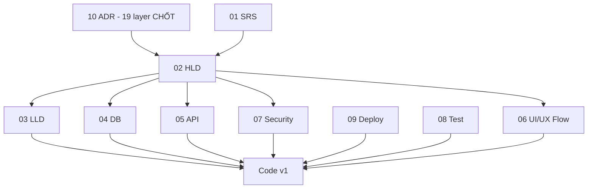

# 11. Project Task Breakdown - Hệ thống đặt vé xe khách

## 1. Thông tin tài liệu

### 1.1. Metadata

| Thuộc tính    | Giá trị                     |
| ------------- | --------------------------- |
| Tên tài liệu  | Project Task Breakdown      |
| Mã tài liệu   | 11-project-task-breakdown   |
| Dự án         | Marketplace-Ve-Xe-Nhanh     |
| Trạng thái    | Review                      |
| Người viết    | Nguyễn Hồng Khanh, AI Agent |
| Người duyệt   | Nguyễn Hồng Khanh           |
| Ngày tạo      | 11/05/2026                  |
| Ngày cập nhật | 25/10/2026                  |

### 1.2. Lịch sử thay đổi

| Phiên bản | Ngày       | Người cập nhật | Nội dung thay đổi                                                                                                                                                                                                                                                                                                                                                                                                                                                                                                            |
| --------- | ---------- | -------------- | ---------------------------------------------------------------------------------------------------------------------------------------------------------------------------------------------------------------------------------------------------------------------------------------------------------------------------------------------------------------------------------------------------------------------------------------------------------------------------------------------------------------------------- |
| v0.1      | 11/05/2026 | AI Agent       | Tạo bản nháp Project Task Breakdown                                                                                                                                                                                                                                                                                                                                                                                                                                                                                          |
| v0.2      | 25/05/2026 | AI Agent       | Rebrand `Marketplace-Ve-Xe-Nhanh`; cập nhật TASK-FND-001 nguồn                                                                                                                                                                                                                                                                                                                                                                                                                                                               |
| v0.3      | 01/06/2026 | AI Agent       | **Sprint 4 Rework** — bake toàn bộ 19 layer stack (ADR-002 + 009..026). §6 cập nhật trạng thái doc (HLD/DB/LLD/API/Security/Test/Ops rework DONE). §7 task theo module gắn stack: Foundation (Turborepo+pnpm+Render+GitHub Actions+Prisma+BullMQ worker tách), IAM (Better Auth 3-namespace+token+RLS+TOTP+OAuth), BTP (Redis hold+VNPay/MoMo+dedup+escrow+payout manual), NSR (Resend+Expo+sms-noop BullMQ), thêm TASK-TEST (Vitest+Supertest+Playwright+Maestro). §8 DoD thêm money BIGINT/RLS/OpenAPI gen. §10 refine OQ. |
| v0.4      | 08/09/2026 | AI Agent       | **Cascade ADR-028** (Mobile: Expo / React Native → Flutter). §7.5 `TASK-EMP-001` nguồn `ADR-014` → `ADR-028`; §7.6 `TASK-NSR-001` push `Expo` → `FCM/APNs`; §8 DoD Mobile `expo-secure-store` → `flutter_secure_storage` + thêm `integration_test`.                                                                                                                                                                                                                                                                          |
| v0.5      | 09/09/2026 | AI Agent       | Thêm **`TASK-FND-009`** — setup 2 app Flutter (`apps/passenger_mobile` + `apps/employee_mobile`, `packages/mobile_shared/`, Dart client `packages/api_client_dart/` sinh bằng `openapi-generator` pin `v7.25.0`), dependency `TASK-FND-008`. Sửa `TASK-OPS-001`: "EAS mobile" → build mobile Flutter (Android local; iOS tuỳ chọn khi có macOS) — vết Expo còn sót sau cascade v0.4.                                                                                                                                         |
| v0.6      | 17/09/2026 | AI Agent       | Thêm **`TASK-FND-010`** — nền FE web (Tailwind 4 + token VXN + Shadcn/ui + khung layout 3 app), dependency `TASK-FND-001`. Khanh chốt Shadcn/ui cho cả 3 app web (ADR-013). |
| v0.7      | 17/09/2026 | AI Agent       | Rà FE cũ phát hiện 4 nhóm yêu cầu SRS chưa có task chứa → thêm **`TASK-MKT-001`** (profile công khai Operator, FR-MKT-06 + FR-NSR-15), **`TASK-MKT-002`** (hồ sơ hành khách + hành khách thường dùng, FR-IAM-11 + FR-MKT-13), **`TASK-PROM-001`** (promotion, FR-PROM-01..07 + FR-ADM-12), **`TASK-ADM-003`** (kiểm duyệt nội dung, FR-ADM-13). Thu hẹp nguồn `TASK-ADM-002` `FR-ADM-10..17` → `FR-ADM-10..11, 14..17` để FR-ADM-12/13 chỉ thuộc một task. `TASK-FND-010`: layout Marketplace đổi header → sidebar. |
| v0.8      | 21/09/2026 | AI Agent       | Cập nhật `TASK-IAM-004` → **Done** sau khi Khanh xác nhận CI branch xanh; không thay đổi trạng thái Approved của tài liệu.                                                                                                                                                                                                                                                                                                                                                                                                   |
| v0.9      | 23/09/2026 | AI Agent       | Sửa `TASK-DOC-006` về Ready (chờ Khanh): tài liệu 08 vẫn Draft, 09 Approved. `TASK-DOC-008` chỉ yêu cầu tạo tài liệu 12 nên giữ Done. Giảm nhiễu căn lề bảng. |
| v0.10     | 25/09/2026 | AI Agent       | Cập nhật `TASK-IAM-005` → **Done** sau khi Khanh xác nhận CI 5/5 job xanh và PR #10 đã merge; không thay đổi trạng thái Approved của tài liệu. |
| v0.11     | 25/09/2026 | AI Agent       | **Tách §7.3 Transport resource** từ 4 thành 9 task. Lý do: `TASK-TRN-003` gom FR-OPS-06..13 và phụ thuộc vòng với BTP (FR-OPS-11..12 đổi chuyến đã bán vé cần booking + notification, trong khi `TASK-BTP-001` chờ TRN-003); Transport thiếu Catalog (loại xe, điểm đón/trả chuẩn chỉ nằm ở `TASK-ADM-001`). Thêm **`TASK-CAT-001`** (Catalog nền: schema + seed DB-MIG-04 + API đọc), **`TASK-TRN-005`** (Fare), **`TASK-TRN-006`** (vòng đời bán + khóa ghế thủ công), **`TASK-TRN-007`** (lịch lặp lại), **`TASK-TRN-008`** (đổi chuyến đã bán vé). Thu hẹp TRN-003 còn Trip/TripStop/TripSeat; TRN-004 thêm chi tiết chuyến FR-MKT-05 (trước đó chưa task nào chứa). TRN-002 bỏ phụ thuộc TRN-001 (làm song song). `TASK-BTP-001` phụ thuộc TRN-003 → TRN-006. Giữ nguyên ID cũ để không vỡ tham chiếu. |
| v0.12     | 25/09/2026 | AI Agent       | Cập nhật `TASK-FND-010` → **Done** sau khi Khanh xác nhận CI xanh; PR #4 đã merge vào `develop` ngày 18/09/2026. Không thay đổi trạng thái Approved của tài liệu. |
| v0.13     | 25/09/2026 | AI Agent       | Thêm **`TASK-IAM-006`** — web auth cho Operator OS + Platform Admin (first-login password change, TOTP, cookie httpOnly, CSRF, CORS); giữ JSON/Bearer cho Mobile. Đặt làm dependency của `TASK-TRN-001` để màn Xe không triển khai trước luồng đăng nhập web. Thêm `TASK-OQ-05` cho contract cookie/CSRF/CORS còn phải chốt. |
| v0.14     | 25/09/2026 | AI Agent       | **Đóng `TASK-OQ-05`**: chốt `X-Auth-Transport`, cookie host-only, signed double-submit CSRF, exact CORS allowlist/same-site topology và `/auth/csrf` + `/auth/me`; `TASK-IAM-006` chuyển **Draft → Ready**. Đồng bộ 03/05/06/07/08/09; giữ trạng thái phê duyệt hiện có. |
| v0.15     | 25/09/2026 | AI Agent       | `TASK-CAT-001` → **In Progress** sau khi Khanh duyệt Q1–Q4 (endpoint đọc công khai `/catalog/*` ở API §7.6; seed tỉnh/xã từ file danh mục chính thức). Không thay đổi trạng thái Approved của tài liệu. |
| v0.16     | 25/09/2026 | AI Agent       | `TASK-TRN-001` → **In Progress** sau khi Khanh duyệt Q1–Q4 (API §7.3 route chi tiết, DB §5.2 thêm `vehicle_amenities`). Không thay đổi trạng thái Approved của tài liệu. |
| v0.17     | 25/09/2026 | AI Agent       | Bắt đầu **`TASK-TRN-002`** theo yêu cầu của Khanh: tạo todo/guide/checklist và chuyển `Draft → In Progress`. Chưa code trước khi chốt Q1–Q7 về StopPoint/proposal, API, RouteStop/state, Goong, permission và phạm vi FE; giữ trạng thái Approved của tài liệu. |
| v0.18     | 26/09/2026 | AI Agent       | `TASK-TRN-002`: Khanh duyệt Q1–Q8 (thêm Q8 provider ước lượng ở dev); API §7.3, DB §5.2/§7, Security §7, GLOSSARY đồng bộ. Không thay đổi trạng thái Approved của tài liệu. |
| v0.19     | 28/09/2026 | AI Agent       | **ADR-017 amend (Khanh chốt 28/09):** mở rộng phạm vi `TASK-IAM-006` với tách cổng login Owner/Employee, tiền tố username Employee `nv.` + migration đổi tên; `TASK-EMP-001` ghi màn login dùng `/auth/employee/login`. IAM-006 giữ **Ready**. Không thay đổi trạng thái Approved của tài liệu. |
| v0.20     | 29/09/2026 | AI Agent       | **Loyalty VXN Plus / ví voucher / bài viết (Khanh chốt 29/09/2026, SRS v1.21):** §7.5 thêm `TASK-PROM-002` (ví voucher), `TASK-LOY-001` (VXN Plus), `TASK-CNT-001` (bài viết); §9 rủi ro chi phí / lạm dụng loyalty. Trạng thái Approved → **Review**. |
| v0.21     | 29/09/2026 | AI Agent       | SRS v1.22 tách use case: nguồn `TASK-LOY-001` thêm `UC-39`, `TASK-CNT-001` thêm `UC-40`. Giữ trạng thái Review. |
| v0.22     | 30/09/2026 | AI Agent       | **A2 — đăng ký nhà xe theo closed enrollment (Khanh duyệt 30/09/2026, SRS v1.23)**: `TASK-OPR-001` = form đăng ký công khai + link bảo mật + upload KYC; `TASK-ADM-001` duyệt hồ sơ gọi `provisionOperatorOwner`. Giữ trạng thái Review. |
| v0.23     | 30/09/2026 | AI Agent       | **Mốc M0–M5 (Khanh duyệt 30/09/2026)**: §7 thêm bảng mốc theo luồng đầu-cuối; đóng `TASK-OQ-02` / `TASK-OQ-04`. M0 đồng bộ trạng thái với code: `TASK-IAM-006` Ready → **In Progress** (tách cổng Owner/Employee đã merge PR #16, còn web auth); `TASK-CAT-001` ghi rõ chỉ còn seed file danh mục chính thức; `TASK-TRN-001` ghi tiến độ port. Cùng ngày Khanh chọn **đưa FE lên sớm**: IAM-006 phần web vào M1 ngay sau TRN-002, làm bù màn TRN-001/002, từ TRN-003 mỗi task làm cả BE lẫn màn. Giữ trạng thái Review. |
| v0.24     | 30/09/2026 | AI Agent       | Bắt đầu **`TASK-TRN-003`** trên repo hiện tại (Khanh duyệt Q1–Q6): Draft → **In Progress**, bỏ "thiếu thời gian quay đầu" khỏi mô tả task theo Q1 (xe rảnh ngay tại giờ đến); thêm nguồn UC-12 A3 (chặn sửa SeatMap đang được chuyến dùng). Giữ trạng thái Review. |
| v0.25     | 30/09/2026 | AI Agent       | Bắt đầu **`TASK-TRN-005`** theo yêu cầu của Khanh: nhánh `TASK-TRN-005`, tạo `TRN-005-todo.md`, Draft → **In Progress**. Chưa code trước khi chốt Q1–Q7 (SDLC mới có nguyên tắc OQ-08/BR-40/41/OQ-17, chưa có cột bảng, endpoint, cách tính giá theo thời điểm, cách lưu lịch sử). Giữ trạng thái Review. |
| v0.26     | 30/09/2026 | AI Agent       | `TASK-TRN-005`: Khanh chốt Q2 (rule giá tuyệt đối, rule cụ thể hơn thắng), Q3 (thời điểm = giờ khởi hành — SRS BR-41 v1.29), Q5 (API `/operator/fares`, quyền `trip:manage`), Q6 (**cảnh báo trần/sàn chuyển sang `TASK-ADM-001`**), Q7 (cho sửa bảng giá, ghi lịch sử). Còn Q1 (giá theo loại xe) và Q4 (nơi lưu lịch sử). Giữ trạng thái Review. |
| v0.27     | 30/09/2026 | AI Agent       | `TASK-TRN-005`: Khanh chốt **Q1 = PA1** (bảng giá theo tuyến × loại xe catalog) và **Q4 = Mongo `audit_event`**; đồng bộ SRS v1.30, GLOSSARY, HLD v0.9, LLD v0.10, DB v0.16, API v0.14, Security v0.12, Test plan v0.8 trước khi code. Giữ trạng thái Review. |
| v0.28     | 30/09/2026 | AI Agent       | Bắt đầu **`TASK-TRN-006`** theo yêu cầu của Khanh: nhánh `TASK-TRN-006`, tạo `TRN-006-todo.md`, Draft → **In Progress**. Chưa code trước khi chốt Q1–Q8 (SDLC có danh sách trạng thái §17.3/§17.4 và BR-39, chưa có bảng chuyển trạng thái, "tạm dừng" vs "khóa", nơi cấu hình thời điểm ngừng bán online, endpoint, audit). Giữ trạng thái Review. |
| v0.29     | 30/09/2026 | AI Agent       | `TASK-TRN-006`: Khanh chốt Q1–Q8 theo khuyến nghị (tạm dừng = khóa, bảng chuyển trạng thái + thu hồi nháp, điều kiện mở bán trả đủ lý do, ngừng bán online theo chuyến, khóa ghế theo lô, audit, API, chỉ kiểm lúc mở bán); **cửa sổ đón khách chuyển sang `TASK-EMP-002`**. Đồng bộ SRS v1.31, GLOSSARY, LLD v0.12, DB v0.18, API v0.16, Security v0.13, Test plan v0.9 trước khi code. Giữ trạng thái Review. |
| v0.30     | 30/09/2026 | AI Agent       | `TASK-BTP-001`: ghi bàn giao từ review TRN-006 (khoá chuyến `FOR SHARE` + kiểm trạng thái / giờ bán khi giữ / bán ghế; câu hỏi hold Redis vs Postgres cần Khanh chốt trước khi code BTP-001). Giữ trạng thái Review. |
| v0.31     | 03/10/2026 | AI Agent       | Thêm **`TASK-TRN-009`** — hình ảnh phương tiện (Khanh chốt 03/10/2026, SRS v1.32): tải ảnh xe lên R2 public, tối đa 8 ảnh, ảnh đại diện ở kết quả tìm + bộ ảnh ở chi tiết chuyến, Admin gỡ ảnh vi phạm; xếp mốc M3. `TASK-TRN-004` trả kèm ảnh xe; `TASK-ADM-003` thêm rà soát / gỡ ảnh xe. Giữ trạng thái Review. |
| v0.32     | 04/10/2026 | AI Agent       | Thêm **`TASK-TRN-010`** — phân loại xe và loại chỗ (Khanh chốt 04/10/2026, SRS v1.33): `vehicle_types` thêm dạng chỗ + hạng xe, seed 6 loại xe, enum loại chỗ thêm cabin và chỗ đôi; làm trước màn xe / sơ đồ ghế Operator OS và trước khi port TRN-003 / TRN-005. `TASK-TRN-004` lọc theo dạng chỗ + hạng; `TASK-BTP-001` giữ chỗ đôi như một chỗ (`OQ-23` đã chốt). Giữ trạng thái Review. |
| v0.33     | 04/10/2026 | AI Agent       | Thêm **`TASK-TRN-011`** — bổ sung API cho màn xe / sơ đồ ghế Operator OS sau khi đối chiếu Figma nhà xe (Khanh chốt 04/10/2026): SeatMap trả `deckCount` + `inUse`, Vehicle trả `seatMapLocked`. `TASK-TRN-009` thêm chú thích ảnh. Giữ trạng thái Review. |
| v0.34     | 04/10/2026 | AI Agent       | **Thiết kế lại điểm dừng (Khanh chốt 04/10/2026, SRS v1.35):** thêm `TASK-TRN-012` (BE: loại điểm riêng, khóa, đề xuất kèm căn cứ, cho đón / cho trả), `TASK-TRN-013` (màn Điểm dừng Operator OS), `TASK-TRN-014` (bản đồ Goong chọn tọa độ), `TASK-ADM-004` (Admin quản lý điểm dừng — tách khỏi `ADM-001`). `TASK-TRN-002` Q1 / Q3 bị sửa; `TASK-TRN-003` chép cờ đón / trả; `TASK-TRN-004` tìm theo vị trí. Giữ trạng thái Review. |
| v0.35     | 04/10/2026 | AI Agent       | Bắt đầu **`TASK-TRN-010`** theo yêu cầu của Khanh: nhánh `TASK-TRN-010`, tạo `TRN-010-todo.md` / guide / checklist, Draft → **In Progress**. Thiết kế đã chốt 04/10/2026 (SRS v1.33) nên không có câu hỏi cần chốt thêm; giả định hiện thực ghi ở todo. Phần `deckCount` của `TASK-TRN-011` làm cùng task này. Giữ trạng thái Review. |
| v0.36     | 04/10/2026 | AI Agent       | Bắt đầu **màn Operator OS của `TASK-TRN-001`** (nhánh `TASK-TRN-001-web`, phần 1: danh sách xe + form thêm / sửa xe; phần 2 là danh sách và trình soạn sơ đồ ghế). `TASK-TRN-011` Draft → **In Progress**: Vehicle trả thêm `seatMap` tóm tắt (Khanh chốt 04/10/2026: bổ sung vào API, không để giao diện tự ghép); `seatMapLocked` / `inUse` đã có trong response, luôn `false` tới khi port TRN-003. Giữ trạng thái Review. |
| v0.37     | 05/10/2026 | AI Agent       | **Màn Operator OS của `TASK-TRN-001`, phần 2** (nhánh `TASK-TRN-001-web`; Khanh chốt 05/10/2026 theo Figma `1180:6017`, `1197:6838`): danh sách sơ đồ ghế, trình soạn dùng chung bốn chế độ, nối từ form xe, khung trang theo Figma (thẻ nhà xe, hỗ trợ, tài khoản + đăng xuất), hai màn danh sách dùng chung một kiểu, E2E Playwright cho màn xe + sơ đồ ghế (một phần `TASK-TEST-001`). Thứ tự dòng danh sách vẫn theo mã — sắp "mới cập nhật trước" để bổ sung API sau. Giữ trạng thái Review. |
| v0.38     | 05/10/2026 | AI Agent       | Bắt đầu **`TASK-TRN-012`** theo yêu cầu của Khanh 05/10/2026 (nhánh `TASK-TRN-012` từ `develop`): `Draft → In Progress`. Khanh chốt: dữ liệu thử sai loại thì xóa; ô tìm gõ không dấu cũng ra; cột "số tuyến đang dùng" chỉ ở tab Của nhà xe. Tạo `TRN-012-todo.md` / `-guide.md` / `-verification-checklist.md`. Giữ trạng thái Review. |
| v0.39     | 07/10/2026 | AI Agent       | Bắt đầu **`TASK-TRN-013`** theo yêu cầu của Khanh 07/10/2026 (nhánh `TASK-TRN-013` từ `develop`): `Draft → In Progress`; chia hai phần — phần 1 màn Điểm dừng, phần 2 màn Tuyến đường kèm bổ sung API danh sách route; cả hai đã code, chờ review. Khanh chốt 07/10/2026 theo Figma `1305:6710`: nút "Đề xuất điểm dừng"; bản đồ thuộc V1 nên `TASK-TRN-014` gồm ba bản đồ (tổng quan điểm dừng, chọn tọa độ, lộ trình tuyến); danh sách tuyến có cột Điểm đầu → Điểm cuối (bổ sung API, làm trong TRN-013); bảng chọn điểm dừng mở trong form tuyến. Tạo `TRN-013-todo.md` / `-guide.md` / `-verification-checklist.md`. Giữ trạng thái Review. |
| v0.40     | 07/10/2026 | AI Agent       | Bắt đầu **`TASK-TRN-014`** theo yêu cầu của Khanh 07/10/2026 (nhánh `TASK-TRN-014` từ `develop`, `TASK-TRN-013` đã merge PR #28): `Draft → In Progress`. Phần Operator OS đã code và đã kiểm với bản đồ Goong thật bằng khóa Maptiles của Khanh; hộp thoại của Admin chuyển sang `TASK-ADM-004` (màn Admin chưa có). Thư viện vẽ bản đồ: MapLibre GL JS, Khanh xác nhận 07/10/2026 (ADR-027 amend). Giữ trạng thái Review. |
| v0.41     | 13/10/2026 | AI Agent       | **`TASK-TRN-003` đưa về repo chính** theo yêu cầu của Khanh 13/10/2026 (nhánh `TASK-TRN-003` từ `develop`, `TASK-TRN-014` đã merge PR #30): backend port từ repo bản sao + chỉnh theo `TASK-TRN-010` / `TASK-TRN-012`, cờ khóa sơ đồ của `TASK-TRN-011` tính thật, ba màn Operator OS (danh sách, tạo / sửa, chi tiết) và E2E. Cùng nhánh sửa lỗi CSS làm đỏ CI trên `develop`. Chưa commit — chờ Khanh review. |
| v0.42     | 13/10/2026 | AI Agent       | **`TASK-TRN-003` đã merge `develop` (PR #31, CI xanh); `TASK-TRN-005` đưa về repo chính** theo yêu cầu của Khanh 13/10/2026 (nhánh `TASK-TRN-005` từ `develop`): backend port từ repo bản sao + chỉnh theo 5 loại chỗ của `TASK-TRN-010`, danh sách bảng giá trả thêm khoảng giá, màn Operator OS Bảng giá (danh sách, tạo / chỉnh sửa, lịch sử) và giá trên từng chỗ ở trang chi tiết chuyến, E2E. Chưa commit — chờ Khanh review. |
| v0.43     | 14/10/2026 | AI Agent       | **`TASK-TRN-005` — Khanh chốt 14/10/2026 bốn điểm còn mở theo đề xuất:** khung giờ của quy tắc giá giữ là khoảng ngày giờ khởi hành (không làm giá theo giờ trong ngày như khung Figma); duyệt ba trường khoảng giá của danh sách bảng giá; khoảng giá tính cả quy tắc có khung giờ đã qua; dải cảnh báo "giá ngoài khung giá" trên màn Bảng giá ghi vào `TASK-ADM-001`. **Quy tắc mới (Khanh, 14/10/2026):** `code-reviewer` / `security-auditor` chỉ chạy khi Khanh yêu cầu (`CLAUDE.md` §4.8) — dòng `TASK-TRN-003` sửa chữ "còn nợ review" thành "chưa review". Giữ trạng thái Review. |
| v0.44     | 14/10/2026 | AI Agent       | **`TASK-TRN-006` đưa về repo chính** theo yêu cầu của Khanh 14/10/2026 (nhánh `TASK-TRN-006` tách từ `TASK-TRN-005`): backend port từ repo bản sao (migration `20261014010000_trip_sale_lifecycle`, đổi trạng thái bán, khóa ghế, `reasons` RFC 7807), fixture test theo `TASK-TRN-010` / `TASK-TRN-012`; màn Operator OS theo Figma khung 03–06 (ô ngừng bán online, mở bán / tạm dừng / thu hồi nháp / hủy, khối Điều kiện mở bán, khóa - mở khóa chỗ) + E2E. Chưa commit, chưa qua `code-reviewer` / `security-auditor` — chờ Khanh review. Giữ trạng thái Review. |
| v0.45     | 14/10/2026 | AI Agent       | **Đổi thứ tự mốc — app di động đi trước Marketplace web (Khanh yêu cầu 14/10/2026):** §7 — M2 và M3 làm màn hành khách trên `passenger_mobile` (M2: tìm → đặt → thanh toán → vé; M3: đăng nhập, Vé của tôi, tra cứu vé + `employee_mobile`); màn Marketplace web của cùng các task dời về mốc mới M5; "Mở rộng" thành M6. Maestro / `integration_test` bắt đầu từ màn app đầu tiên của M2. Không đổi bảng module, cột Dependency hay phạm vi. §10 `TASK-OQ-02` / `TASK-OQ-04` ghi thêm thay đổi này. Giữ trạng thái Review. |
| v0.46     | 14/10/2026 | AI Agent       | **Ưu tiên hoàn thiện phần nhà xe (Khanh giao AI quyết thứ tự, 14/10/2026):** §7 xếp lại thành M0–M8 — M2 mới gom việc của nhà xe không cần đặt vé (màn Nhân viên, Tài khoản, ảnh xe, Hồ sơ & KYC, lịch chuyến lặp lại, Lịch xe) + Admin tối thiểu để khép vòng (đăng nhập, duyệt điểm dừng, duyệt hồ sơ); đặt vé lõi thành M3 và kèm màn Đặt vé của nhà xe; M4 tiền của nhà xe; M5 Operator OS đủ mọi mục + app nhân viên; M6 demo; M7 Admin còn lại + Marketplace web; M8 mở rộng. Kênh hành khách vẫn là app di động trước web (v0.45). Thêm hai task **đề xuất, chờ Khanh duyệt**: `TASK-TRN-015` (Lịch xe) và `TASK-OPR-003` (màn Đặt vé của nhà xe — FR-OPS-14, 15 chưa có task). Không đổi phạm vi hay cột Dependency của task cũ. Giữ trạng thái Review. |
| v0.47     | 14/10/2026 | AI Agent       | **Bắt đầu M2 — màn Nhân viên và màn Tài khoản của Operator OS** (phần giao diện của `TASK-IAM-005`, nhánh `TASK-IAM-005-web` từ `TASK-TRN-006`): quản lý tài khoản nhân viên có bước xác nhận lại danh tính, bảng phiên đăng nhập và thu hồi phiên, E2E. API tài khoản nhân viên trả thêm hai trường chỉ đọc (chờ Khanh duyệt). Chưa commit, chưa qua review. Giữ trạng thái Review. |
| v0.48     | 14/10/2026 | AI Agent       | **M2 — `TASK-TRN-009` (ảnh phương tiện), nhánh `TASK-TRN-009` từ `TASK-IAM-005-web` (chưa commit):** kho object dùng chung (R2 + ổ đĩa local cho dev), bảng `vehicle_images` + RLS, hai API ảnh, job dọn object mồ côi trong worker, khối ảnh của form xe + ảnh đại diện ở danh sách xe, E2E. Chưa thử với R2 thật. Chín điểm chờ Khanh ở `TRN-009-todo.md` (gồm: production bắt buộc biến `R2_*` — cần nhập trên Render trước khi merge). Giữ trạng thái Review. |
| v0.49     | 14/10/2026 | AI Agent       | **M0 + M2:** cập nhật trạng thái theo `develop` — TRN-005 (PR #33) → Done; TRN-006 (PR #33), TRN-009 + màn Nhân viên / Tài khoản (PR #34) đã merge, còn điểm chờ Khanh. **`TASK-OPR-001` → In Progress:** phần 001a (đăng ký nhà xe công khai) trên nhánh `TASK-OPR-001`, chưa commit; Khanh chốt 14/10/2026: kho giấy tờ production chưa cấu hình → 503, trang đăng ký trong Operator OS, thứ tự 001a → Admin tối thiểu (đăng nhập Admin + duyệt hồ sơ của ADM-001) → 001b. Mười lăm điểm chờ Khanh ở `OPR-001-todo.md`. Giữ trạng thái Review. |
| v0.50     | 15/10/2026 | AI Agent       | **Khanh 15/10/2026: "Hướng tới dựng hoàn thiện phần admin"** — AI đề xuất thứ tự A1 đăng nhập Admin + khung (phần web Admin của `TASK-IAM-006`) → A2 duyệt hồ sơ nhà xe (`TASK-ADM-001`) → A3 `TASK-ADM-004` → A4 danh mục → A5 kiểm duyệt ảnh xe + nhật ký audit → A6 chính sách + khung giá → A7 `TASK-CNT-001` (chờ Khanh xác nhận). A1 + A2 đã làm: `TASK-ADM-001` Draft → **In Progress**; dòng `TASK-IAM-006` ghi phần web Admin. Chưa có task cho quản lý nhà xe / người dùng (FR-ADM-02/03) và tích hợp & hệ thống (FR-ADM-14/15) — đề xuất ở `ADM-001-todo.md`. Giữ trạng thái Review. |
| v0.51     | 15/10/2026 | AI Agent       | Khanh 15/10/2026 "Thực hiện": mở PR #35 (`TASK-OPR-001`) và #36 (`TASK-IAM-006-admin`); làm A3 = `TASK-ADM-004` (Draft → **In Progress**, chờ duyệt — `ADM-004-todo.md`). Giữ trạng thái Review. |
| v0.52     | 16/10/2026 | AI Agent       | Khanh 15/10/2026 "Tiếp tục": A3 (`TASK-ADM-004`) xong phần code (chờ duyệt); làm A4 = phần danh mục của `TASK-ADM-001` (14 route `/admin/catalog/*` + màn `/catalog`, chờ duyệt — `ADM-001-catalog-todo.md`). Giữ trạng thái Review. |
| v0.53     | 16/10/2026 | AI Agent       | Khanh 16/10/2026 "Tiến tới hoàn thiện admin": làm A5 — phần ảnh xe của `TASK-ADM-003` (Draft → **In Progress**, `ADM-003-vehicle-images-todo.md`) và phần audit của `TASK-ADM-002` (Draft → **In Progress**, `ADM-002-audit-log-todo.md`); chờ duyệt. Giữ trạng thái Review. |
| v0.54     | 17/10/2026 | AI Agent       | **Khanh 16/10/2026: "Hiện còn những gì chưa hoàn thiện của phần admin và op thì làm giúp tôi"** — chọn phạm vi Bài viết, Lịch xe, Quản lý nhà xe + người dùng, Hồ sơ & KYC nhà xe; "Tự thiết kế + code" (schema / API AI tự thiết kế, ghi vào doc, chờ Khanh duyệt); màn phụ thuộc đặt vé "Dựng khung giao diện trước"; Tích hợp & hệ thống "Làm phần chỉ đọc". Đã làm trên nhánh `TASK-ADM-004` (chưa commit, chưa qua `code-reviewer` / `security-auditor`): `TASK-CNT-001` Draft → **In Progress** (phần Admin); `TASK-OPR-001` phần 001b; `TASK-ADM-001` phần quản lý nhà xe + người dùng (FR-ADM-02/03), chính sách + hoa hồng + khung giá (A6); `TASK-TRN-015` Draft → **In Progress**; `TASK-ADM-002` phần tích hợp & hệ thống chỉ đọc; khung giao diện các màn chờ đặt vé (Admin + Operator OS). Điểm chờ Khanh ở `CNT-001-todo.md`, `ADM-001-accounts-todo.md`, `OPR-001b-todo.md`, `ADM-001-policy-todo.md`, `TRN-015-todo.md`, `ADM-system-shells-todo.md`. Giữ trạng thái Review. |
| v0.55     | 17/10/2026 | AI Agent       | **Khanh 17/10/2026: "Tiếp tục nốt phần không cần đặt vé"** (đã commit toàn bộ nhánh `TASK-ADM-004`): làm trên nhánh `TASK-TRN-007`, chưa commit — `TASK-TRN-007` Draft → **In Progress**, `TASK-EMP-001` Draft → **In Progress** (phía Operator OS), `TASK-ADM-003` thêm phần nội dung công khai. Điểm chờ Khanh: `TRN-007-todo.md`, `EMP-001-todo.md`, `ADM-003-content-todo.md`. Tiếp theo: lõi đặt vé (BTP-001..006) — quy tắc theo SRS/ADR, không làm giao diện khách hàng. Giữ trạng thái Review. |
| v0.56     | 19/10/2026 | AI Agent       | **Khanh 19/10/2026: "Tiếp tục toàn bộ job sau"** (EMP-002 backend, đối soát tự động, RPT-001/002 + hai trang Tổng quan, TRUST-001, PROM-001, VXN Plus phía Admin) — làm trên nhánh `TASK-TRN-008`, chưa commit, chưa qua `code-reviewer` / `security-auditor`. `TASK-EMP-002`, `TASK-RPT-001`, `TASK-RPT-002`, `TASK-TRUST-001`, `TASK-PROM-001`, `TASK-LOY-001` → **In Progress**; `TASK-ADM-002` ghi thêm job đối soát. Điểm chờ Khanh ở `doc/task-propreties/{EMP-002,RECON,RPT,TRUST-001,PROM-001,LOY-001-admin}-todo.md`. |
| v0.57     | 21/10/2026 | AI Agent       | **Khanh 21/10/2026: phân quyền cho từng tài khoản ở Admin và nhà xe (làm trước), sau đó thay VNPay/MoMo bằng payOS + cổng demo** — thêm `TASK-IAM-007` (In Progress, nhánh `feat/account-permissions`, đã push, chưa merge). Việc cổng thanh toán chưa thêm task (chờ làm xong phân quyền). |
| v0.58     | 25/10/2026 | AI Agent       | **Đồng bộ sau đợt merge 21–24/10 (Khanh 25/10: cập nhật toàn bộ tài liệu):** `TASK-IAM-007` → **Done** (PR #44, Khanh xác nhận); `TASK-CAT-001` ghi danh mục chính thức + ánh xạ hành chính cũ + điểm dừng chuẩn (PR #46, #48), còn xác nhận seed production; `TASK-EMP-001` ghi giao diện tài xế (dữ liệu mẫu); `TASK-MKT-001` / `TASK-MKT-002` Draft → **In Progress** (web nối API, PR #49 / #50); §7 thêm đoạn tiến độ M6 / M7. Không đổi trạng thái tài liệu. |

---

## 2. Mục lục

1. Thông tin tài liệu
2. Mục lục
3. Giới thiệu
4. Quy ước task
5. Dependency tổng quan
6. Task theo giai đoạn tài liệu
7. Task theo module triển khai
8. Definition of Done
9. Rủi ro kế hoạch
10. Open Questions / TBD

---

## 3. Giới thiệu

Tài liệu này chia nhỏ công việc từ SDLC sang task triển khai, kiểm thử và nghiệm thu. Stack đã chốt 19/19 layer (ADR-002 + ADR-009..027); tham chiếu `01-srs`, `02-hld`, `03-lld`, `04-db`, `05-api`, `07-security`, `08-test`, `09-ops`, `10-adr`. Bản nháp này chưa thay thế issue tracker chính thức.

---

## 4. Quy ước task

| Trường     | Ý nghĩa                                               |
| ---------- | ----------------------------------------------------- |
| Task ID    | `TASK-<GROUP>-NNN`                                    |
| Nguồn      | FR/UC/NFR/BR/ADR/tài liệu liên quan                   |
| Owner      | BE/FE/Mobile/QA/DevOps/Reviewer (v1 solo: Khanh + AI) |
| Dependency | Task hoặc tài liệu cần hoàn thành trước               |
| Status     | Draft / Ready / In Progress / Blocked / Done          |
| DoD        | Điều kiện hoàn thành                                  |

---

## 5. Dependency tổng quan

---

## 6. Task theo giai đoạn tài liệu

Sau Sprint 5 rework + Sprint 4 Phase 4 DevOps, các doc thiết kế đã reset theo 18 ADR — chờ Khanh review/promote.

| Task ID      | Task                                                    | Nguồn           | Owner              | Dependency    | Status            |
| ------------ | ------------------------------------------------------- | --------------- | ------------------ | ------------- | ----------------- |
| TASK-DOC-001 | Review + promote 02 HLD (Review/Approved)               | 02 HLD          | Reviewer           | Rework DONE   | Done              |
| TASK-DOC-002 | Review + promote 04 DB                                  | 04 DB           | Reviewer/BE        | Rework DONE   | Done              |
| TASK-DOC-003 | Review + promote 03 LLD                                 | 03 LLD          | Reviewer/Architect | Rework DONE   | Done              |
| TASK-DOC-004 | Review + promote 05 API                                 | 05 API          | Reviewer/BE        | Rework DONE   | Done              |
| TASK-DOC-005 | Review + promote 07 Security                            | 07 Security     | Reviewer/Security  | Rework DONE   | Done              |
| TASK-DOC-006 | Review + promote 08 Test + 09 Deploy                    | 08 Test, 09 Ops | Reviewer/QA/DevOps | Rework DONE   | Ready (chờ Khanh) |
| TASK-DOC-007 | Hoàn thiện 06 UI/UX flow (User/Operator/Employee/Admin) | 06 UI/UX        | FE/Mobile/Reviewer | TASK-DOC-001  | Done              |
| TASK-DOC-008 | Tạo 12 Release Notes & Change Log (khi vào code)        | —               | Reviewer           | Code v1 start | Done              |

---

## 7. Task theo module triển khai

**Mốc triển khai theo luồng đầu-cuối** (Khanh duyệt 30/09/2026, đóng `TASK-OQ-02` / `TASK-OQ-04`; 14/10/2026 đổi thứ tự hai lần: app di động đi trước Marketplace web, rồi **ưu tiên hoàn thiện phần nhà xe** — Khanh giao AI quyết thứ tự). Bảng module bên dưới giữ nguyên; mốc chỉ quyết định thứ tự làm. Trong mỗi mốc vẫn theo cột Dependency.

| Mốc | Task | Kết quả kiểm chứng được |
| --- | ---- | ----------------------- |
| M0 — Dọn dẹp | Cập nhật trạng thái task cho khớp code; rút `PROJECT-STATE §7` | Bảng task khớp `develop` |
| M1 — Có chuyến để bán | TRN-001 → TRN-002 (BE) → **IAM-006 phần web** → TRN-010 (phân loại xe / chỗ) + TRN-011 (bổ sung API cho màn xe) → màn Operator OS cho TRN-001 (xe, sơ đồ ghế) → TRN-012 (thiết kế lại điểm dừng) → TRN-013 (màn điểm dừng) + màn tuyến của TRN-002 → TRN-003 → TRN-005 → TRN-006, **từ TRN-003 mỗi task làm cả BE lẫn màn Operator OS** | Nhà xe đăng nhập Operator OS và tạo được chuyến đang mở bán trên giao diện |
| M2 — Nhà xe: phần không cần đặt vé | Màn **Nhân viên** và **Tài khoản** của Operator OS (API đã có từ IAM-005) → TRN-009 (ảnh xe; dựng luôn bộ lưu file dùng chung `external/storage/`) → OPR-001 (Hồ sơ & KYC, trang đăng ký nhà xe) → TRN-007 (lịch chuyến lặp lại) → TRN-015 (Lịch xe). **Admin tối thiểu để khép vòng của nhà xe:** đăng nhập Admin (phần còn lại của IAM-006) → ADM-004 (duyệt đề xuất điểm dừng) → phần duyệt hồ sơ nhà xe của ADM-001 | Mọi mục của Operator OS không phụ thuộc đặt vé đều dùng được; đề xuất điểm dừng và hồ sơ đăng ký nhà xe có người duyệt |
| M3 — Đặt vé lõi | TRN-004 → BTP-001 → BTP-002 → BTP-003 (VNPay sandbox trước, MoMo sau) → BTP-004; NSR-001 (chỉ email vé); **màn `passenger_mobile` đi cùng từng task** (tìm chuyến → danh sách → chi tiết chuyến → chọn điểm đón / trả + chỗ → thông tin hành khách → thanh toán, quay về app bằng deep link → vé có QR; đặt vé không cần đăng nhập — 06 UI §6.2; khung app dựng cùng TRN-004) → **OPR-003** (màn Đặt vé của nhà xe) | Khách đặt + thanh toán sandbox + nhận vé trên app Android; nhà xe thấy booking và danh sách khách trên Operator OS; test bắt buộc money / idempotency / webhook-HMAC |
| M4 — Tiền của nhà xe | BTP-005 → BTP-006 → OPR-002 (Tài chính) → RPT-001 (Báo cáo + trang Tổng quan) → TRN-008 (đổi / hủy chuyến đã bán vé); ADM-002 (quyết định hoàn tiền, xác nhận chi trả T+3 — thiếu thì khoản chi cho nhà xe không bao giờ hoàn tất) | Nhà xe xem được doanh thu, hoa hồng, lịch sử chi trả, báo cáo; hủy / hoàn và chi trả chạy đủ vòng |
| M5 — Operator OS đủ mọi mục | TRUST-001 (Hỗ trợ) → PROM-001 (Khuyến mãi) → phần khung giá trần / sàn của ADM-001 (dải cảnh báo trên màn Bảng giá) → EMP-001 (phân công nhân viên cho chuyến + `employee_mobile`) → EMP-002 (soát vé QR, trạng thái chuyến) | Mọi mục trên thanh bên Operator OS có màn thật; nhân viên của nhà xe soát vé bằng app |
| M6 — Demo được | Hoàn thiện `passenger_mobile`: đăng nhập Email + OTP (phần Mobile còn lại của IAM-001), Vé của tôi, tra cứu vé Guest; OPS-001 (deploy staging, build APK) | Luồng đầu-cuối chạy trên Operator OS + hai app Android; API deploy staging |
| M7 — Admin còn lại và Marketplace web | ADM-001 (danh mục, chính sách), ADM-003, RPT-002, CNT-001; màn Marketplace của TRN-004 và BTP-001..004, đăng nhập hành khách, Vé của tôi, tra cứu vé Guest — dùng lại API đã có | Admin đủ nghiệp vụ; luồng đặt vé chạy trên web |
| M8 — Mở rộng | MKT-001 / 002, PROM-002, LOY-001, NSR-002 | Cắt được nếu thiếu thời gian |

**Tiến độ 21–24/10/2026** (đồng bộ 25/10/2026): M6 — `passenger_mobile` có giao diện đăng nhập + OTP (PR #47), `employee_mobile` có giao diện tài xế theo Figma bằng dữ liệu mẫu; chưa nối API, chưa build APK. M7 — web Marketplace nối API cho tìm chuyến, chi tiết chuyến / nhà xe, giữ chỗ → đặt vé → thanh toán, vé của tôi, tra cứu vé Guest, hồ sơ, hỗ trợ, VXN Plus (PR #49) và giao diện theo Figma (PR #50, áp lại 24/10); điểm lệch API chờ Khanh quyết ở `task-propreties/marketplace-api-integration-report.md`. Phân quyền theo tài khoản (`TASK-IAM-007`) xong. Thay VNPay / MoMo bằng payOS + cổng demo (Khanh 21/10) chưa có task, chưa làm.

`TASK-TEST-001` làm dần theo mốc (Playwright cùng màn hình đầu tiên; Maestro + `integration_test` cùng màn `passenger_mobile` đầu tiên của M3). Onboarding nhà xe (OPR-001) lên M2 từ 14/10/2026; seed vẫn tạo sẵn Operator + Owner cho demo. **FE đưa lên sớm** (Khanh chọn 30/09/2026): TRN-001 Q4 / TRN-002 Q7 hoãn màn hình vì Operator OS chưa có đăng nhập web; IAM-006 phần web đã gần xong ở repo bản sao nên port ngay sau TRN-002, rồi làm bù màn của hai task này thay vì dồn FE về M3.

**Ưu tiên hoàn thiện phần nhà xe** (Khanh giao AI quyết thứ tự, 14/10/2026). Cách xếp:

- M2 gom mọi việc của nhà xe không cần dữ liệu đặt vé, nên làm được ngay và không chờ quyết định nào về giữ ghế / thanh toán.
- Từ M3, màn của nhà xe đứng ngay sau task backend sinh ra dữ liệu cho nó (Đặt vé sau BTP-004, Tài chính sau BTP-006) thay vì dồn về cuối.
- Admin chỉ kéo lên phần mà thiếu nó thì luồng của nhà xe không khép được: duyệt điểm dừng, duyệt hồ sơ, xác nhận hoàn tiền / chi trả, khung giá. Phần còn lại ở M7.
- Màn Nhân viên và Tài khoản là phần giao diện còn thiếu của IAM-005 (API `/operator/employees`, `/auth/sessions` đã có), không cần task mới. Phân công nhân viên cho chuyến thuộc EMP-001 (M5).
- Hai task mới lấp chỗ bảng chưa có task — **đề xuất, chờ Khanh duyệt**: `TASK-OPR-003` (FR-OPS-14, 15 có trong SRS) và `TASK-TRN-015` (khung Lịch xe Khanh duyệt thiết kế 13/10/2026; Khanh chọn làm 16/10/2026 — đã code, chờ duyệt). Trang Tổng quan của Operator OS làm cùng RPT-001.
- Quyết định làm đổi ADR / SRS đã chốt (giữ ghế Redis hay Postgres, năm điểm lệch của khung app hành khách, kiến trúc app Flutter, API lịch chuyến lặp lại, OQ-24) **không** nằm trong phần AI tự quyết: nêu ở vòng câu hỏi của task liên quan, kèm khuyến nghị. Không điểm nào chặn ba việc đầu của M2.

**App di động đi trước Marketplace web** (Khanh chọn 14/10/2026) vẫn giữ cho kênh hành khách: ở M3, màn của hành khách làm trên `passenger_mobile`, chỉ tới mức đủ đặt vé; phần còn lại của app ở M6, màn Marketplace web của cùng các task ở M7 và dùng lại API đã có. Cần biết trước khi vào M3:

- `passenger_mobile` và `employee_mobile` hiện mới là khung trống của `TASK-FND-009`. Khung Figma của app hành khách **đã có** (trang `Mobile Ve_Xe`, bảng `1160:1854`, Khanh gửi 14/10/2026): Splash, Đăng nhập, Xác nhận email, Hoàn thiện hồ sơ, Trang chủ, Kết quả tìm kiếm + Lọc chuyến, Chi tiết chuyến, Chọn chỗ + chọn điểm đón / trả, Thông tin hành khách, Xác nhận booking, Thanh toán + chọn ngân hàng, Vé của bạn. Bảng này chưa có khung cho Vé của tôi, tra cứu vé và các trạng thái chờ / lỗi thanh toán; chưa thấy khung của `employee_mobile`.
- Một số điểm trong khung app hành khách lệch quyết định đã chốt — giữ ghế 20 phút (ADR-015: 10 phút), "Tiền mặt — thanh toán khi lên xe" (SRS: v1 chỉ thanh toán trước), một QR cho cả đơn nhiều khách (SRS: mỗi chỗ một vé), phí dịch vụ chưa có quy tắc — phải chốt trước khi code task tương ứng (BTP-001 … BTP-004).
- Thanh toán trên app mở cổng VNPay ngoài app rồi quay về bằng deep link (`app_links`, ADR-028) → `TASK-BTP-003` có thêm phần Mobile.
- Android là nền tảng chính (ADR-028); thử trên máy thật / emulator cần API truy cập được qua mạng nội bộ.

### 7.1. Foundation

| Task ID      | Task                                                                                                                                                                                                                                                                                                                                                                                                                                              | Nguồn           | Owner  | Dependency   | Status               |
| ------------ | ------------------------------------------------------------------------------------------------------------------------------------------------------------------------------------------------------------------------------------------------------------------------------------------------------------------------------------------------------------------------------------------------------------------------------------------------- | --------------- | ------ | ------------ | -------------------- |
| TASK-FND-001 | Setup monorepo Turborepo + pnpm (`apps/api,marketplace,operator-os,admin,passenger_mobile,employee_mobile` + `packages/*`)                                                                                                                                                                                                                                                                                                                        | ADR-013/014     | DevOps | None         | Done                 |
| TASK-FND-002 | Docker foundation API+Worker (cùng image, khác start cmd `main.ts`/`worker.ts` — ADR-024) + Render Web Service (`apps/api`) + GitHub Actions CI skeleton + secret placeholders. **KHÔNG Render Cron Job riêng** — payout cron = BullMQ `repeat` concurrency 1 trong Worker (ADR-024). Frontend deploy + staging smoke → TASK-OPS-001; full observability (Pino/RFC 7807/Sentry SDK/OTel) → TASK-FND-006                                           | ADR-023/024/026 | DevOps | TASK-FND-001 | Done ( local worker) |
| TASK-FND-003 | Prisma + Postgres + Mongoose + Mongo audit + RLS policy + migration                                                                                                                                                                                                                                                                                                                                                                               | ADR-011         | BE     | TASK-FND-001 | Done                 |
| TASK-FND-004 | Redis Upstash (ioredis) + BullMQ worker process tách + Bull Board                                                                                                                                                                                                                                                                                                                                                                                 | ADR-015/016/024 | BE     | TASK-FND-003 | Done                 |
| TASK-FND-005 | Zod env validation (nestjs-zod) + config theo môi trường                                                                                                                                                                                                                                                                                                                                                                                          | ADR-010         | BE     | TASK-FND-002 | Done                 |
| TASK-FND-006 | Logging Pino + request id + RFC 7807 error + Sentry + OTel                                                                                                                                                                                                                                                                                                                                                                                        | ADR-012/026     | BE     | TASK-FND-005 | Done                 |
| TASK-FND-007 | Audit module base (Mongo append-only) + ESLint boundary rule                                                                                                                                                                                                                                                                                                                                                                                      | ADR-010/011     | BE     | TASK-FND-006 | Done                 |
| TASK-FND-008 | OpenAPI auto-gen (nestjs-zod) + gen api-client (`openapi-typescript`) CI                                                                                                                                                                                                                                                                                                                                                                          | ADR-012         | BE     | TASK-FND-005 | Done                 |
| TASK-FND-009 | **Setup 2 app Flutter**: `flutter create` `apps/passenger_mobile` + `apps/employee_mobile` (`--org com.vexenhanh`, `--project-name` snake_case trùng tên thư mục (quy ước 14/09/2026), `--platforms android,ios`); package Dart dùng chung `packages/mobile_shared/`; Dart client `packages/api_client_dart/` sinh bằng `openapi-generator` **pin v7.25.0** + `dart-dio`; pin Flutter SDK qua FVM; CI job `flutter analyze` + `flutter test` tách khỏi job Node | ADR-028         | Mobile | TASK-FND-008 | Done                 |
| TASK-FND-010 | **Nền FE web** cho `apps/marketplace` + `apps/operator-os` + `apps/admin`: Tailwind CSS 4 + design token VXN (port từ FE cũ) + **Shadcn/ui** trong `packages/ui` (xuất source, `transpilePackages`) + font Be Vietnam Pro + khung layout (sidebar + footer Marketplace theo `CustomerShell` FE cũ; sidebar Operator OS/Admin; mục điều hướng theo 06 UI §5). KHÔNG gồm màn hình nghiệp vụ, auth web (→ `TASK-IAM-006`), API client, phần Employee | ADR-013 | FE | TASK-FND-001 | Done |

### 7.2. IAM

| Task ID      | Task                                                                                                                   | Nguồn                  | Owner        | Dependency   | Status   |
| ------------ | ---------------------------------------------------------------------------------------------------------------------- | ---------------------- | ------------ | ------------ | -------- |
| TASK-IAM-001 | Better Auth + custom NestJS adapter; login 3-namespace (Email/OTP/OAuth + `{slug}/{username}` + `platform/{username}`) | FR-IAM-\*, ADR-017/020 | BE/FE/Mobile | TASK-FND-006 | Done     |
| TASK-IAM-002 | Hybrid token (JWT RS256 15min + opaque refresh 30d rotation/family) + `auth_sessions` + Redis cache                    | ADR-017                | BE           | TASK-IAM-001 | Done     |
| TASK-IAM-003 | RBAC 8-role + TenantGuard (JWT claims) + Postgres RLS                                                                  | FR-IAM-06, ADR-011/017 | BE           | TASK-IAM-002 | Done     |
| TASK-IAM-004 | MFA TOTP (mandatory Owner/PlatformAdmin/PlatformSupport) + backup code                                                 | ADR-017                | BE           | TASK-IAM-002 | Done     |
| TASK-IAM-005 | Closed enrollment provisioning (Platform cấp Operator+Owner; Owner cấp employee) + **FR-IAM-15** (xem danh sách phiên + thu hồi theo thiết bị) — Q1–Q8 được Khanh duyệt ngày 22/09/2026; CI 5/5 job xanh, PR #10 merge ngày 25/09/2026. **14/10/2026: màn Operator OS Nhân viên (`/employees`) và Tài khoản (`/account`)** đã merge `develop` cùng TRN-009 (PR #34, 14/10/2026), chưa qua review, còn N1–N8 chờ Khanh; xem `IAM-005-web-todo.md` | ADR-017, FR-IAM-15     | BE/FE        | TASK-IAM-003 | Done     |
| TASK-IAM-006 | **Web auth cho `apps/operator-os` + `apps/admin`**: login đúng namespace; state machine mật khẩu tạm → đổi bắt buộc → login lại → TOTP enrollment/verify + backup code một lần → cookie httpOnly; `GET /auth/csrf` + `/auth/me`; protected route; refresh single-flight; logout/revoke + clear cookie; signed double-submit CSRF; exact CORS allowlist theo contract TASK-OQ-05. Giữ JSON/Bearer cho Mobile. **Tách cổng Owner/Employee** (ADR-017 amend, Khanh chốt 28/09/2026): `/auth/operator/login` chỉ Owner; thêm `/auth/employee/login` chỉ Employee + chỉ Bearer; sai cổng = `AUTH_INVALID_CREDENTIALS`; username Employee bắt buộc `nv.`, Owner cấm `nv.` (DTO + DB CHECK + migration đổi tên Employee cũ, dừng khi xung đột); seed dev `phuongtrang/nv.driver042`; sinh lại TS/Dart client. **Không gồm** auth Passenger/Marketplace, màn login Employee mobile (→ TASK-EMP-001), màn nghiệp vụ, provisioning Platform employee, recovery/reset MFA. **Tiến độ 30/09/2026**: phần tách cổng Owner/Employee (endpoint, `nv.`, migration, seed, client TS/Dart) đã merge `develop` (PR #16); còn toàn bộ phần web auth (cookie, CSRF, `/auth/csrf`, `/auth/me`, CORS, màn login Operator OS/Admin). **15/10/2026:** phần web **Admin** (đăng nhập `platform/{username}` + TOTP bắt buộc, khung + thanh bên theo Figma) làm trên nhánh `TASK-IAM-006-admin`; giao diện đăng nhập web chuyển sang `packages/ui` dùng chung hai cổng — xem `ADM-001-todo.md` | FR-IAM-02b/02c, FR-IAM-13..16, UC-01 A6, ADR-017, 04 DB §7, 05 API §7.1/§7.3, 06 UI §4/§7/§9, 07 Security §5/§11, 08 TC-SEC-009..011 | BE/FE/QA | TASK-FND-010, TASK-IAM-004, TASK-IAM-005 | In Progress |
| TASK-IAM-007 | **Phân quyền theo từng tài khoản** (Khanh 21/10/2026): tài khoản quản trị tick quyền trong trần vai trò (`access:manage`); chủ nhà xe cấp **tài khoản quản lý** Operator OS (`OPERATOR_MANAGER`, `manager:manage`); claim `perms`, `/auth/me.permissions`, ẩn menu / nút theo quyền; tách `payout:manage` / `refund:manage`; `transport:read`. Tự thiết kế, chờ duyệt — `IAM-007-todo.md`. Merge `develop` PR #44 (21/10/2026); Khanh xác nhận xong 25/10/2026 | FR-IAM-07, FR-IAM-19 (chờ duyệt), ADR-017 bổ sung | BE/FE | TASK-IAM-006 | Done |

### 7.3. Transport resource

Bảng xếp theo thứ tự làm. ID cũ giữ nguyên để không vỡ tham chiếu (`TASK-TRN-002` = Goong ở checklist FND-009; `TASK-TRN-003` ở EMP-001), nên số không trùng thứ tự. Luồng: `CAT-001 → (TRN-001 ∥ TRN-002) → TRN-003 → TRN-005 → TRN-006 → (TRN-004 ∥ TRN-007)`; `TRN-008` chờ thêm BTP-005 + NSR-001. `TRN-009` (ảnh xe) chỉ cần TRN-001 + đăng nhập web, làm song song được; phần hiển thị cho khách đi cùng TRN-004. `TRN-010` (phân loại xe / chỗ) làm ngay sau TRN-001, trước màn Operator OS và trước khi port TRN-003 / TRN-005. `TRN-011`: phần `deckCount` làm cùng TRN-010, phần cờ khóa sơ đồ làm khi port TRN-003. `TRN-012` (thiết kế lại điểm dừng) sửa code TRN-002 và phải xong trước khi port TRN-003; `TRN-013` cần TRN-012, `TRN-014` (bản đồ) là tùy chọn; `ADM-004` cần đăng nhập web của Admin.

| Task ID      | Task                                                                                                                                                                                                                                                | Nguồn                                              | Owner | Dependency                             | Status |
| ------------ | --------------------------------------------------------------------------------------------------------------------------------------------------------------------------------------------------------------------------------------------------- | -------------------------------------------------- | ----- | -------------------------------------- | ------ |
| TASK-CAT-001 | **Catalog nền cho Transport**: schema `provinces`, `wards`, `stop_points_catalog`, `vehicle_types`, `amenities` + seed tối thiểu + API đọc cho Operator/Marketplace (05 API mới có `/admin/catalog/*` → cần Khanh duyệt endpoint đọc). Admin quản lý catalog thuộc `TASK-ADM-001`; điểm dừng dùng chung và duyệt đề xuất thuộc `TASK-ADM-004` — Q1–Q4 được Khanh duyệt ngày 25/09/2026 (API §7.6 đọc công khai). Code + test đã merge `develop` (PR #13, 28/09/2026). **21–22/10/2026 (PR #46, #48):** file danh mục chính thức vào repo (34 tỉnh, 3.321 xã sau sáp nhập 2025, kèm cấp hành chính + văn bản pháp lý), bảng `legacy_administrative_mappings` (239 ánh xạ từ 63 tỉnh cũ), 182 điểm dừng chuẩn; `db:seed:catalog` đọc 3 file, chạy lại thì bổ sung cấp / văn bản pháp lý cho dòng đã có (RB-08). **Còn:** Khanh xác nhận đã chạy bản seed này trên production | DB-MIG-04, FR-ADM-04 (phần đọc), LLD Catalog       | BE    | TASK-FND-003, TASK-IAM-003             | In Progress |
| TASK-TRN-001 | Vehicle (biển số, `VehicleType`, tiện ích, trạng thái vận hành) + SeatMap/Seat (layout `JSONB`): `/operator/vehicles`, `/operator/seat-maps`; unique `(operator_id, plate_number)` + RLS — Q1–Q4 được Khanh duyệt ngày 25/09/2026 (SeatMap mẫu + tùy chỉnh bằng bản sao; chỉ BE, UI Operator OS làm sau). 30/09/2026: code port vào nhánh `TASK-TRN-001`, test + smoke đạt, chờ Khanh review + CI | FR-OPS-01..03, UC-12                               | BE/FE | TASK-CAT-001                           | In Progress |
| TASK-TRN-002 | Route + RouteStop từ StopPoint chuẩn hoặc StopPoint riêng; đề xuất StopPoint mới (chờ Admin duyệt ở ADM-004); adapter Goong `external/routing/goong/` lưu distance/duration vào DB lúc cấu hình route, không gọi mỗi lần search. Q1–Q8 được Khanh duyệt ngày 26/09/2026 (điểm riêng dùng ngay + đề xuất riêng; `route:manage`; Goong lỗi 503; ước lượng ở dev; chỉ BE). **04/10/2026: Q1 và Q3 bị sửa bởi thiết kế lại điểm dừng — xem `TASK-TRN-012`** | FR-OPS-04..05, BR-23, BR-38, UC-13, ADR-027 | BE/FE | TASK-CAT-001 | In Progress |
| TASK-TRN-003 | Trip + TripStop + TripSeat (sinh từ SeatMap): tạo chuyến lẻ theo route/ngày giờ/xe ở trạng thái `DRAFT`; chặn một xe chạy hai chuyến trùng giờ. Q1–Q6 được Khanh duyệt ngày 30/09/2026 (**không có thời gian đệm quay đầu** — xe rảnh ngay tại giờ đến; chặn bằng EXCLUDE ở DB; xe tuỳ chọn khi `DRAFT`; cửa sổ đón + ngừng bán online để TRN-006; `trip:manage` Owner; enum trạng thái đủ theo GLOSSARY). 30/09/2026: phần BE xong ở repo bản sao (API `/operator/trips`, chặn sửa SeatMap đang dùng UC-12 A3). **13/10/2026: đã đưa về repo chính trên nhánh `TASK-TRN-003`** — migration `20261013010000_add_trip`, `trip_stops` chép cho đón / cho trả (`TASK-TRN-012`), điểm dừng trả thêm loại điểm, loại chỗ 5 giá trị (`TASK-TRN-010`); màn Operator OS `/trips`, `/trips/new`, `/trips/{id}`, `/trips/{id}/edit` + E2E. **Đã merge `develop` (PR #31, 13/10/2026), CI xanh.** Phần port và màn Operator OS **chưa qua** `code-reviewer` / `security-auditor` (chỉ chạy khi Khanh yêu cầu — `CLAUDE.md` §4.8) — xem `TRN-003-todo.md` | FR-OPS-06, BR-14, UC-12 A3, UC-14                  | BE/FE | TASK-TRN-001, TASK-TRN-002             | In Progress |
| TASK-TRN-005 | Fare + FareRule theo chuyến / loại ghế / thời điểm (= giờ khởi hành), lưu lịch sử giá, VND `BIGINT` không âm; giá theo chặng ngoài v1; **test money bắt buộc**. Cảnh báo vượt trần/sàn (OQ-17) **chuyển sang TASK-ADM-001** (Q6). 30/09/2026: mở nhánh `TASK-TRN-005` (tách từ nhánh TRN-003); Khanh chốt Q1–Q7: **mỗi tuyến một bảng giá, rule theo loại xe × loại chỗ × giờ khởi hành (PA1 — xe thường ≠ xe VIP)**, lịch sử giá = Mongo `audit_event`, quyền `trip:manage`. **13/10/2026: đã đưa về repo chính trên nhánh `TASK-TRN-005`** — migration `20261013020000_add_fare` (ràng buộc trùng phạm vi đủ 5 loại chỗ), giá từng ghế trong chi tiết chuyến, danh sách bảng giá trả thêm khoảng giá; màn Operator OS `/fares`, `/fares/new`, `/fares/{id}` + E2E; `code-reviewer` + `security-auditor` không có finding chặn. **14/10/2026: Khanh đã commit và chốt bốn điểm còn mở** (khung giờ = khoảng ngày giờ khởi hành, không theo giờ trong ngày; duyệt ba trường khoảng giá; khoảng giá tính cả quy tắc có khung giờ đã qua; dải cảnh báo khung giá để `TASK-ADM-001`). **Đã merge `develop` (PR #33, 14/10/2026), CI xanh** — xem `TRN-005-todo.md` | FR-OPS-08..09, BR-40..41, OQ-08, OQ-17             | BE/FE | TASK-TRN-003                           | Done |
| TASK-TRN-006 | Vòng đời bán **khi chưa có vé**: kiểm tra đủ điều kiện trước khi mở bán (route, xe/SeatMap, fare, điểm đón/trả, giờ) → mở / khóa / tạm dừng / hủy; khóa / mở ghế thủ công (`BLOCKED`) cho vé bán ngoài Platform. 30/09/2026: nhánh `TASK-TRN-006` (tách từ nhánh TRN-005); Khanh chốt Q1–Q8 theo khuyến nghị: **tạm dừng = khóa (`LOCKED`)**, thu hồi về nháp khi chưa có vé, mở bán trả 422 kèm mọi lý do (mọi ghế có giá > 0), thời điểm ngừng bán online **theo chuyến** (mặc định 60 phút), khóa ghế theo lô + giữ khi đổi xe, hủy bắt buộc lý do, audit đổi trạng thái trong transaction / khóa ghế best-effort, API `/operator/trips/{id}/status` + `/seats/status`, chỉ kiểm lúc mở bán. **Cửa sổ đón khách chuyển sang TASK-EMP-002**; đồng bộ hệ thống quầy chưa có trong tài liệu (ghi chú Q5). Phần BE xong + review ở repo bản sao (API `/operator/trips/{id}/status`, `/seats/status`). **14/10/2026: đã đưa về repo chính trên nhánh `TASK-TRN-006`** — migration `20261014010000_trip_sale_lifecycle`, fixture test theo 5 loại chỗ + cờ đón / trả; màn Operator OS theo Figma khung 03–06 (ô ngừng bán online ở form chuyến; mở bán / tạm dừng bán / mở bán lại / thu hồi về nháp / hủy; khối Điều kiện mở bán; khóa - mở khóa chỗ) + E2E. Phần port và màn Operator OS **chưa qua** `code-reviewer` / `security-auditor` (`CLAUDE.md` §4.8). **Đã merge `develop` (PR #33, 14/10/2026), CI xanh**; còn G1–G7 chờ Khanh — xem `TRN-006-todo.md` | FR-OPS-10, FR-OPS-13, BR-11, BR-39, BR-42          | BE/FE | TASK-TRN-005                           | In Progress |
| TASK-TRN-004 | Search `GET /trips/search`: index Postgres + cache Redis (TTL 60s), chỉ chuyến đang mở bán + còn ghế; điểm đi / đến là tỉnh / thành hoặc địa danh dùng chung, khớp theo vị trí (BR-80); lọc (gồm dạng chỗ + hạng xe, BR-77)/sắp xếp (theo đánh giá bật khi có TRUST-001) + **chi tiết chuyến** `GET /trips/{tripId}`; trả kèm ảnh đại diện / bộ ảnh xe khi đã có TRN-009. 26/10/2026 (chờ duyệt): thêm `GET /catalog/popular-routes` + `/catalog/featured-operators` cho trang chủ SCR-PSG-01 | FR-MKT-01..05, FR-MKT-15, BR-22, BR-80, UC-02, ADR-015 | BE/FE | TASK-TRN-006                           | Draft  |
| TASK-TRN-007 | Lịch chuyến lặp lại theo rule; chạy lại không sinh chuyến trùng (05 API chưa có endpoint → cần Khanh duyệt). **17/10/2026: đã làm** trên nhánh `TASK-TRN-007` (thiết kế AI, chờ duyệt) — `trip_schedules` + `trips.schedule_id`/`service_date` UNIQUE, `/operator/trip-schedules*` (sinh chuyến nháp, mở bán ngay tuỳ chọn), màn Lịch chạy lặp lại, E2E; chưa qua `code-reviewer` / `security-auditor` — xem `TRN-007-todo.md`                                                                                                                                          | FR-OPS-07                                          | BE/FE | TASK-TRN-006                           | In Progress |
| TASK-TRN-008 | Đổi chuyến **đã bán vé**: bắt buộc lý do + audit + thông báo hành khách bị ảnh hưởng; đổi xe phải map được ghế đã bán; hủy chuyến có vé → dừng bán + chặn thanh toán mới + kích hoạt hoàn tiền                                                            | FR-OPS-11..12, BR-10, BR-12, BR-20, UC-14          | BE/FE | TASK-TRN-006, TASK-BTP-005, TASK-NSR-001 | Draft  |
| TASK-TRN-009 | **Hình ảnh phương tiện**: adapter lưu trữ `external/storage/` (R2 public; dev dùng adapter local), bảng `vehicle_images` + RLS, `POST …/images/upload-url` + `PUT …/images` (tối đa 8 ảnh, JPEG / PNG / WebP ≤ 5 MB, ảnh đầu là ảnh đại diện, chú thích ngắn ≤ 60 ký tự cho từng ảnh), job dọn object mồ côi; khối ảnh trong form xe Operator OS. Hiển thị cho khách làm trong TRN-004, Admin gỡ ảnh làm trong ADM-003. **Test tenant-RLS bắt buộc**; cần chốt `LLD-OQ-08` (ảnh thu nhỏ). **14/10/2026: làm trên nhánh `TASK-TRN-009`** — kho object `external/storage/` (R2 qua `@aws-sdk/client-s3`, ổ đĩa local + hai route dev), migration `20261014020000_add_vehicle_images`, `POST …/images/upload-url` + `PUT …/images`, job `vehicle-image-cleanup` (hàng đợi `storage-maintenance`, worker), khối ảnh của form xe theo Figma 02 / 04 / 08 (ảnh nén ở trình duyệt, lưu cùng nút "Lưu phương tiện") + ảnh đại diện ở danh sách xe, E2E. `LLD-OQ-08` áp mặc định v1, chờ Khanh chốt. **Chưa thử với R2 thật**; chưa qua `code-reviewer` / `security-auditor` (`CLAUDE.md` §4.8). **Đã merge `develop` (PR #34, 14/10/2026), CI xanh**; còn G1–G9 chờ Khanh (G9: nhập biến `R2_*` trên Render trước khi lên `master`) — xem `TRN-009-todo.md` | FR-OPS-16, FR-MKT-15, BR-76, UC-12, ADR-018        | BE/FE | TASK-TRN-001, TASK-IAM-006             | In Progress |
| TASK-TRN-010 | **Phân loại xe và loại chỗ** (BR-77, BR-78): migration `vehicle_types.form` + `class`, seed 6 loại xe (đổi mã `LIMOUSINE` → `SEATER_LIMOUSINE`, thêm `SLEEPER_LIMOUSINE`, `CABIN_LIMOUSINE`), enum `seat_type` thêm `BED_DOUBLE` / `CABIN` / `CABIN_DOUBLE`; API catalog trả `form` + `class`, SeatMap trả `passengerCapacity`; sinh lại client TS + Dart. Bảng giá và xe không đổi cấu trúc. Luồng bán chỗ đôi (`OQ-23`) làm ở nhóm BTP, không thuộc task này | FR-OPS-02..03, FR-MKT-03, BR-77, BR-78, UC-12     | BE    | TASK-CAT-001, TASK-TRN-001             | In Progress |
| TASK-TRN-011 | **Bổ sung API cho màn xe / sơ đồ ghế Operator OS** (đối chiếu Figma `1094:3201`, `1115:4906`): SeatMap (list + chi tiết) trả `deckCount` — làm cùng TRN-010; Vehicle (list + chi tiết) trả `seatMap` tóm tắt (tên, số chỗ, sức chứa, số tầng) — làm cùng màn xe; Vehicle trả `seatMapLocked`, SeatMap trả `inUse` để giao diện khóa trước việc đổi / sửa sơ đồ đang được chuyến chưa kết thúc dùng — **đã tính thật từ 13/10/2026 khi port TRN-003** (trước đó luôn `false`); server vẫn trả 409 `SEAT_MAP_IN_USE` khi ghi. Sinh lại client TS + Dart | FR-OPS-01..03, UC-12 A3                            | BE    | TASK-TRN-001, TASK-TRN-003 (cờ khóa)   | In Progress |
| TASK-TRN-012 | **Thiết kế lại điểm dừng — backend nhà xe** (BR-38, BR-79, BR-81): điểm riêng chỉ nhận `OFFICE` / `REST_STOP` (API + CHECK DB, dọn dữ liệu thử sai loại); trạng thái `SUSPENDED` + lý do, nhà xe không tự gỡ (RLS); đề xuất chỉ `BUS_STATION` / `PICKUP_POINT` + `legalBasis`; `route_stops` thêm `allow_pickup` / `allow_dropoff` và quy tắc theo loại điểm / vị trí; list điểm thêm lọc `type`, `provinceId`, tìm `q` (không phân biệt dấu), `routeCount`; `/catalog/stop-points` thêm `q`. Sửa code TRN-002 đã merge; sinh lại client TS + Dart. **Test tenant-RLS bắt buộc** | FR-OPS-04..05, FR-OPS-17, BR-38, BR-79, BR-81, UC-13 | BE    | TASK-TRN-002                           | In Progress |
| TASK-TRN-013 | **Màn Điểm dừng — Operator OS**: mục riêng trên thanh bên; hai tab Của nhà xe / Dùng chung; hộp thoại thêm / sửa; đề xuất kèm căn cứ công bố + theo dõi trạng thái; màn Tuyến đường: danh sách có cột Điểm đầu → Điểm cuối (API danh sách route trả thêm tên hai điểm), form chọn cho đón / cho trả, thẻ Tổng quan, bảng chọn điểm dừng mở trong form, cảnh báo hai đầu không phải bến xe (UI §7). Bản đồ để `TASK-TRN-014`                              | FR-OPS-04..05, FR-OPS-17, UC-13                    | BE/FE | TASK-TRN-012, TASK-IAM-006             | In Progress |
| TASK-TRN-014 | **Bản đồ Goong trên web** (ADR-027): thư viện bản đồ + key Maptiles (biến môi trường công khai phía web), bấm / kéo ghim lấy tọa độ trong hộp thoại điểm dừng của Operator OS và Admin; bản đồ tổng quan đóng mở ở màn Điểm dừng; bản đồ lộ trình trong form tuyến (ghim đánh số, nối đường thẳng) — cả ba thuộc V1 (Khanh chốt 07/10/2026); hiển thị đúng Hoàng Sa / Trường Sa. Môi trường chưa đặt khóa thì ẩn bản đồ, nhập tọa độ tay. 07/10/2026: phần Operator OS đã code (MapLibre GL JS + bản đồ nền Goong, lớp dùng chung ở `packages/ui`) và **đã kiểm với bản đồ Goong thật** (mọi yêu cầu chỉ tới `tiles.goong.io`; Hoàng Sa / Trường Sa / Biển Đông mang nhãn tiếng Việt); hộp thoại của Admin làm ở `TASK-ADM-004` — xem `TRN-014-todo.md`                          | ADR-027, UI §7                                     | FE    | TASK-TRN-013                           | In Progress |
| TASK-TRN-015 | **Lịch xe** (đề xuất 14/10/2026 — chờ Khanh duyệt): màn dòng thời gian theo xe trong ngày (mỗi xe một hàng, chuyến tô màu theo trạng thái, hàng "Chưa gắn xe", cột "Rảnh từ"), ô chọn xe ở form chuyến chia nhóm Rảnh / Trùng giờ, thẻ "Lịch xe trong ngày"; Figma khung 07, 08 và thẻ ở khung 02 (Khanh duyệt thiết kế 13/10/2026). Dùng `GET /operator/trips` đã có; nơi xe dừng sau chuyến chỉ để hiển thị, chưa có quy tắc cảnh báo. **17/10/2026: đã làm** trên nhánh `TASK-ADM-004` (Khanh chọn 16/10/2026) — công tắc Danh sách / Lịch xe ở `/trips`, dòng thời gian theo xe, bấm khoảng trống tạo chuyến điền sẵn, ô Xe chia Rảnh / Trùng giờ, thẻ Lịch xe trong ngày; chỉ giao diện; chưa qua `code-reviewer` / `security-auditor` — xem `TRN-015-todo.md` | FR-OPS-06, BR-14, 06 UI §7 | FE | TASK-TRN-003 | In Progress |

### 7.4. Booking, payment, ticket

| Task ID      | Task                                                                                            | Nguồn                  | Owner        | Dependency                 | Status |
| ------------ | ----------------------------------------------------------------------------------------------- | ---------------------- | ------------ | -------------------------- | ------ |
| TASK-BTP-001 | SeatHold Redis `SET NX EX 600` + Lua EVAL ownership. Chỗ đôi (BR-78, `OQ-23`): giữ nguyên chỗ như một ghế, nhận một hoặc hai hành khách. **Bàn giao TRN-006 (review):** giữ / bán ghế phải khoá chuyến `FOR SHARE` + kiểm `OPEN_FOR_SALE` và còn giờ bán online trong cùng transaction; hold Redis phải kiểm ghế `BLOCKED`, còn khóa ghế / thu hồi nháp / hủy / đổi xe hiện **không thấy** hold Redis → cần Khanh chốt trước khi code: hold ghi thêm `HOLDING` vào Postgres (hybrid, ADR-015 để ngỏ) hay giữ thuần Redis + kiểm key ở các luồng đó | FR-BTP-01..03, ADR-015 | BE           | TASK-TRN-006, TASK-FND-004 | Draft  |
| TASK-BTP-002 | Booking snapshot + total calculation (BIGINT/Decimal)                                           | FR-BTP-05..06, ADR-009 | BE/FE        | TASK-BTP-001               | Draft  |
| TASK-BTP-003 | PaymentGateway adapter VNPay (SHA512) + MoMo (SHA256) + webhook BullMQ + dedup `(provider,txn)` | FR-BTP-07..09, ADR-019 | BE           | TASK-BTP-002               | Draft  |
| TASK-BTP-004 | Ticket issuance + QR token hash. 26/10/2026 (chờ duyệt): tra cứu vé khách vãng lai bắt buộc OTP qua email (`/guest/ticket-lookup/otp`, `/verify`, phiên 15 phút) + web B1 → B2 → kết quả; 27/10/2026: mã đặt vé không bắt buộc — danh sách đơn của email 12 tháng (`/guest/ticket-lookup/bookings`), hỏi đăng nhập, chỉ mục `contact_email` / `contact_phone` | FR-BTP-10..11          | BE/FE/Mobile | TASK-BTP-003               | Draft  |
| TASK-BTP-005 | Cancel/refund request flow (policy snapshot)                                                    | FR-BTP-12..14          | BE/FE        | TASK-BTP-004               | Draft  |
| TASK-BTP-006 | EscrowLedger append-only + commission 5% + payout T+3 manual (BullMQ cron concurrency 1)        | FR-BTP-15..17, ADR-022 | BE/FE        | TASK-BTP-003               | Draft  |

### 7.5. Operator, Employee, Admin, Trust

| Task ID        | Task                                                     | Nguồn                    | Owner     | Dependency                 | Status |
| -------------- | -------------------------------------------------------- | ------------------------ | --------- | -------------------------- | ------ |
| TASK-OPR-001   | Operator onboarding: form đăng ký công khai + link bảo mật (BR-75), upload KYC (R2 private + presigned), gửi duyệt; profile sau khi duyệt. **14/10/2026: phần 001a (đăng ký công khai) trên nhánh `TASK-OPR-001`** — bảng `operator_applications*` + RLS chỉ scope platform / system, 6 API công khai + URL xem giấy tờ, link bảo mật (SHA-256, 72 giờ, cấp lại thu hồi link cũ), giấy tờ ở kho riêng tư (production chưa cấu hình → 503, OQ-21), job dọn giấy tờ mồ côi, ba trang công khai trong Operator OS theo Figma + khối "Trở thành đối tác" ở màn đăng nhập, E2E. Phần duyệt hồ sơ làm ở ADM-001 (kéo lên ngay sau 001a), Hồ sơ & KYC sau khi duyệt (001b) làm sau. Chưa qua `code-reviewer` / `security-auditor`. Chưa commit — xem `OPR-001-todo.md`. **17/10/2026: phần 001b đã làm** trên nhánh `TASK-ADM-004` — duyệt hồ sơ chép thông tin pháp lý / giấy tờ / tài khoản nhận tiền sang tenant; `operator_profiles` (thông tin công khai), `kyc_documents`, `bank_accounts` + RLS; `/operator/profile*` (sửa hồ sơ, thay / xem giấy tờ, yêu cầu đổi tài khoản nhận tiền cần xác nhận lại); Admin xác minh / từ chối đổi tài khoản; màn Hồ sơ & KYC theo Figma `1667:27240` / `27586`, E2E; chưa qua `code-reviewer` / `security-auditor` — xem `OPR-001b-todo.md` | FR-OPR-01..06, FR-OPR-12, BR-75, ADR-018   | BE/FE     | TASK-IAM-005               | In Progress |
| TASK-OPR-002   | Operator finance dashboard (escrow/payout view)          | FR-OPR-07..09            | BE/FE     | TASK-BTP-006               | Draft  |
| TASK-OPR-003   | **Màn Đặt vé của nhà xe** (đề xuất 14/10/2026 — chờ Khanh duyệt; SRS có yêu cầu nhưng bảng chưa có task): danh sách booking / vé theo chuyến, ngày, trạng thái, kênh bán; danh sách hành khách theo chuyến + xuất file; che dữ liệu cá nhân theo quyền; RLS theo nhà xe | FR-OPS-14..15 | BE/FE | TASK-BTP-004 | Draft |
| TASK-EMP-001   | Employee assignment/passenger list (employee_mobile); màn login gọi `/auth/employee/login` (Bearer, username `nv.`). **17/10/2026: phía Operator OS đã làm** trên nhánh `TASK-TRN-007` (chờ duyệt) — `employee_assignments`, `/operator/trip-assignments`, `PUT /operator/trips/{tripId}/driver` (chống trùng giờ, lý do khi sắp chạy), màn Phân công chuyến theo Figma, E2E; app nhân viên + `GET /employee/assignments` chưa làm — xem `EMP-001-todo.md`. **24/10/2026:** `employee_mobile` có giao diện tài xế theo Figma (dữ liệu mẫu `demo_data.dart`, chưa gọi API) + test tương tác | FR-EMP-01..06, ADR-028, ADR-017 amend 28/09 | BE/Mobile | TASK-IAM-005, TASK-TRN-003 | In Progress |
| TASK-EMP-002   | QR check-in + trip status (Maestro test); **cửa sổ đón khách** theo điểm (UC-14 bước 6, BR-23, no-show — chuyển từ TRN-006) **19/10/2026: phần backend đã làm** trên nhánh `TASK-TRN-008` (chờ duyệt) — `/employee/assignments`, danh sách khách, soát vé QR / mã, check-in / vắng mặt, trạng thái chuyến (tài xế), `payout_eligible_at` theo giờ hoàn thành; app `employee_mobile`, cửa sổ đón, sự cố chưa làm (`EMP-002-todo.md`). | FR-EMP-07..13            | BE/Mobile | TASK-BTP-004, TASK-EMP-001 | In Progress |
| TASK-ADM-001   | Admin duyệt hồ sơ đăng ký nhà xe (gọi `provisionOperatorOwner`: tạo Operator + Owner mật khẩu tạm) / catalog (trừ điểm dừng — chuyển sang `TASK-ADM-004`) / policy; **khung giá trần/sàn + cảnh báo Operator khi giá vượt khung** (FR-ADM-09, FR-OPS-09, OQ-17 — chuyển từ TRN-005 theo Q6, 30/09/2026; gồm dải cảnh báo trên màn Bảng giá của Operator OS, Figma `1665:24475` — Khanh chốt 14/10/2026). **15/10/2026: phần duyệt hồ sơ đăng ký nhà xe đã làm** trên nhánh `TASK-IAM-006-admin` (từ `TASK-OPR-001`) — 7 route `/admin/operator-applications*`, migration `20261015010000_operator_application_review`, màn hàng đợi / chi tiết / hộp thoại theo Figma ADM-02a…02d, E2E; chưa chép giấy tờ / tài khoản nhận tiền sang tenant; **16/10/2026: phần danh mục đã làm** trên nhánh `TASK-ADM-004` — 14 route `/admin/catalog/*`, màn `/catalog` theo Figma ADM-04a…04c, E2E (`ADM-001-catalog-todo.md`); **17/10/2026: phần quản lý nhà xe + người dùng** (tạm khóa nhà xe, khóa hành khách, tài khoản quản trị, nhân viên chỉ xem — `ADM-001-accounts-todo.md`) **và chính sách + hoa hồng + khung giá** (phiên bản chính sách, mức hoa hồng riêng, khung giá + dải cảnh báo ở Bảng giá Operator OS — `ADM-001-policy-todo.md`) đã làm trên nhánh `TASK-ADM-004`; đọc chính sách khi đặt vé / chi trả + `policy_snapshots` làm cùng `TASK-BTP-*`; chưa qua `code-reviewer` / `security-auditor` — xem `ADM-001-todo.md` | FR-ADM-02..09, FR-OPS-09            | BE/FE     | TASK-IAM-005               | In Progress |
| TASK-ADM-002   | Admin payment/refund/payout confirm/dispute/audit. **16/10/2026: phần nhật ký audit đã làm** trên nhánh `TASK-ADM-004` — `GET /admin/audit-logs` + `GET /admin/audit-logs/{id}` (che dữ liệu nhạy cảm, ghi lượt xem), màn Nhật ký audit theo Figma ADM-15a/15b, E2E; chưa có xuất nhật ký; thanh toán / hoàn tiền / chi trả / tranh chấp chờ `TASK-BTP-005`; **17/10/2026: phần tích hợp & hệ thống chỉ đọc** (`/admin/system/*`, quyền `system:read`, màn ADM-16a / 16b không bảo trì / chạy lại) + khung giao diện các màn thanh toán / chi trả / tranh chấp (trạng thái trống, không số liệu mẫu) — `ADM-system-shells-todo.md`; chưa qua `code-reviewer` / `security-auditor` — xem `ADM-002-audit-log-todo.md` **19/10/2026: job đối soát tự động với cổng** (FR-BTP-17, chờ duyệt — `RECON-todo.md`). | FR-ADM-10..11, FR-ADM-14..17, FR-DSP-\* | BE/FE     | TASK-BTP-005, TASK-FND-007 | In Progress |
| TASK-TRUST-001 | Review/support/complaint/dispute workflow **19/10/2026: đã làm** (chờ duyệt) — khiếu nại theo đơn, tranh chấp (quyết định + hoàn qua đầu nhà xe), đánh giá + kiểm duyệt, tệp minh chứng kho riêng tư; màn Admin + Operator OS (`TRUST-001-todo.md`). | FR-NSR-06..11, FR-DSP-\* | BE/FE     | TASK-BTP-004               | In Progress |
| TASK-MKT-001   | Profile công khai Operator: thông tin, đánh giá, scorecard, tuyến tiêu biểu, điều khoản dịch vụ. **23–24/10/2026:** API công khai `/operators/…` đã có; web Marketplace nối trang nhà xe (PR #49, #50); app hành khách chưa; chờ Khanh xác nhận đủ tiêu chí (điểm lệch API: `marketplace-api-integration-report.md`) | FR-MKT-06, FR-NSR-15, UC-03 | BE/FE | TASK-OPR-001, TASK-TRUST-001 | In Progress |
| TASK-MKT-002   | Hồ sơ hành khách + lưu hành khách thường dùng để đặt vé nhanh. **23–24/10/2026:** API `/me/profile`, `/me/saved-passengers` đã có; web Marketplace nối hồ sơ + hành khách đã lưu (PR #49, #50); app hành khách chưa; chờ Khanh xác nhận | FR-IAM-11, FR-MKT-13, UC-01 | BE/FE | TASK-IAM-003 | In Progress |
| TASK-PROM-001  | Promotion cấp Platform / Operator: rule + guardrail + giới hạn lượt dùng + redemption snapshot vào booking; màn quản lý (Admin, Operator OS) + nhập mã ở checkout; **test money bắt buộc** **19/10/2026: đã làm** (chờ duyệt, LLD-OQ-07: nhà xe chịu phần giảm + phải tham gia) — giữ lượt nguyên tử, snapshot vào đơn, hoa hồng sau giảm, hoàn trên phần đã trả; màn Admin + Operator OS (`PROM-001-todo.md`). | FR-PROM-01..07, FR-ADM-12, FR-MKT-10, UC-33 | BE/FE | TASK-BTP-002, TASK-IAM-003 | In Progress |
| TASK-ADM-003   | Kiểm duyệt nội dung: review, báo cáo vi phạm, banner, FAQ, content page (ảnh qua R2 bucket public), rà soát + gỡ ảnh phương tiện vi phạm (`/admin/vehicle-images`, lý do + audit) + hiển thị banner/FAQ ở Marketplace. **16/10/2026: phần ảnh phương tiện đã làm** trên nhánh `TASK-ADM-004` — quyền `content:moderate`, `/admin/vehicle-images` + gỡ ảnh (audit trong transaction, email chủ nhà xe), tab Ảnh phương tiện theo Figma ADM-10b/10c, E2E; **17/10/2026: phần banner / FAQ / trang tĩnh đã làm** (nhánh `TASK-TRN-007`, chờ duyệt) — `content_pages` ở `catalog/`, `/admin/content-pages*` + `/content-pages*` công khai, tab Nội dung công khai theo Figma ADM-10d + trang soạn, E2E; còn review / báo cáo vi phạm (chờ TRUST-001); chưa qua `code-reviewer` / `security-auditor` — xem `ADM-003-vehicle-images-todo.md`, `ADM-003-content-todo.md` | FR-ADM-13, FR-ADM-20, UC-28, BR-76, ADR-018 | BE/FE | TASK-TRUST-001, TASK-IAM-003 | In Progress |
| TASK-ADM-004   | **Admin quản lý điểm dừng** (tách khỏi ADM-001): API `/admin/stop-points` (điểm dùng chung, căn cứ công bố), `/admin/stop-point-proposals` (duyệt / từ chối, cảnh báo điểm trùng ở gần), `/admin/operator-stop-points` (xem, khóa / mở khóa) + audit + thông báo nhà xe; màn Điểm dừng ba tab (hộp thoại dùng lại bản đồ chọn tọa độ của `TASK-TRN-014`); nhập sẵn danh sách bến xe các tỉnh (Khanh cung cấp nguồn công bố). **15/10/2026: đã làm** trên nhánh `TASK-ADM-004` (từ `TASK-IAM-006-admin`) — migration `20261015020000_admin_stop_points`, quyền `catalog:manage`, 10 route, màn ba tab + trang xem xét đề xuất theo Figma ADM-05a…05e, bản đồ dùng chung với Operator OS, E2E; còn nhập danh sách bến xe (chờ nguồn) và thông báo nhà xe; chưa qua `code-reviewer` / `security-auditor` — xem `ADM-004-todo.md` | FR-ADM-04..05, FR-ADM-21, UC-24, BR-38, BR-81 | BE/FE | TASK-TRN-012, TASK-IAM-006 (web Admin) | In Progress |
| TASK-PROM-002  | Ví voucher: lưu mã công khai, danh sách + trạng thái, chọn voucher ở checkout, giữ / tiêu / trả theo BR-72; màn Marketplace + `passenger_mobile`; **test money / idempotency bắt buộc**. 26/10/2026 (chờ duyệt): web chọn voucher ở bước 2 + báo giá `POST /promotions/check` với `userVoucherId`; `passenger_mobile` chưa làm | FR-PROM-08..10, UC-37, BR-72 | BE/FE/Mobile | TASK-PROM-001 | Draft |
| TASK-LOY-001   | Loyalty VXN Plus: `LoyaltyAccount`, sổ điểm append-only, cộng điểm khi trip `COMPLETED` + thu hồi khi hoàn, hạng 12 tháng, đổi điểm → voucher, job hết hạn, phần giảm Platform chịu vào escrow ledger; màn VXN Plus / lịch sử / đổi điểm (web + `passenger_mobile`) + Admin policy / điều chỉnh / báo cáo; **test money / idempotency / RLS bắt buộc**. Gate: chốt `LLD-OQ-06` **19/10/2026: phía Admin đã làm** (chờ duyệt, LLD-OQ-06 đã chốt 18/10) — sổ điểm append-only, job tích / thu hồi / hết hạn, tham số qua chính sách `LOYALTY`, màn Admin `/loyalty`; đổi điểm / ví voucher / màn hành khách chưa làm (`LOY-001-admin-todo.md`). | FR-LOY-01..12, UC-36..37, UC-39, BR-65..73 | BE/FE/Mobile | TASK-PROM-002, TASK-BTP-006, TASK-EMP-002 | In Progress |
| TASK-CNT-001   | Bài viết tin tức / cẩm nang: `Article` + `ArticleCategory`, Admin CRUD / xuất bản / gỡ (ảnh R2 public, Markdown sanitize), trang Khám phá + chi tiết bài (Marketplace ISR + `passenger_mobile`). **17/10/2026: phần Admin + API đã làm** trên nhánh `TASK-ADM-004` (Khanh chọn 16/10/2026) — `articles` / `article_categories`, quyền `content:manage`, API Admin + API công khai, màn ADM-13a…13c, E2E; còn trang Khám phá / chi tiết bài ở Marketplace + app hành khách, revalidate ISR; chưa qua `code-reviewer` / `security-auditor` — xem `CNT-001-todo.md` | FR-MKT-14, FR-ADM-18..19, UC-38, UC-40, BR-74, ADR-018 | BE/FE/Mobile | TASK-IAM-003, TASK-FND-010 | In Progress |

### 7.6. Notification, reporting, operation, test

| Task ID       | Task                                                                                                                                    | Nguồn                  | Owner        | Dependency   | Status |
| ------------- | --------------------------------------------------------------------------------------------------------------------------------------- | ---------------------- | ------------ | ------------ | ------ |
| TASK-NSR-001  | Notification fan-out BullMQ (Resend email + FCM/APNs push + sms-noop) + retry + DLQ                                                     | FR-NSR-01..05, ADR-020 | BE           | TASK-FND-004 | Draft  |
| TASK-NSR-002  | Notification preference + `notification_log` Mongo                                                                                      | FR-NSR-14              | BE/FE/Mobile | TASK-NSR-001 | Draft  |
| TASK-RPT-001  | Operator reporting (Postgres CTE/materialized view) **19/10/2026: đã làm** (chờ duyệt) — tính trực tiếp từ Postgres (chưa materialized view), Tổng quan + Báo cáo Operator OS, CSV có audit (`RPT-todo.md`). | FR-NSR-12, ADR-011     | BE/FE        | TASK-BTP-006 | In Progress |
| TASK-RPT-002  | Admin reporting + Mongo audit aggregation **19/10/2026: đã làm** (chờ duyệt) — Tổng quan + Báo cáo Admin, quyền `payment:monitor` (`RPT-todo.md`). | FR-NSR-13              | BE/FE        | TASK-RPT-001 | In Progress |
| TASK-OPS-001  | Deployment pipeline Render + GitHub Actions + staging smoke + build mobile Flutter (Android local; iOS tuỳ chọn khi có macOS — ADR-028) | 09 Ops, ADR-023/026    | DevOps/BE    | TASK-FND-002 | Draft  |
| TASK-TEST-001 | Setup Vitest + Supertest + Playwright + Maestro + Testcontainers; mandatory test money/idempotency/tenant-RLS                           | 08 Test, ADR-025       | QA/BE        | TASK-FND-002 | Draft  |

---

## 8. Definition of Done

| Nhóm task | DoD tối thiểu                                                                                                                                     |
| --------- | ------------------------------------------------------------------------------------------------------------------------------------------------- |
| Backend   | FR/UC linked, Zod DTO validation, service logic, Prisma schema/index/RLS, RBAC/ownership, RFC 7807 error code, money BIGINT/Decimal, Vitest tests |
| Frontend  | API contract (gen client) linked, loading/error/empty/permission state, responsive, Zod form validation                                           |
| Mobile    | `flutter_secure_storage` token, offline/sync state nếu có, permission state, `integration_test` + Maestro E2E critical flow                       |
| Database  | Prisma schema/index/RLS reviewed, migration/rollback, seed data nếu cần                                                                           |
| Security  | RBAC/RLS/ownership test, audit log (Mongo), no sensitive logging, webhook HMAC                                                                    |
| QA        | Test case (Vitest/Supertest/Playwright/Maestro), evidence, regression, critical pass                                                              |
| DevOps    | Render config/secret (env group), GitHub Actions CI/CD, Sentry, deployment checklist, rollback                                                    |

---

## 9. Rủi ro kế hoạch

| Rủi ro                          | Tác động                           | Giảm thiểu                                                                                |
| ------------------------------- | ---------------------------------- | ----------------------------------------------------------------------------------------- |
| SeatHold race condition         | Bán trùng ghế                      | Redis SET NX EX + Lua EVAL + test concurrency bắt buộc; hybrid Postgres defer nếu đo được |
| Money rounding                  | Sai tiền commission/refund/payout  | BIGINT/Decimal + lint cấm float + test mandatory (ADR-009/011)                            |
| Tenant leak                     | Operator xem dữ liệu nhau          | TenantGuard + Postgres RLS + test RLS bắt buộc                                            |
| Webhook spoofing/trùng          | Ghi tiền sai                       | HMAC verify + dedup `(provider,txn)` (ADR-019)                                            |
| Loyalty chi phí / lạm dụng      | Platform chịu tiền sai hoặc lỗ     | Sổ điểm append-only + idempotency + test money; tham số theo phiên bản; báo cáo chi phí (FR-LOY-12); chốt `LLD-OQ-06` trước khi code |
| **OQ-22 giấy phép TGTT**        | Chặn production escrow/payout thật | Sandbox/MVP không vướng; production prep (defer)                                          |
| **OQ-21 KYC storage residency** | Chặn production KYC                | dev-local adapter; production VN-cloud/DPIA (defer)                                       |

---

## 10. Open Questions / TBD

| ID         | Câu hỏi                                                      | Tác động    | Trạng thái                                                                 |
| ---------- | ------------------------------------------------------------ | ----------- | -------------------------------------------------------------------------- |
| TASK-OQ-01 | Issue tracker chính thức?                                    | Task sync   | Khuyến nghị **GitHub Issues** (đồng bộ GitHub Actions ADR-026); Khanh chốt |
| TASK-OQ-02 | Ưu tiên release MVP Marketplace trước hay Operator OS trước? | Sprint plan | **Đóng 30/09/2026**: không chọn một phía — làm theo luồng đầu-cuối M0–M5 (§7): BE nguồn cung + đặt vé trước, rồi giao diện cả Operator OS lẫn Marketplace ở M3. **14/10/2026:** ưu tiên hoàn thiện phần nhà xe (Operator OS trước); kênh hành khách dùng app di động trước Marketplace web — mốc M0–M8 ở §7 |
| TASK-OQ-03 | Owner từng nhóm BE/FE/Mobile/QA/DevOps?                      | Assignment  | v1 solo Khanh + AI                                                         |
| TASK-OQ-04 | Chia milestone theo module hay end-to-end flow?              | Roadmap     | **Đóng 30/09/2026**: end-to-end flow, mốc ở §7 (Khanh duyệt); 14/10/2026 thành M0–M8, phần nhà xe đi trước |
| TASK-OQ-05 | Contract dual-mode cho `TASK-IAM-006`: transport, cookie, CSRF, CORS, topology và session bootstrap? | API/Security/FE | **Đóng 25/09/2026**: `X-Auth-Transport` explicit (default Bearer); `vxn_access`/`vxn_refresh` host-only; signed double-submit `vxn_csrf`; exact credentialed CORS + same-site domain; thêm `/auth/csrf`, `/auth/me`; chi tiết normative ở 05 API §7.1.1–§7.1.2 và 07 Security §5.1 |

---

### Quy ước mã trong Task Breakdown

- `TASK-<GROUP>-NNN`: Task triển khai.
- `TASK-OQ-NN`: Câu hỏi mở của Task Breakdown.
