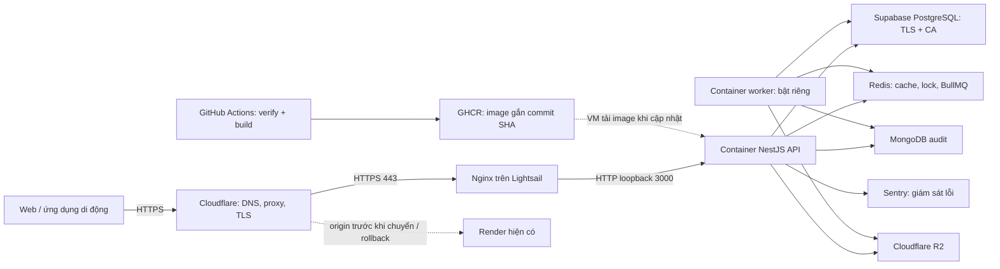

# SỬ DỤNG DỊCH VỤ ĐIỆN TOÁN ĐÁM MÂY

## Nghiên cứu tình huống: triển khai API Vé Xe Nhanh từ Render sang AWS Lightsail

**Môn học:** Điện toán đám mây  
**Dự án minh họa:** Marketplace Vé Xe Nhanh  
**Ngày tổng hợp:** 03/11/2026  
**Căn cứ:** quá trình cấu hình, ảnh chụp màn hình và kết quả lệnh được cung cấp trong phiên thực hành.

Tài liệu trình bày quá trình lựa chọn dịch vụ, dự toán chi phí, tạo máy chủ, xuất Docker image bằng CI, vận hành API và kiểm tra truy cập qua Cloudflare. Hai góc nhìn được sử dụng là người tư vấn giải pháp và khách hàng thuê dịch vụ. Các nội dung bảo mật tập trung vào tài khoản, quyền truy cập, chứng chỉ, cấu hình bí mật và ranh giới mạng.

**Kết quả có bằng chứng:** API đã chạy trên Lightsail, trả HTTP 200 qua HTTPS tại origin và qua tên miền thử nghiệm Cloudflare. Một bài thử giả mạo `X-Forwarded-For` cho thấy ứng dụng chọn đúng IP do Cloudflare xác nhận. Việc chuyển tên miền chính, kiểm thử toàn bộ nghiệp vụ và vận hành worker đã được hướng dẫn nhưng chưa có đầy đủ phản hồi nghiệm thu trong phiên; mục 9 ghi rõ giới hạn này.

## 1. Mục tiêu và phạm vi

Dự án cần một môi trường demo có địa chỉ API ổn định, không phụ thuộc máy tính cá nhân phải luôn bật. API sử dụng NestJS, Node.js 24, Prisma và PostgreSQL; đồng thời kết nối MongoDB phục vụ audit, Redis và Cloudflare R2. Hệ thống đã có tên miền `vexenhanh.id.vn`, quản lý DNS bằng Cloudflare, còn API ban đầu chạy trên Render.

Các mục tiêu thực hành gồm:

- Sử dụng ưu đãi tài khoản AWS mới với ngân sách ban đầu 100 USD credit.
- Đưa phần thực thi API lên AWS, giữ các dịch vụ dữ liệu hiện có để giảm số thành phần phải di chuyển cùng lúc.
- Dựng môi trường mới song song để Render tiếp tục phục vụ trong thời gian cấu hình.
- Giữ địa chỉ chính `https://api.vexenhanh.id.vn` khi thay đổi nơi chạy API.
- Dùng CI tạo image có thể truy về commit; giảm thao tác build trên máy cá nhân.
- Chuẩn bị worker có thể bật khi demo cần xử lý tác vụ nền.

Đây là môi trường demo dùng dữ liệu mẫu. Phạm vi không bao gồm chuyển database sang AWS, xây dựng cụm nhiều máy, tự động mở rộng theo tải hay phê duyệt vận hành thanh toán/KYC thật.

## 2. Liên hệ với kiến thức điện toán đám mây

### 2.1. Khái niệm và mô hình dịch vụ

Theo NIST SP 800-145, điện toán đám mây cho phép truy cập tài nguyên dùng chung qua mạng và cấp phát theo nhu cầu. Các đặc trưng gồm tự phục vụ, truy cập qua mạng, chia sẻ tài nguyên, co giãn và đo lường sử dụng. Ba mô hình dịch vụ cơ bản là IaaS, PaaS và SaaS. [Nguồn NIST](https://nvlpubs.nist.gov/nistpubs/Legacy/SP/nistspecialpublication800-145.pdf).

Trong bài thực hành, người dùng tự tạo máy chủ, quản trị từ xa và theo dõi tài nguyên/chi phí qua Console. Tuy nhiên, một máy Lightsail không tự trở thành hệ thống co giãn hoặc có tính sẵn sàng cao; những khả năng đó cần thiết kế thêm.

| Thành phần | Vai trò trong hệ thống | Liên hệ mô hình dịch vụ |
| --- | --- | --- |
| Render | Môi trường API ban đầu, hỗ trợ deploy từ repository | Cách sử dụng gần với PaaS: nhà cung cấp xử lý phần lớn nền tảng chạy ứng dụng |
| AWS Lightsail | Máy chủ ảo chạy Ubuntu, Docker và Nginx | Cách vận hành gần với IaaS: người thuê tự quản lý hệ điều hành và phần mềm |
| GitHub Actions, GHCR | Chạy CI và lưu container image | Dịch vụ được quản lý phục vụ quy trình phát triển/phát hành |
| Cloudflare | DNS, reverse proxy và TLS cho hostname API | Dịch vụ mạng/biên được quản lý |
| Supabase PostgreSQL | Lưu dữ liệu nghiệp vụ | Dịch vụ database được quản lý |
| MongoDB, Redis, R2 | Audit, cache/queue và object storage | Các dịch vụ dữ liệu ngoài máy API |
| Sentry | Thu nhận exception và ngữ cảnh lỗi | Dịch vụ giám sát lỗi được quản lý |

Ứng dụng kết hợp dịch vụ của nhiều nhà cung cấp public cloud. Việc có một máy Windows dùng để quản trị không đủ để gọi kiến trúc này là hybrid cloud. Docker đóng gói môi trường chạy; riêng việc dùng Docker cũng không đồng nghĩa có cloud hoặc tự động mở rộng.

### 2.2. Vì sao chọn Lightsail cho tình huống này?

Trong phiên đã xem xét nhu cầu duy trì Render, VPS/hosting tại Việt Nam và AWS. Tiêu chí quyết định là phù hợp demo, có thể chạy liên tục, dự toán được tiền thuê máy và tận dụng credit. Báo cáo không chép lại các báo giá hosting bên ngoài chưa có bảng giá đối chiếu đầy đủ.

| Phương án | Lợi ích | Điều cần cân nhắc |
| --- | --- | --- |
| Tiếp tục dùng Render | Ít công việc quản trị máy chủ, quy trình deploy thuận tiện | Phân biệt phí workspace với phí compute; kiểm tra điều kiện ngủ của đúng gói đang dùng |
| Thuê VPS Việt Nam | Có thể thuận tiện về hỗ trợ, thanh toán và vị trí người dùng | Đối chiếu RAM, CPU dùng chung, băng thông, backup, VAT và mức hỗ trợ thực tế |
| Lightsail một máy | Gói tài nguyên rõ ràng, phù hợp credit và thực hành quản trị | Phải quản lý Ubuntu, Docker, Nginx, chứng chỉ, backup và giám sát |
| Cụm container nhiều thành phần | Có thể phục vụ nhu cầu mở rộng/sẵn sàng cao hơn | Tăng độ phức tạp và chi phí so với nhu cầu demo hiện tại |

Lightsail được chọn vì phù hợp phạm vi thực hành, không phải vì luôn rẻ hoặc ổn định hơn mọi PaaS. Với khách hàng ít kinh nghiệm vận hành, phần công quản trị có thể lớn hơn khoản tiết kiệm tiền máy.

## 3. Tài khoản, cấu hình và chi phí

### 3.1. Free plan và credit

Người thực hành đăng ký AWS, chọn **Free account plan**. Ảnh Console cung cấp trong phiên hiển thị **100 USD credit**, còn **182 ngày**, mốc kết thúc **02/05/2027**; hoạt động nhận thêm credit là **0/5**.

AWS công bố 100 USD ban đầu và khả năng nhận thêm tối đa 100 USD qua hoạt động. Free plan kết thúc sau sáu tháng hoặc khi credit hết, tùy mốc đến trước; cần có kế hoạch nâng cấp hoặc rời dịch vụ trước hạn để duy trì truy cập. Paid plan có thể tính phí vượt credit. [Điều kiện tài khoản AWS](https://docs.aws.amazon.com/awsaccountbilling/latest/aboutv2/free-tier-plans.html).

Những hoạt động nhận thưởng đã được giới thiệu gồm Budgets, EC2, Lambda, Bedrock và RDS. Phải đọc điều kiện trên widget của chính tài khoản, theo dõi credit thực nhận và dọn tài nguyên thử. Không mặc định tạo Lightsail sẽ hoàn thành nhiệm vụ EC2. Chưa có bằng chứng người thực hành nhận khoản thưởng bổ sung. [Danh sách hoạt động AWS](https://docs.aws.amazon.com/awsaccountbilling/latest/aboutv2/free-tier-plans-activities.html).

### 3.2. Cấu hình máy đã lựa chọn

| Thuộc tính | Lựa chọn |
| --- | --- |
| Dịch vụ | Amazon Lightsail |
| Region | Singapore, `ap-southeast-1` |
| Plan type | General purpose |
| Network | Dual-stack, có public IPv4 |
| Blueprint | Linux operating system → Ubuntu 24.04 LTS |
| Kiến trúc | `x86_64`, tương ứng image `linux/amd64` |
| Tài nguyên gói | 2 GB RAM, 2 vCPU, 60 GB SSD |
| Mô hình chạy | API thường trực, worker bật riêng khi cần |

Blueprint hệ điều hành được chọn để tự cài Docker và Nginx. Node.js chạy bên trong image của dự án, vì vậy không cần blueprint Node.js cài sẵn để thực hiện phương án này.

### 3.3. Dự toán sáu tháng

Giá công bố của Lightsail Linux có public IPv4, đối chiếu ngày 03/11/2026:

| Gói RAM | Tiền máy/tháng | Ước tính sáu tháng | So với 100 USD credit |
| --- | ---: | ---: | --- |
| 1 GB | 7 USD | 42 USD | Ít dư địa bộ nhớ; chưa kiểm chứng đủ tải |
| **2 GB** | **12 USD** | **72 USD** | Còn khoảng 28 USD cho phát sinh |
| 4 GB | 24 USD | 144 USD | Vượt 44 USD nếu chỉ có credit ban đầu |

Đây là phép tính ngân sách, không phải hóa đơn hoặc cam kết miễn phí. Cần cộng snapshot, lưu trữ/băng thông ngoài gói, dịch vụ thử, phí dữ liệu ngoài AWS và các khoản thuế/phí áp dụng. Kiểm giá cuối trong Console. [Bảng giá Lightsail](https://aws.amazon.com/lightsail/pricing/).

Bật thêm container worker trên cùng máy không tạo thêm phí thuê VM, nhưng làm tăng nhu cầu CPU/RAM. Tắt worker không làm giảm giá gói máy. Lightsail thông thường vẫn tính phí khi instance ở trạng thái stop; tài nguyên được giữ lại có thể tiếp tục phát sinh phí. [Quy định tính phí](https://docs.aws.amazon.com/lightsail/latest/userguide/amazon-lightsail-frequently-asked-questions-faq-billing-and-account-management.html).

Hai GB là mức khởi điểm đã chọn, không phải mức tối thiểu được chứng minh bằng benchmark. RAM trống của VM hoặc mức sử dụng lúc khởi động không đại diện khả năng chịu tải khi API và worker cùng xử lý nghiệp vụ.

## 4. Kiến trúc triển khai



API, worker và Nginx cùng thuộc phương án một VM; các database và storage tiếp tục dùng dịch vụ bên ngoài. Đường tải image từ GHCR về VM trong phiên vẫn là thao tác thủ công, chưa phải CD tự động.

| Cổng/địa chỉ | Mục đích | Cách giới hạn |
| --- | --- | --- |
| SSH TCP 22 | Quản trị Ubuntu | Khuyến nghị giới hạn IP quản trị, giữ quyền browser SSH cần thiết |
| HTTPS TCP 443 | Cloudflare kết nối origin | Mở trên Lightsail; Nginx kiểm soát nguồn bằng allowlist Cloudflare |
| HTTP `127.0.0.1:3000` | Nginx gọi container API | Chỉ bind loopback, không publish ra mọi interface |
| `api-aws.vexenhanh.id.vn` | Hostname kiểm thử AWS | Record A trỏ Static IP, bật Proxied |
| `api.vexenhanh.id.vn` | Hostname API chính | Ban đầu về Render; chỉ đổi khi kiểm tra đạt |

## 5. Quy trình thực hiện

Các giá trị `<COMMIT_SHA_40>`, `<STATIC_IPV4>` và `<REQUEST_ID>` trong ví dụ phải được thay bằng giá trị thực. Không nhập dấu ngoặc nhọn của phần giữ chỗ. Các lệnh Bash chạy trong SSH Ubuntu; lệnh PowerShell chạy trên máy Windows. Chỉ đi tiếp khi bước kiểm tra trước thành công.

### Bước 1. Đăng ký và kiểm soát tài khoản

1. Tạo tài khoản AWS, hoàn thành xác minh theo Console, chọn Free plan và mức hỗ trợ cơ bản phù hợp.
2. Kiểm tra số dư, hạn Free plan và điều kiện sử dụng dịch vụ.
3. Thiết lập MFA cho tài khoản quản trị; quản lý quyền theo nhu cầu thay vì dùng root cho mọi tác vụ.
4. Cấu hình theo dõi ngân sách và kiểm tra Billing định kỳ. Cảnh báo ngân sách không đồng nghĩa tự động ngắt chi tiêu.

Đăng ký tài khoản và số dư credit đã được xác nhận bằng ảnh trong phiên. MFA và budget là yêu cầu vận hành được khuyến nghị, chưa có bằng chứng đã cấu hình hoàn tất.

### Bước 2. Tạo instance và gắn Static IP

Trong Lightsail, chọn **Create instance**, dùng cấu hình ở mục 3.2, đợi trạng thái Running. Tạo **Static IP** trong Networking và gắn vào instance cùng region để DNS không phụ thuộc IP động sau khi stop/start. [Hướng dẫn Static IP](https://docs.aws.amazon.com/lightsail/latest/userguide/lightsail-create-static-ip.html).

Mở **Connect using SSH** và kiểm tra:

```bash
cat /etc/os-release
uname -m
free -h
df -h /
```

Kết quả người thực hành cung cấp: Ubuntu **24.04.4 LTS**, `x86_64`, tổng RAM khoảng **1,9 GiB**, filesystem khoảng **58 GB**, còn khoảng **56 GB** tại thời điểm kiểm tra. Không có swap khi kiểm tra ban đầu.

### Bước 3. Cài Docker, Compose và Nginx

Trên Ubuntu mới, thêm repository chính thức của Docker rồi cài các gói. Ví dụ cho Ubuntu Noble, amd64:

```bash
sudo apt-get update
sudo apt-get install -y ca-certificates curl
sudo install -d -m 0755 /etc/apt/keyrings
sudo curl -fsSL https://download.docker.com/linux/ubuntu/gpg -o /etc/apt/keyrings/docker.asc
sudo chmod 0644 /etc/apt/keyrings/docker.asc

sudo tee /etc/apt/sources.list.d/docker.sources >/dev/null <<'EOF'
Types: deb
URIs: https://download.docker.com/linux/ubuntu
Suites: noble
Components: stable
Architectures: amd64
Signed-By: /etc/apt/keyrings/docker.asc
EOF

sudo apt-get update
sudo apt-get install -y docker-ce docker-ce-cli containerd.io \
  docker-buildx-plugin docker-compose-plugin nginx
sudo systemctl enable --now docker nginx
```

Đối chiếu [hướng dẫn Docker cho Ubuntu](https://docs.docker.com/engine/install/ubuntu/) khi dùng phiên bản hệ điều hành khác. Xác nhận cài đặt bằng:

```bash
sudo docker run --rm hello-world
sudo docker compose version
sudo nginx -t
sudo systemctl is-active docker nginx
```

Trong phiên, `hello-world` thành công, `nginx -t` thành công và hai dịch vụ đều `active`.

### Bước 4. Chuyển từ build thủ công sang CI xuất image

Ban đầu, phương án build trên Windows rồi dùng `docker image save` và SCP được đề xuất. Sau khi người dùng hỏi về việc lặp lại thao tác ở mỗi commit, quy trình được điều chỉnh sang GitHub Actions và GHCR.

File thực tế đã được hiệu chỉnh là [ci.yml](../../.github/workflows/ci.yml). Các thay đổi chính:

| Thành phần | Cách hoạt động |
| --- | --- |
| `workflow_dispatch.inputs.source_sha` | Cho phép chọn full commit SHA; bỏ trống dùng commit của lần chạy |
| Job `verify` | Kiểm SHA, checkout đúng source, chạy lint/typecheck/test/build/gen-client và kiểm generated contract |
| Output `source_sha` | Truyền SHA đã xác nhận từ verify sang publisher |
| Cache | Khóa cache theo SHA của source được kiểm tra |
| Job `publish-api` | `needs: verify`; chỉ publish cho push hoặc dispatch trên `develop` |
| Quyền publisher | `contents: read`, `packages: write`; dùng `GITHUB_TOKEN` |
| Image | Build `linux/amd64`, tag full SHA, thêm label repository và revision |
| Pull request | Chạy verify, không publish image |

Luồng đã thiết lập:

```text
Push/merge develop hoặc chạy thủ công
  → verify đúng source commit
  → build Docker image
  → push ghcr.io/nhkyn0410/vexenhanh-api:<COMMIT_SHA_40>
  → ghi địa chỉ image vào Summary
```

Với lần chạy thủ công, vào **Actions → CI → Run workflow**, chọn `develop`, điền SHA nếu muốn chọn một bản cụ thể. Tại thời điểm kiểm tra trong phiên, repository còn đặt `master` làm default branch; phải kiểm tra việc workflow có nằm trên default branch để sử dụng `workflow_dispatch`. Không tự đổi default branch như một thao tác bắt buộc cho mọi repository. [Điều kiện chạy thủ công của GitHub](https://docs.github.com/en/actions/how-tos/manage-workflow-runs/manually-run-a-workflow).

Workflow đã qua `actionlint`, kiểm tra diff và 34 kiểm tra cục bộ bằng Docker giả lập. Các kiểm tra này xác nhận logic cấu hình, không thay thế một lần build/push thật. Sau đó log VM ghi nhận image từ GHCR với tag `da3a4e79814224d6493c9bb5da223939c1c2cbf3` đã chạy; phiên không lưu run ID của GitHub để kiểm toán đầy đủ quá trình phát hành.

**Phân biệt CI và CD:** phần đã làm tự động tạo/xuất image. Tải image, sửa image đang chọn và tạo lại container trên Lightsail vẫn do người vận hành thực hiện. Chưa có job SSH/SSM tự deploy và tự rollback.

### Bước 5. Đăng nhập registry và tải image về AWS

Đối với image riêng tư, tạo GitHub **Personal access token (classic)** với scope `read:packages`. Màn hình fine-grained token không có lựa chọn scope giống hướng dẫn này. Job publish dùng `GITHUB_TOKEN`; token cá nhân trên VM chỉ phục vụ tải image. [Tài liệu GHCR](https://docs.github.com/en/packages/working-with-a-github-packages-registry/working-with-the-container-registry).

Trên SSH Ubuntu:

```bash
sudo docker login ghcr.io --username nhkyn0410
```

Khi hiện `Password:`, nhập token riêng tư; terminal không hiển thị ký tự. Chờ `Login Succeeded`, rồi chạy, thay SHA trước khi thực hiện:

```bash
sudo docker pull ghcr.io/nhkyn0410/vexenhanh-api:<COMMIT_SHA_40>
```

Không nhập token trực tiếp trong lệnh, file báo cáo hoặc ảnh chụp. Token có thời hạn cần được theo dõi và thay thế khi hết hạn.

### Bước 6. Chuẩn bị cấu hình runtime và certificate database

Tạo thư mục và các file bằng editor:

```bash
sudo install -d -m 0700 -o ubuntu -g ubuntu /opt/vexenhanh-demo
cd /opt/vexenhanh-demo
umask 077
nano .env
nano api.env
```

File `.env` dùng để chọn image, ví dụ:

```dotenv
API_IMAGE=ghcr.io/nhkyn0410/vexenhanh-api:<COMMIT_SHA_40>
```

File `api.env` chứa cấu hình ứng dụng từ Render và Environment Group hiện có. Các dòng tiêu biểu:

```dotenv
NODE_ENV=production
PORT=3000
BETTER_AUTH_URL=https://api.vexenhanh.id.vn
OPERATOR_WEB_ORIGINS=https://operator.vexenhanh.id.vn
ADMIN_WEB_ORIGINS=https://admin.vexenhanh.id.vn
TRUST_PROXY_HOPS=2
```

Phải bổ sung các kết nối và khóa thật trên VM: `DATABASE_URL`, `MONGODB_AUDIT_URI`, `REDIS_URL`, `BULLMQ_PREFIX`, JWT, MFA, CSRF, QR vé, Resend, Goong, R2 và những nhà cung cấp đang bật. Ví dụ trên chưa đủ để chạy production. Đối chiếu schema [env.config.ts](../../apps/api/src/config/env.config.ts) của đúng phiên bản image.

Giữ các khóa đang sử dụng khi di chuyển để không vô tình đổi chữ ký token, khóa giải mã MFA hoặc QR vé. Dùng DB app role, không đưa tài khoản migration/owner vào runtime. Không chạy migrate/seed chỉ vì đổi máy chủ.

Định dạng của các file cần phân biệt:

| Giá trị | Định dạng dùng trong phương án |
| --- | --- |
| Dòng `api.env` | `TEN_BIEN=gia_tri`, mỗi biến một dòng, không bọc thêm dấu nháy khi dùng raw env-file |
| `JWT_ACCESS_PRIVATE_KEY` | Base64 một dòng của toàn bộ PEM chuẩn hóa, gồm BEGIN/END và xuống dòng của PEM |
| Khóa FCM/APNs nếu dùng | Một dòng có literal `\n`, theo decoder của adapter tương ứng |
| Certificate/private key Nginx | File PEM nhiều dòng, không chuyển toàn bộ thành base64 một dòng |
| Certificate CA PostgreSQL | File PEM của CA do nhà cung cấp database cung cấp |

Với Supabase, tải CA từ **Database → Settings → SSL Configuration**, lưu tại `certs/supabase-ca.crt`, quyền file đủ để container non-root đọc. Mount thư mục certificate read-only. Giữ phần kết nối đang dùng và bổ sung tham số:

```text
/postgres?sslmode=verify-full&schema=public&sslrootcert=/app/certs/supabase-ca.crt
```

Đây chỉ là phần cuối URL; password, host, port và database phải đúng môi trường. Tránh trùng `sslmode`/`sslrootcert`. [Supabase SSL](https://supabase.com/docs/guides/database/connecting-to-postgres#ssl), [node-postgres SSL](https://node-postgres.com/features/ssl).

`TRUST_PROXY_HOPS=2` là giá trị cho tuyến đã thử **Cloudflare → Nginx → API**. Khi topology thay đổi phải kiểm chứng lại, không coi đây là giá trị đúng cho mọi môi trường.

### Bước 7. Khởi động bằng Docker Compose

Tạo `/opt/vexenhanh-demo/compose.yaml`:

```yaml
name: vexenhanh-demo
services:
  api:
    image: ${API_IMAGE:?Set API_IMAGE in .env}
    env_file:
      - path: ./api.env
        format: raw
    volumes:
      - ./certs:/app/certs:ro
    ports:
      - "127.0.0.1:3000:3000"
    restart: unless-stopped
    init: true
    stop_grace_period: 60s
    logging:
      driver: json-file
      options:
        max-size: "10m"
        max-file: "3"
  worker:
    image: ${API_IMAGE:?Set API_IMAGE in .env}
    command: ["dist/worker.js"]
    env_file:
      - path: ./api.env
        format: raw
    volumes:
      - ./certs:/app/certs:ro
    profiles: [worker]
    restart: "no"
    init: true
    stop_grace_period: 120s
    logging:
      driver: json-file
      options:
        max-size: "10m"
        max-file: "3"
```

`format: raw` cần Compose từ 2.30 và giữ nguyên ký tự đặc biệt trong giá trị. API image của dự án dùng Node distroless: command worker là `dist/worker.js`, không thêm `node` hoặc shell vào trước command. [Docker env-file](https://docs.docker.com/reference/compose-file/services/#env_file).

Chạy lần lượt:

```bash
chmod 600 .env api.env compose.yaml
sudo docker compose config --quiet
sudo docker compose up -d api
sudo docker compose ps
sudo docker compose logs --tail=80 api
curl -i http://127.0.0.1:3000/v1/health
```

`config --quiet` kiểm tra cú pháp Compose; không kiểm chứng đủ điều kiện khởi động ứng dụng. Container báo `Up` cũng chưa chứng minh API sẵn sàng. Khi sửa env, tạo lại container bằng `up -d --no-deps --force-recreate api`; chỉ restart không nạp lại env mới. [Docker restart](https://docs.docker.com/reference/cli/docker/compose/restart/).

Ba endpoint cần kiểm tra riêng trước khi chuyển DNS:

```bash
curl -i http://127.0.0.1:3000/v1/health/postgres
curl -i http://127.0.0.1:3000/v1/health/mongo
curl -i http://127.0.0.1:3000/v1/health/redis
```

### Bước 8. HTTPS tại origin và firewall

Trong Cloudflare, vào **SSL/TLS → Origin Server → Create Certificate**. Tạo Origin Certificate dạng PEM cho cả `api.vexenhanh.id.vn` và `api-aws.vexenhanh.id.vn`; trong phiên chọn RSA. Lưu certificate và private key thành:

```text
/etc/nginx/ssl/vxn-origin.crt
/etc/nginx/ssl/vxn-origin.key
```

Giới hạn quyền thư mục SSL, đặt key ở quyền `600`, giữ PEM đúng nhiều dòng. Certificate này bảo vệ Cloudflare → origin; khi kiểm tra trực tiếp bằng curl cần chỉ định CA phù hợp. [Cloudflare Origin CA](https://developers.cloudflare.com/ssl/origin-configuration/origin-ca/).

Tải các dải IP chính thức và tạo allowlist, chỉ chạy phần ghi file khi tải thành công:

```bash
cd /opt/vexenhanh-demo
curl -fsSL https://www.cloudflare.com/ips-v4 -o cf-ips-v4.txt &&
curl -fsSL https://www.cloudflare.com/ips-v6 -o cf-ips-v6.txt &&
awk 'NF {print "allow " $0 ";"}' cf-ips-v4.txt cf-ips-v6.txt |
  sudo tee /etc/nginx/vxn-cloudflare-allow.conf >/dev/null
```

Cấu hình site `/etc/nginx/sites-available/vexenhanh-api`:

```nginx
server {
    listen 443 ssl;
    listen [::]:443 ssl;
    server_name api.vexenhanh.id.vn api-aws.vexenhanh.id.vn;
    ssl_certificate /etc/nginx/ssl/vxn-origin.crt;
    ssl_certificate_key /etc/nginx/ssl/vxn-origin.key;

    allow 127.0.0.1;
    allow ::1;
    include /etc/nginx/vxn-cloudflare-allow.conf;
    deny all;

    location / {
        proxy_pass http://127.0.0.1:3000;
        proxy_http_version 1.1;
        proxy_set_header Host $host;
        proxy_set_header X-Forwarded-Host $host;
        proxy_set_header X-Forwarded-Proto https;
        proxy_set_header X-Forwarded-For $proxy_add_x_forwarded_for;
        proxy_set_header CF-Connecting-IP $http_cf_connecting_ip;
    }
}
```

Chuyển mọi path để hỗ trợ cả REST `/v1/*` và OAuth `/api/auth/*`. Không thêm real-IP rewrite khi dùng đúng mẫu proxy/hop này nếu chưa đánh giá lại. Allowlist cần cập nhật khi Cloudflare đổi dải IP; nó giới hạn nguồn ở mạng Cloudflare, chưa xác thực riêng zone của khách hàng.

Tạo symlink một lần, kiểm cấu hình và chỉ reload khi kiểm tra đạt:

```bash
sudo ln -s /etc/nginx/sites-available/vexenhanh-api /etc/nginx/sites-enabled/vexenhanh-api
sudo nginx -t
sudo systemctl reload nginx
```

Kiểm tra HTTPS trên loopback với CA công khai của Cloudflare:

```bash
cd /opt/vexenhanh-demo
curl -fsSL https://developers.cloudflare.com/ssl/static/origin_ca_rsa_root.pem \
  -o cloudflare-origin-ca-rsa.pem
curl --cacert ./cloudflare-origin-ca-rsa.pem \
  --resolve api.vexenhanh.id.vn:443:127.0.0.1 \
  -i https://api.vexenhanh.id.vn/v1/health
```

Trong phiên, phép thử này trả HTTP 200. Trên Lightsail cần thêm rule HTTPS TCP 443; màn hình ban đầu chỉ có HTTP 80 và SSH 22 nên chưa đủ. Phương án đã hướng dẫn mở 443 cho public, còn Nginx thực thi allowlist; SSH cần giới hạn riêng. Nếu có UFW hoặc lớp firewall khác, cũng kiểm tra cấu hình tương ứng.

### Bước 9. Kiểm tra public qua hostname tạm

Trong Cloudflare DNS, tạo record **A**, tên `api-aws`, content là Static IPv4 Lightsail, bật **Proxied**, TTL Auto. Giữ record `api` chính về Render trong thời gian chuẩn bị.

Overview SSL/TLS lúc kiểm tra đang hiển thị **Full**. Để áp dụng **Full (strict)** riêng cho AWS, tạo **Rules → Configuration Rule** với điều kiện:

```text
(http.host eq "api-aws.vexenhanh.id.vn")
```

Trong action, bấm **Add** ở SSL, chọn **Strict**, Deploy. Full (strict) xác minh chứng chỉ origin, gồm tính hợp lệ, CA và hostname. Sau rule riêng, Overview có thể vẫn hiển thị chế độ chung là Full. [Full (strict)](https://developers.cloudflare.com/ssl/origin-configuration/ssl-modes/full-strict/), [Configuration Rules SSL](https://developers.cloudflare.com/rules/configuration-rules/settings/#ssl).

Kiểm tra từ Windows:

```powershell
curl.exe -i https://api-aws.vexenhanh.id.vn/v1/health
```

Kết quả thực tế: **HTTP 200**, `Server: cloudflare`, `cf-cache-status: DYNAMIC`. Header DYNAMIC không phải bằng chứng API đang được cache; phản hồi này cũng không tự chứng minh tất cả nghiệp vụ hoạt động hoặc rule Strict đã được kiểm toán.

Kiểm tra IP bằng cách chỉ giả mạo XFF:

```powershell
curl.exe -i `
  -H "X-Forwarded-For: 192.0.2.99" `
  https://api-aws.vexenhanh.id.vn/v1/health
```

Lấy **`x-request-id`** và tra trên SSH:

```bash
sudo docker compose logs --since=10m --no-color api | grep -F '<REQUEST_ID>'
```

Log đã cung cấp xác nhận `clientIpMatchesCf: true`; `trustedClientIp`, `cfConnectingIp` và `clientIp` trùng nhau, khác IP giả. IP `192.0.2.99` vẫn có trong XFF nhưng không được chọn làm IP tin cậy. Log tương ứng trong container AWS cũng chứng minh request đã tới máy AWS.

Lần thử trước đó tự gửi cả `CF-Connecting-IP` trả 403 và không có `x-request-id` trong phản hồi được gửi. Cloudflare có thể từ chối request kiểu này; không thể kết luận chỉ từ 403 rằng Nginx/API sai. `CF-RAY` thuộc Cloudflare, khác request ID của ứng dụng. [Cloudflare error 1000](https://developers.cloudflare.com/support/troubleshooting/http-status-codes/cloudflare-1xxx-errors/error-1000/).

### Bước 10. Chuyển tên miền chính, quay lui và dọn hostname thử

Phần này là quy trình bàn giao đã hướng dẫn, cần xác nhận thực hiện khi nghiệm thu:

1. Xác nhận ba dependency health, kiểm proxy, phiên bản ứng dụng/schema và các khóa dùng chung phù hợp. Không kết hợp thay đổi nghiệp vụ lớn với đổi hạ tầng nếu có thể tránh.
2. Lưu Type, Content, Proxy status và TTL của record `api` đang về Render.
3. Sửa chính record `api` sang **A → Static IPv4 Lightsail**, giữ Proxied. Xử lý AAAA cũ để tránh traffic đi nhầm origin; không tạo CNAME và A cùng tên song song.
4. Mở rộng SSL Strict rule cho hai hostname bằng expression bên dưới.
5. Gọi health trên `api.vexenhanh.id.vn` và tìm request ID trong log AWS. Chỉ thấy `Server: cloudflare` chưa xác định được origin phía sau.
6. Kiểm đăng nhập, MFA, refresh/logout, CORS/CSRF/cookie, upload và OAuth nếu đang bật.
7. Giữ Render 24–48 giờ hoặc theo khung quan sát đã thống nhất. Nếu lỗi ảnh hưởng sử dụng, khôi phục DNS/SSL cũ rồi kiểm tra lại.

```text
(http.host eq "api-aws.vexenhanh.id.vn") or (http.host eq "api.vexenhanh.id.vn")
```

Người dùng tiếp tục sử dụng cùng hostname API; việc đổi origin không yêu cầu sửa URL client nếu các client đã dùng hostname đó. DNS và kết nối đang tồn tại có thời gian hội tụ, vì vậy không hứa tuyệt đối không gián đoạn. Với DB/Redis chung, quay lui hạ tầng không có nghĩa restore DB hoặc flush Redis; thay đổi schema phải tương thích với bản quay lui.

Sau khi API chính thực sự được nghiệm thu, có thể xóa **riêng DNS record `api-aws`**, sửa rule còn hostname `api`, và dọn cấu hình tên thử khi phù hợp. Xóa DNS thử không xóa VM và không làm giảm tiền máy. Trong phiên chưa có bằng chứng xác nhận các thao tác dọn này đã hoàn tất.

## 6. Những lỗi thực tế và cách xử lý

| Hiện tượng | Chẩn đoán và cách xử lý | Bài học vận hành |
| --- | --- | --- |
| Không có Select scopes khi tạo token | Mở nhầm fine-grained token; chuyển sang PAT classic với `read:packages` cho VM | Chọn đúng cơ chế xác thực của dịch vụ đích |
| Docker login báo `password is empty` | Biến shell chứa token đang rỗng; dùng prompt Password để nhập token trực tiếp | Dán từng bước, không đưa token vào câu lệnh/chat |
| `-----END PRIVATE KEY----- contains whitespaces` | PEM nhiều dòng trong env-file bị tách thành các tên biến; đổi định dạng phù hợp từng decoder | Cùng là khóa nhưng loader có thể nhận định dạng khác nhau |
| Hai WEB_ORIGINS báo thiếu | Kiểm tra trong container cho thấy chuỗi rỗng; hướng dẫn loại dòng trùng, kiểm `environment` ghi đè và recreate | Ảnh file cấu hình không chứng minh giá trị hiệu lực trong container; không xác định duy nhất nguồn ghi đè khi chưa có file |
| `curl: (7)` hoặc `(56) Connection reset by peer` | API chưa listen hoặc chết trong quá trình khởi tạo; đọc logs, trạng thái, restart count và Sentry | Container tồn tại chưa đồng nghĩa readiness |
| Prisma báo self-signed certificate chain | Bổ sung CA Supabase, mount read-only, thêm `sslrootcert`, giữ `verify-full` | Tin cậy đúng CA thay vì tắt xác minh TLS |
| JWT `DECODER routines::unsupported` | Lỗi tại `createPublicKey`; chuẩn hóa lại PEM/base64 với cùng key material, kiểm OpenSSL và Node | Không tạo khóa mới chỉ để sửa lỗi trình bày dữ liệu |
| Nginx `PEM routines::bad end line` | Dán lại Origin Certificate đúng PEM nhiều dòng, đủ BEGIN/END | File certificate HTTPS khác chuỗi secret một dòng trong env |
| Symlink báo `File exists` | Link đã tạo trước; cấu hình sau đó kiểm tra đạt bằng `nginx -t` | Không cần tạo link ở mọi lần sửa cấu hình |
| Firewall chỉ có 80 và 22 | Bổ sung HTTPS 443 để Cloudflare vào origin | HTTPS cần rule cổng tương ứng |
| Rule `action parameters are required` | Đã tạo điều kiện nhưng chưa Add action SSL/Strict | Rule cần cả điều kiện và thiết lập thực thi |
| Request có header CF tự đặt trả 403 | Điều chỉnh bài thử chỉ XFF; dùng request ID đúng để đối chiếu | Tách lỗi ở edge, proxy và ứng dụng |

Sentry giúp xác định lớp khởi tạo thất bại: đầu tiên Prisma/TLS, sau đó TokenService/JWT. Đường dẫn Debian trong Sentry là môi trường container, không mâu thuẫn với host Ubuntu. Không gán mọi lỗi reset kết nối cho firewall hoặc thiếu RAM khi chưa có bằng chứng.

## 7. Worker, cập nhật phiên bản và vận hành lâu dài

### 7.1. Worker chạy khi nào?

Yêu cầu ban đầu là worker không nhất thiết thường trực. Phương án hiện có dùng profile Compose để bật thủ công:

```bash
cd /opt/vexenhanh-demo
sudo docker compose --profile worker up -d worker
sudo docker compose --profile worker ps
```

Trước khi bật phải xác nhận CA, env và image đúng; bàn giao/dừng worker cũ nếu đang chạy local và dùng cùng queue. Trước khi tắt cần chờ các job liên quan buổi demo hoàn tất, rồi:

```bash
sudo docker compose stop -t 120 worker
```

Thời gian 120 giây là khoảng chờ dừng, không bảo đảm mọi job dài đã hoàn tất. Không yêu cầu mọi delayed maintenance job đều bằng 0 mới được dừng.

**Chưa có cơ chế tự bật theo người dùng.** Số người đang mở trang không đồng nghĩa số việc nền cần xử lý: callback thanh toán, thông báo, refund hoặc giải phóng booking hết hạn có thể cần chạy sau khi người dùng rời đi. Tắt worker có thể khiến trạng thái chờ đến lần bật sau; phải mô tả giới hạn này khi demo. Phiên chưa có kết quả worker xử lý một job thực tế.

### 7.2. Quy trình cập nhật sau lần đầu

1. Đưa thay đổi qua nhánh/PR theo quy trình dự án, kiểm tra CI.
2. CI xuất image mới theo SHA; ghi lại tag hoặc digest và phiên bản đang phục vụ.
3. VM tải image mới, cập nhật `API_IMAGE` trong `.env`.
4. Tạo lại riêng API, kiểm health, log và nghiệp vụ; cập nhật worker khi phù hợp.
5. Giữ bản trước để quay lui. Không dùng thao tác dọn image hàng loạt làm mất bản rollback.

Một VM có thể gián đoạn ngắn khi tạo lại container. Phần CD tự cập nhật sau CI là hướng phát triển tiếp theo, cần chuẩn bị quyền triển khai, kiểm health và rollback; chưa triển khai trong phiên.

### 7.3. Theo dõi tài nguyên và kết thúc sử dụng

```bash
free -h
df -h /
sudo docker stats --no-stream
sudo docker compose ps -a
```

Theo dõi CPU/RAM, dung lượng log, restart/OOM, lỗi Sentry và số dư credit. Một VM là một điểm lỗi; `restart: unless-stopped` chỉ hỗ trợ tự chạy lại container, không thay thế HA hoặc backup.

Lập lịch kiểm hạn token/certificate và thời hạn Free plan. Trước khi dừng dịch vụ phải chuyển traffic, bảo đảm dữ liệu/cấu hình cần giữ đã được sao lưu và kiểm tra khả năng phục hồi. Khi xóa tài nguyên cần kiểm đúng tên, region, IP và snapshot; dọn DNS không dừng hóa đơn VM.

## 8. Lưu ý khi đứng ở vị trí người tư vấn và khách hàng

| Vấn đề | Góc nhìn người tư vấn dịch vụ | Góc nhìn khách hàng sử dụng |
| --- | --- | --- |
| Xác định nhu cầu | Hỏi rõ demo hay kinh doanh thật, thời gian sử dụng, luồng quan trọng và năng lực vận hành trước khi chọn gói | Nêu ngân sách, số người dùng dự kiến, thời điểm demo và mức gián đoạn chấp nhận được |
| Giá và ưu đãi | Báo riêng tiền máy, dịch vụ phụ, công quản trị và chi phí sau hết credit; ghi ngày tham khảo | Đọc điều kiện Free/Paid, theo dõi Billing; không hiểu credit là miễn phí vô thời hạn |
| Hiệu năng | Đề xuất 2 GB như điểm thử, đo API + worker với luồng tiêu biểu trước khi hứa năng lực | Cung cấp dữ liệu/tình huống demo thật và chấp nhận nâng cấu hình khi kết quả đo cần thiết |
| PaaS hay VM | Giải thích đánh đổi giữa ít công quản trị và quyền chủ động cấu hình | Đánh giá tổng chi phí sở hữu, gồm cả thời gian sửa lỗi và hỗ trợ, không chỉ giá RAM |
| Quyền sở hữu | Bàn giao AWS, GitHub, Cloudflare, danh mục secret và quy trình thu hồi quyền | Giữ quyền sở hữu tài khoản, billing, domain và ít nhất một cách quản trị dự phòng |
| Di chuyển | Dựng song song, test hostname tạm, xác định cửa sổ đổi DNS và rollback | Nghiệm thu chức năng, đồng ý thời điểm chuyển và giữ môi trường cũ đủ thời gian quan sát |
| Tự động hóa | Nói rõ CI xuất image khác với CD triển khai; bàn giao cách xác định bản đang chạy | Kiểm Actions, image SHA và health sau mỗi lần cập nhật; tránh tin rằng commit nào cũng tự lên AWS |
| Độ ổn định và dữ liệu | Thống nhất phạm vi hỗ trợ, backup, người xử lý sự cố và thời gian phục hồi mục tiêu | Hỏi ai chịu trách nhiệm khi API lỗi, dữ liệu mất hoặc tài khoản hết credit; yêu cầu thử khôi phục |

Ví dụ tư vấn phù hợp: “Gói 2 GB dự toán 12 USD/tháng, sáu tháng khoảng 72 USD riêng tiền máy. Chúng ta cần đo thêm khi worker chạy và chuẩn bị phương án sau hạn Free plan.” Cách trình bày này rõ hơn việc cam kết “100 USD chắc chắn đủ sáu tháng cho mọi mức sử dụng”.

Khách hàng có thể dùng bốn câu hỏi khi nghiệm thu: **Tài khoản thuộc ai? Tổng chi phí gồm gì? Khi lỗi quay lại bằng cách nào? Đã có bằng chứng chức năng nào chạy thành công?**

## 9. Kết quả và giới hạn bằng chứng

| Hạng mục | Trạng thái ghi nhận trong phiên |
| --- | --- |
| Tạo AWS account và nhận credit ban đầu | Có ảnh Console xác nhận 100 USD; chưa có bằng chứng nhận thêm 100 USD |
| VM Ubuntu, Docker, Nginx | Có kết quả lệnh xác nhận cấu hình và dịch vụ hoạt động |
| Cấu hình CI xuất GHCR | File workflow đã sửa; actionlint và 34 kiểm tra mô phỏng đạt |
| Image trên VM | Có log container dùng image GHCR; không có GitHub run ID lưu trong báo cáo |
| PostgreSQL CA và JWT | Đã xử lý lỗi khởi tạo, API sau đó khởi động và trả liveness 200 |
| HTTPS origin | `curl --cacert --resolve` trả 200 qua Nginx |
| Hostname public thử nghiệm | `api-aws` trả 200 qua Cloudflare, có log tương ứng trên AWS |
| Chống giả mạo XFF | Một request thử có XFF giả nhưng IP tin cậy vẫn đúng; chưa phải kiểm thử bảo mật toàn diện |
| Full (strict) | Đã hướng dẫn cấu hình rule và xử lý lỗi action; HTTP 200 không tự xác nhận policy Strict đang hiệu lực |
| Ba dependency health | Đã hướng dẫn; chưa có đủ ba phản hồi riêng được cung cấp để ghi là nghiệm thu đạt |
| Chuyển hostname `api` chính | Đã hướng dẫn; chưa có request ID trên hostname chính đối chiếu log AWS |
| Xóa DNS `api-aws` | Đã hướng dẫn điều kiện dọn; chưa có xác nhận thao tác đã hoàn tất |
| Worker và tự bật theo tải | Có cấu hình bật thủ công; chưa có bằng chứng xử lý job, chưa có tự bật theo người dùng |
| CD tự cập nhật container | Chưa triển khai; pull/recreate trên VM vẫn thủ công |
| Tải, HA, backup/restore | Chưa có benchmark hoặc bài phục hồi để kết luận |

Khi hoàn thiện báo cáo nộp, có thể bổ sung ảnh CI xanh, ba health dependency, request của hostname chính trong log AWS và kết quả nghiệp vụ. Trước khi chèn ảnh cần che email quản trị, token, password, private key và IP cá nhân. Không ghi một bước là hoàn thành chỉ vì đã có hướng dẫn thao tác.

## 10. Một số điểm bảo mật cần quan tâm

**Trách nhiệm chia sẻ.** Nhà cung cấp bảo vệ hạ tầng cloud; người thuê vẫn chịu trách nhiệm phần mình cấu hình. Với VM này, khách hàng cần quản lý Ubuntu, Docker, Nginx, quyền truy cập, ứng dụng và dữ liệu. [Mô hình trách nhiệm chia sẻ AWS](https://aws.amazon.com/compliance/shared-responsibility-model/).

**Quyền và secret.** Khuyến nghị MFA cho tài khoản quản trị, token VM chỉ `read:packages`, quyền ghi registry riêng job publish. `api.env`/private key có quyền hạn chế và không đưa vào Git/image. Nếu token lộ phải thu hồi và cấp lại. Base64 chỉ là biểu diễn dữ liệu, không mã hóa bảo mật; log và bản sao lưu env cũng cần bảo vệ.

**Mạng và TLS.** API bind loopback, HTTPS qua Nginx, SSH giới hạn nguồn. Tách CA PostgreSQL khỏi Cloudflare Origin CA, giữ xác minh certificate/hostname. Allowlist mạng Cloudflare chưa chứng minh request thuộc riêng zone; có thể cân nhắc Authenticated Origin Pulls hoặc cơ chế xác thực origin phù hợp khi tăng yêu cầu bảo vệ.

**Dữ liệu và vận hành.** Dùng DB app role và RLS, giữ các khóa xác thực khi di chuyển, cập nhật bản vá và kiểm backup/restore. Dùng dữ liệu mẫu trong bài demo; việc chạy được API không đồng nghĩa đủ điều kiện tiếp nhận dữ liệu nhạy cảm hay giao dịch thanh toán thật. Đây là các lưu ý theo cấu hình đã dùng, không phải kết quả một cuộc audit bảo mật.

## 11. Kết luận phục vụ môn học

Bài thực hành cho thấy sử dụng cloud bao gồm cả lựa chọn dịch vụ, quản trị chi phí, triển khai, xử lý lỗi, kiểm thử và bàn giao vận hành. Chuỗi GitHub Actions → GHCR → Lightsail → Nginx → Cloudflare giúp tách việc đóng gói ứng dụng khỏi địa chỉ truy cập của người dùng. Giữ dịch vụ dữ liệu hiện có và dựng song song với Render giúp chia nhỏ phạm vi di chuyển.

Kết quả được chứng minh là API đã phục vụ qua hostname thử nghiệm HTTPS trên AWS và xử lý đúng IP trong một bài thử XFF. Các bước chuyển hostname chính, worker, triển khai tự động và đo tải cần bằng chứng riêng để kết luận hoàn thành. Từ phía tư vấn, giải pháp phải đi cùng giới hạn và chi phí vận hành; từ phía khách hàng, cần nắm quyền sở hữu, cách kiểm tra và cách khôi phục dịch vụ.

## 12. Tài liệu đối chiếu và phụ lục kiểm tra

Các nguồn chính thức được đặt ngay cạnh nội dung liên quan. Khi thực hiện lại, đối chiếu giao diện/giá/điều kiện ở thời điểm mới; mốc giá và số dư trong báo cáo là ghi nhận của phiên tháng 11/2026.

Mã nguồn/cấu hình dự án liên quan:

- [CI workflow](../../.github/workflows/ci.yml): verify và publish-api.
- [Dockerfile](../../Dockerfile): build monorepo, runtime Node distroless.
- [Schema cấu hình](../../apps/api/src/config/env.config.ts): biến runtime bắt buộc.
- [PrismaService](../../apps/api/src/database/prisma.service.ts): adapter pg và kiểm tra RLS khi khởi động.
- [TokenService](../../apps/api/src/iam/auth/token.service.ts): nạp JWT key và suy public key.
- [Hướng dẫn triển khai ban đầu](../task-propreties/AWS-DEPLOY-API-guide.md): tài liệu chuẩn bị; báo cáo này bổ sung kết quả thực hành và các lỗi đã gặp.

Các lệnh chẩn đoán dùng khi tái hiện bài thực hành, chạy trong SSH:

```bash
# Trạng thái container, kể cả container đã dừng
sudo docker compose ps -a

# Log gần nhất; đọc tại máy và che thông tin riêng trước khi chia sẻ
sudo docker compose logs --since=10m --tail=100 api

# Trạng thái khởi động/restart/OOM, không in toàn bộ env
sudo docker inspect \
  --format 'status={{.State.Status}} exit={{.State.ExitCode}} oom={{.State.OOMKilled}} restarts={{.RestartCount}}' \
  vexenhanh-demo-api-1

# Đọc metadata certificate, không in private key
sudo openssl x509 -in /etc/nginx/ssl/vxn-origin.crt -noout -subject -issuer -dates
sudo openssl pkey -in /etc/nginx/ssl/vxn-origin.key -check -noout

# Kiểm cấu hình trước khi reload
sudo nginx -t
```

Checklist nghiệm thu còn cần lưu bằng chứng:

- [ ] PostgreSQL, MongoDB và Redis health đều trả 200.
- [ ] Đối chiếu rule Full (strict) đang áp dụng đúng hostname.
- [ ] Hostname chính có request ID xuất hiện trong log AWS.
- [ ] Đăng nhập, MFA, refresh/logout, CORS/CSRF và upload cần demo hoạt động.
- [ ] Worker xử lý được job mẫu và có quy trình dừng/bàn giao.
- [ ] Đo tài nguyên với luồng demo tiêu biểu, kiểm restart và thử khôi phục phù hợp.
- [ ] Xác nhận ngân sách, người nhận cảnh báo, hạn token/certificate và kế hoạch hết Free plan.

*Ghi nhận cách thực hiện: người dùng trực tiếp thao tác Console/SSH; trợ lý AI hỗ trợ lựa chọn, viết phần cấu hình CI được yêu cầu, giải thích lỗi và tổng hợp tài liệu. Kết quả trong báo cáo được giới hạn bởi bằng chứng đã cung cấp trong phiên.*
