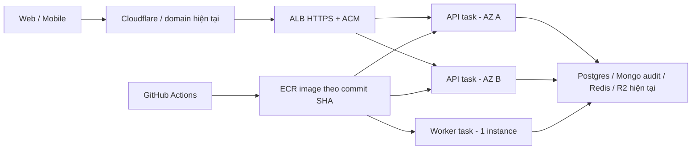

# Kế hoạch chuyển API production và worker sang AWS

> **Cập nhật phạm vi 29/10/2026:** Khanh chọn demo bằng Free Tier/credit, chỉ API
> cần thường trực, worker bật khi cần. Hướng dẫn áp dụng hiện tại ở
> [AWS account/credit](AWS-ACCOUNT-CREDITS-guide.md) và
> [triển khai API Lightsail](AWS-DEPLOY-API-guide.md). Phần ECS/HA và dự trù chi phí
> bên dưới giữ làm phương án tham khảo trước khi phạm vi được thu gọn.

Ngày lập: **29/10/2026**. Trạng thái: **Đề xuất, chưa triển khai**.

Khanh đã xác nhận phạm vi: **API và worker; giữ nguyên DB, Redis, storage**.
Ngân sách, tải thực tế và thời gian gián đoạn cho phép chưa được xác nhận.
Tài liệu dựa trên code/cấu hình trong repo và tài liệu AWS; chưa xác minh dashboard,
DNS, tài khoản cloud hay cấu hình secret đang hoạt động.

## 1. Kết quả cần đạt

- API và BullMQ worker chạy thường trực tại AWS Singapore (`ap-southeast-1`).
- Giữ `https://api.vexenhanh.vn`, API `/v1`, các frontend và ứng dụng mobile hiện tại.
- Giữ PostgreSQL, MongoDB audit, Upstash Redis và Cloudflare R2 hiện hành.
- Phiên đăng nhập, token, giữ ghế và queue tiếp tục sử dụng dữ liệu hiện có.
- Có CI/CD, theo dõi lỗi, xử lý dừng container và quy trình quay về Render/worker cũ.

Đây là chuyển nơi chạy ứng dụng. Việc chuyển DB sang RDS, Redis sang ElastiCache,
storage sang S3, thay payment vendor hoặc thay business rule cần kế hoạch riêng.

## 2. Hiện trạng làm căn cứ

| Nội dung | Bằng chứng trong repo | Hệ quả cho kế hoạch |
| --- | --- | --- |
| API Render Singapore, gói free | [`render.yaml`](../../render.yaml), [RB-07](../runbook/RB-07-render-deploy.md) | Cần xác minh bản chạy thật; Render free có sleep nên phải kiểm tra khả năng tiếp nhận traffic khi rollback. |
| Worker Render còn comment, tài liệu ghi chạy local | [`render.yaml`](../../render.yaml), [RB-07](../runbook/RB-07-render-deploy.md) | Kiểm kê máy/process worker hiện đang xử lý Redis production trước khi bàn giao. |
| Có image Node 24, distroless nonroot, port 3000 | [`Dockerfile`](../../Dockerfile) | Dùng lại image; command API là `["dist/main.js"]`, worker là `["dist/worker.js"]`, vì entrypoint đã là Node. |
| Worker có 12 queue và nhiều scheduler nghiệp vụ | [`queue.constants.ts`](../../apps/api/src/queue/queue.constants.ts), [`worker.module.ts`](../../apps/api/src/worker.module.ts) | Worker production phải được nghiệm thu như một thành phần chính. |
| Health gốc chỉ là liveness | [`app.controller.ts`](../../apps/api/src/app.controller.ts), [`queue-health.service.ts`](../../apps/api/src/queue/queue-health.service.ts) | `/v1/health` xanh chưa chứng minh DB/Redis/worker xử lý được nghiệp vụ. Health queues hiện chỉ đếm queue foundation. |
| Worker có shutdown hooks; API chưa có | [`worker.ts`](../../apps/api/src/worker.ts), [`main.ts`](../../apps/api/src/main.ts) | Cần bổ sung và kiểm chứng graceful shutdown API trước rolling deploy. |
| IP đăng nhập dựa trên topology Render | [PROXY-IP-rollout-guide](PROXY-IP-rollout-guide.md), [`trust-proxy.ts`](../../apps/api/src/common/trust-proxy.ts) | Phải xác minh lại `TRUST_PROXY_HOPS` và chống giả header trên đường Cloudflare → ALB → API. |
| CI đã có kiểm tra code, chưa có deploy AWS | [CI](../../.github/workflows/ci.yml), [DB integration](../../.github/workflows/db-integration.yml) | Bổ sung pipeline ECR/ECS, giữ các gate hiện tại. |

Theo [PROJECT-STATE §4](../context/PROJECT-STATE.md), production hiện được ghi nhận
là môi trường demo với dữ liệu mẫu. Các điều kiện mở dữ liệu/KYC/payment thật vẫn
theo quyết định hiện hành; chuyển hạ tầng không đồng nghĩa đủ điều kiện launch thật.

## 3. Phương án AWS đề xuất

**Chọn ECS chạy Fargate**, giữ modular monolith và tách API/worker thành hai ECS
service. AWS quản lý máy chạy container; đội dự án quản lý image, task, mạng và vận hành.
Fargate hỗ trợ ALB cho API HTTP: [AWS ECS load balancing](https://docs.aws.amazon.com/AmazonECS/latest/developerguide/service-load-balancing.html).

| Thành phần | Cấu hình khởi điểm để đo kiểm |
| --- | --- |
| API service | 2 task ở 2 AZ; mỗi task 0,5 vCPU / 1 GiB RAM; ALB target port 3000. |
| Worker service | 1 task, 0,25 vCPU / 1 GiB RAM; không public HTTP, không gắn ALB. |
| Network | ALB public; API/worker private subnet; NAT egress ở mỗi AZ để kết nối các nhà cung cấp hiện tại. IP egress ổn định được thêm vào allowlist cần thiết. |
| TLS/domain | ACM cho hostname API, giữ Cloudflare và DNS provider hiện tại. Không cần chuyển nameserver sang Route 53. |
| Image | ECR, Linux x86_64 khởi điểm, cùng image digest cho API và worker; giữ các digest đã chạy tốt để rollback. |
| Cấu hình/secret | Secrets Manager và cấu hình task; execution role/task role/deploy role tách trách nhiệm. Không đưa giá trị secret vào image hay repo. |
| Log/metrics | Pino ra stdout → CloudWatch; giữ Sentry, thiết lập retention và cảnh báo. |
| Hạ tầng | Đề xuất CloudFormation trong `infra/aws/`; chỉ tạo sau khi phương án và chi phí được chọn. |

API task chỉ nhận kết nối từ security group ALB. Khi giữ Cloudflare proxy, giới hạn
ingress ALB theo tuyến Cloudflare và kiểm tra chặn truy cập bỏ qua tuyến đó.
Đường outbound private subnet cần NAT; xem [AWS ECS outbound networking](https://docs.aws.amazon.com/AmazonECS/latest/developerguide/networking-outbound.html)
và [security group cho ECS](https://docs.aws.amazon.com/AmazonECS/latest/developerguide/security-network.html).

RAM/CPU trên là điểm bắt đầu, phải điều chỉnh sau khi đo. Hai API task không làm
DB/Redis bên ngoài tự có HA. Worker khởi điểm một instance nên vẫn có khoảng ngừng
xử lý job khi thay task; queue giữ job trong Redis để xử lý tiếp.

App Runner không được chọn cho tài khoản mới: AWS đã dừng nhận khách hàng mới từ
30/04/2026. ECS Express Mode có thể đơn giản hóa phần API HTTP, nhưng worker vẫn
cần service riêng; kế hoạch cơ sở dùng ECS service cấu hình rõ cho cả hai.
Nguồn: [AWS App Runner](https://aws.amazon.com/apprunner/),
[ECS Express Mode](https://docs.aws.amazon.com/AmazonECS/latest/developerguide/express-service-overview.html).

## 4. Dự trù chi phí

**Dành khoảng 180–260 USD/tháng cho cấu hình cơ sở**, trước thuế, với tải thấp,
chạy 730 giờ/tháng, 2 API task + 1 worker và NAT cho 2 AZ. Đây là khoảng dự trù
để lựa chọn kiến trúc, chưa phải báo giá theo tài khoản hay kết quả Calculator.

| Nhóm | Khoảng dự trù USD/tháng |
| --- | ---: |
| Fargate API + worker theo cấu hình trên | 55–85 |
| ALB, lượng dùng thấp và IPv4 của ALB | 25–40 |
| NAT cho 2 AZ, IPv4 và lượng xử lý dữ liệu thấp | 80–110 |
| ECR, Secrets Manager, CloudWatch và phần traffic nhỏ | 10–25 |

Khoảng tổng được làm tròn có dự phòng nhỏ. Chưa gồm chi phí dịch vụ dữ liệu hiện có,
egress tăng từ các nhà cung cấp, Render trong thời gian chạy song song, môi trường
diễn tập, support hoặc autoscale vượt cấu hình cơ sở. Traffic lớn có thể vượt khoảng này.

Trước khi tạo tài nguyên: nhập đúng Singapore, số task, RAM/CPU, 2 AZ, số IPv4,
LCU/giờ, NAT GB, internet egress và log GB vào AWS Pricing Calculator; lưu estimate
và đặt AWS Budgets theo ngân sách Khanh chọn. Budget alert không phải giới hạn chi tiêu cứng.
Nếu ngân sách thấp hơn nhiều, cần chọn lại cấu hình và mức sẵn sàng trước khi provision.

Cơ sở tính phí: [Fargate](https://aws.amazon.com/fargate/pricing/),
[ALB](https://aws.amazon.com/elasticloadbalancing/pricing/),
[NAT/IPv4](https://aws.amazon.com/vpc/pricing/),
[AWS Pricing Calculator](https://calculator.aws/).

## 5. Các giai đoạn và điều kiện hoàn tất

Ước lượng **5–7 ngày làm việc**, cộng 48–72 giờ quan sát sau chuyển. Thời gian
chờ quyền tài khoản, ngân sách, DNS và quyết định vận hành chưa tính vào ước lượng.

### Giai đoạn 1 — Xác minh production và chốt cấu hình (0,5–1 ngày)

- [ ] Xác nhận AWS account, region, người quản lý billing/DNS/Render và cửa sổ chuyển.
- [ ] Ghi nhận SHA đang chạy, cấu hình task dự kiến và manifest tên biến môi trường
  từ cả schema runtime lẫn cấu hình thực tế. `render.yaml` không phải inventory đầy đủ:
  ví dụ `TICKET_QR_SECRET` được schema yêu cầu nhưng chưa có trong Blueprint.
- [ ] Kiểm kê worker local: process/máy, phiên bản, queue prefix, scheduled jobs,
  active jobs, thời lượng job dài nhất và người có thể khởi động lại.
- [ ] Đo baseline latency/p95, 5xx, RAM/CPU, queue age/backlog, DB/Redis/Mongo connections.
- [ ] Kiểm tra backup/restore hiện tại; ghi bằng chứng backup còn dùng được.
- [ ] Chốt estimate, ngân sách, ngưỡng dừng chuyển và mục tiêu phục hồi.

**Hoàn tất khi:** có inventory, người thực hiện/rollback, baseline và chi phí được chọn.

### Giai đoạn 2 — Chuẩn bị ứng dụng cho ECS (1–2 ngày)

- [ ] Bật graceful shutdown API; diễn tập SIGTERM, request đang chạy, đóng pool và
  ALB deregistration. Với worker, xác minh job dở dang được hoàn tất hoặc retry an toàn;
  chọn stop timeout theo job và giới hạn Fargate, không chỉ dựa vào có shutdown hook.
- [ ] Có readiness rõ ràng cho điều kiện API nhận traffic; tách khỏi liveness,
  kiểm DB/Redis và dependency bắt buộc theo hành vi hiện có. Không dùng health
  queue foundation để kết luận mọi queue/worker đều khỏe.
- [ ] Kiểm tra image distroless bằng command Node, không giả định có shell/curl.
  Giữ command đúng cho API và worker như §2.
- [ ] Tính connection budget cho Render + API AWS + worker + số task tăng tạm khi
  rolling deploy; đặt pool ceiling/giới hạn task phù hợp với gói DB/Mongo/Redis.
- [ ] Chuẩn bị env đủ cho từng runtime. Worker hiện dùng chung `loadAppConfig()`
  nên vẫn chịu các validation production của schema chung; không tự giả định
  chỉ cần ba connection URI. Tách schema API/worker là cải tiến tùy chọn.
- [ ] Xác minh app role PostgreSQL không bypass RLS; runtime không nhận migration-owner URI.
- [ ] Kiểm chứng cùng secret/key/issuer giữa Render, hai API task và worker theo nhu cầu
  runtime: JWT, Better Auth, MFA encryption, CSRF, ticket QR; không rotate trong đợt chuyển.

**Hoàn tất khi:** image khởi động, xử lý request/job, dừng và restart an toàn trong diễn tập.
Tham khảo [AWS connection draining](https://docs.aws.amazon.com/AmazonECS/latest/developerguide/load-balancer-connection-draining.html).

### Giai đoạn 3 — Hạ tầng và CI/CD (1–2 ngày)

- [ ] Khai báo VPC/subnet/egress/SG, ECR, IAM, ECS API/worker, ALB, ACM, log, secrets.
- [ ] Thêm egress IP AWS vào allowlist DB/Mongo/vendor cần thiết; kiểm DNS, TLS và
  độ trễ thực tế tới các dịch vụ dữ liệu đang giữ nguyên.
- [ ] GitHub Actions dùng OIDC, khóa trust theo repo và production environment/nhánh
  được phép; không tạo access key dài hạn cho pipeline.
- [ ] Giữ gate lint, typecheck, Vitest, build, generated client và DB integration liên quan.
  Build image một lần, tag commit SHA, deploy bằng digest sau CI xanh.
- [ ] API rolling update có deployment circuit breaker/rollback và cảnh báo; có bản
  completed trước mới dùng được rollback tự động. Lần deploy đầu cần phương án xử lý riêng.
- [ ] Worker deploy có bước dừng/drain trước khi bật bản mới, khởi điểm một instance;
  không để rolling update mặc định âm thầm tăng worker concurrency.
- [ ] Theo dõi task restart/OOM, 5xx, p95, DB pool, queue age/failed và dấu hiệu worker
  xử lý job; thiết lập health/smoke worker thay vì chỉ dựa task RUNNING.

**Hoàn tất khi:** pipeline đưa đúng digest lên môi trường diễn tập và rollback được.
Nguồn: [AWS GitHub OIDC](https://docs.aws.amazon.com/IAM/latest/UserGuide/id_roles_create_for-idp_oidc.html),
[ECS deployment failure detection](https://docs.aws.amazon.com/AmazonECS/latest/developerguide/deployment-failure-detection.html).

### Giai đoạn 4 — Diễn tập và nghiệm thu trước chuyển (1 ngày)

- [ ] Môi trường diễn tập dùng DB/Redis tách production và dữ liệu mẫu; chặn gửi
  email/thanh toán thật. Đổi `BULLMQ_PREFIX` đơn thuần chưa tách auth limiter:
  key login hiện chưa có prefix môi trường.
- [ ] Gọi health liveness, PostgreSQL, MongoDB, Redis; thử job có kiểm soát từ queued
  đến completed và kiểm các queue nghiệp vụ/scheduler.
- [ ] Thử login trên task A, refresh/logout/revoke trên task B; cookie/CSRF/CORS qua
  các frontend, bao gồm phiên tạo trước khi chuyển; kiểm OAuth callback nếu đang bật.
- [ ] Kiểm tenant RLS, tiền, webhook HMAC, payment dedup, refresh-token reuse,
  seat-hold cạnh tranh và retry job theo các test bắt buộc hiện có.
- [ ] Đo tuyến Cloudflare → ALB → API để xác định `TRUST_PROXY_HOPS`. Thử hai mạng
  client độc lập và XFF/CF header giả; IP/bucket phải đúng và đường bypass phải bị chặn.
- [ ] Restart một API task dưới tải; thử dừng worker giữa job trong sandbox, kiểm retry
  không tạo side effect trùng; đo giới hạn pool trong lúc rolling deploy.
- [ ] Diễn tập quay traffic về Render và bàn giao worker ngược lại; ghi thời gian thực tế.

**Hoàn tất khi:** các kiểm tra trên pass và không còn lỗi chặn cutover. Load test
thực hiện ở môi trường diễn tập, không tự đẩy tải lớn vào dịch vụ production hiện có.

### Giai đoạn 5 — Chuyển production và quan sát (0,5 ngày + 48–72 giờ)

1. Đóng băng phiên bản triển khai hai nơi, giữ cùng commit nghiệp vụ và schema;
   xác nhận backup, allowlist, secrets, AWS health và khả năng Render nhận lại traffic.
   Không ghép nâng cấp business logic hoặc schema phá tương thích vào lần chuyển.
2. Chuẩn bị route/DNS trước giờ chuyển. Nếu DNS-only, điều chỉnh TTL khi provider
   cho phép và chờ TTL cũ hết; nếu Cloudflare proxied, xác minh cách đổi origin và cache
   thực tế. Không mặc định provider có weighted routing miễn phí.
3. **Chuyển worker trước:** ghi counts/scheduler → dừng nhận job ở worker local →
   drain active jobs → xác nhận process cũ dừng → bật một AWS worker với **đúng Redis
   và `BULLMQ_PREFIX` production cũ**. Không flush Redis, không tạo namespace queue mới.
4. Xác nhận scheduler/job tiếp tục, queue age ổn định, không có email/refund/payment
   trùng. `upsertJobScheduler` có ID ổn định nhưng concurrency là theo từng process;
   một worker không đồng nghĩa side effect tự có exactly-once.
5. Khởi động/kiểm API AWS production trong đường kiểm thử có kiểm soát, không nhận
   public traffic ngoài dự kiến. Kiểm auth với hostname/site phù hợp, không kết luận
   cookie auth bằng domain ALB ngẫu nhiên.
6. Đổi origin/DNS của **hostname API hiện tại** sang ALB; chạy smoke từ web/mobile,
   auth, giữ ghế và các luồng nghiệp vụ đang bật bằng dữ liệu test có kiểm soát.
7. Theo dõi tập trung 30–60 phút đầu, rồi 48–72 giờ. Giữ Render cùng phiên bản và
   bảo đảm luôn có thể đưa nó trở lại phục vụ; worker local chỉ giữ khả năng khởi động,
   không tiếp tục consume khi worker AWS hoạt động.
8. Khi ổn định, tắt deploy tự động/retire cấu hình Render phù hợp, gỡ quyền/IP tạm,
   cập nhật tài liệu vận hành và estimate theo chi phí đo được.

## 6. Ngưỡng dừng chuyển và rollback

Các ngưỡng dưới đây là **đề xuất cho đợt migration**, chưa phải SLA/DR đã được duyệt:

- Dừng chuyển ngay nếu login/refresh lỗi, cookie/CSRF hỏng, sai IP/bucket limiter,
  mất tenant isolation, giữ ghế sai hoặc xuất hiện side effect tài chính trùng.
- Điều tra và quay lui nếu 5xx >1% trong 5 phút hoặc p95 >2 lần baseline liên tục
  10 phút, sau khi loại trừ tải thử/ít mẫu; với traffic thấp ưu tiên lỗi cụ thể và smoke.
- Worker không xử lý được job hoặc backlog/oldest age tăng qua hai chu kỳ bình thường
  là điều kiện dừng chuyển worker; chốt ngưỡng riêng theo queue ở giai đoạn 1.
- Mục tiêu thao tác đưa traffic về Render trong khoảng **15 phút**, phải đo trong diễn
  tập. Cache DNS, kết nối đang mở và Render cold start có thể làm hội tụ lâu hơn.

| Sự cố | Cách quay lui |
| --- | --- |
| API AWS lỗi, worker khỏe | Trả origin/DNS về Render; kiểm health/auth/proxy. Giữ AWS phục vụ các kết nối còn cache nếu an toàn, drain sau khi hội tụ. Worker AWS có thể tiếp tục. |
| Worker AWS lỗi | Dừng/drain AWS worker và xác nhận đã dừng trước khi khởi động worker cũ; dùng Redis/prefix cũ, kiểm active/stalled/retry và idempotency. |
| Cả hai lỗi | Quay API và worker theo hai thao tác trên, tránh chạy hai bộ worker ngoài chủ đích. |
| Lỗi ở DB/Redis chung | Việc đổi traffic không sửa được dependency chung; xử lý theo runbook dependency, không lặp lại cutover. |

**Không restore DB hay xóa Redis chỉ để rollback nơi chạy ứng dụng**: hai nơi đang
dùng chung dữ liệu mới phát sinh. Khôi phục dữ liệu chỉ thực hiện theo kế hoạch sự cố
dữ liệu riêng. Đợt chuyển giữ schema nên không cần chạy migration/seed mới.
Nếu sau này có schema change, owner chỉ dùng trong job migration riêng; image runtime
distroless hiện không chứa Prisma CLI để giả định migrate ngay trong API task.

SRS hiện đặt availability **99,5%/tháng**; RTO/RPO toàn hệ thống còn mở ở OPS-OQ-04,
không suy diễn thành cam kết zero downtime hay RPO=0.
Nguồn: [SRS §7](../SDLC/01-srs-he-thong-dat-ve-xe-khach.md),
[Deploy §9–§12](../SDLC/09-deployment-operation-standard.md).

## 7. Hồ sơ bàn giao khi triển khai xong

- [ ] IaC + pipeline + manifest tên env/API-worker, không chứa secret.
- [ ] Bằng chứng CI, smoke, multi-task auth, tenant RLS, queue/retry và rollback drill.
- [ ] Runbook deploy/rollback AWS, rotate secret, worker drain/restart, cảnh báo và billing.
- [ ] Cập nhật ADR-023, ADR-024/026 nếu bị ảnh hưởng, HLD §14, Deploy, RB-07,
  hướng dẫn proxy/env và PROJECT-STATE theo quyết định thực tế; không tự promote Approved.
- [ ] Ghi chi phí đo được, task sizing, connection budget và người chịu trách nhiệm vận hành.

Tài liệu này chỉ lập kế hoạch, chưa tạo AWS resource, thay code, chuyển DNS hay deploy.
