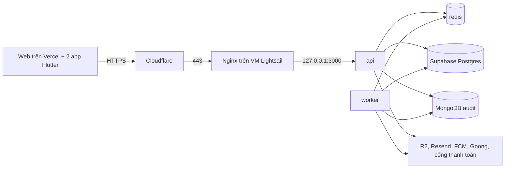
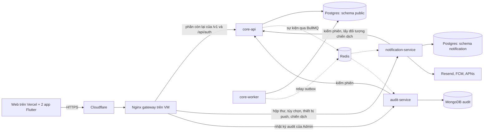

# Kế hoạch tách microservice cho backend Vé Xe Nhanh

> Ngày lập: **15/11/2026**. Trạng thái: **Đề xuất — chờ Khanh duyệt**. Chưa đổi code, hạ tầng, ADR hay tài liệu SDLC.
> Yêu cầu: Khanh, 15/11/2026 — nghiên cứu và đề xuất kế hoạch triển khai microservice; hiện API, worker và Redis chạy trên AWS, web chạy trên Vercel.
> Căn cứ: mã nguồn nhánh `fix/passenger-parity` ngày 15/11/2026; ADR-002 / 006 / 011 / 016 / 017 / 024 / 030; [hướng dẫn AWS](AWS-DEPLOY-API-guide.md); [báo cáo Lightsail](../report/su-dung-dich-vu-dien-toan-dam-may-aws-lightsail.md); số đo trong phiên (cách đo ở §11).
> Chưa qua `code-reviewer` / `security-auditor`.

## 1. Tóm tắt đề xuất

1. **Không tách toàn bộ backend thành microservice.** Luồng tiền (thanh toán → đặt vé → vé → escrow) đang là một transaction Postgres duy nhất; tách nó ra buộc phải viết saga và bù trừ cho tiền. Lý do ADR-002 chọn modular monolith vẫn còn nguyên, và môi trường hiện tại là demo trên một VM 2 GB.
2. **Tách có chọn lọc, từng bước, theo kiểu strangler.** Giữ một **core** (đặt vé, thanh toán, vé, hoàn tiền, escrow, chuyến, giá, IAM…). Tách hai phần vốn đã bất đồng bộ hoặc đã có kho dữ liệu riêng: **notification-service** trước, **audit-service** sau.
3. **Không thêm hạ tầng, không thêm vendor, không tăng tiền thuê máy cho hai service đầu.** Nginx đang có làm API gateway. BullMQ trên Redis đang có làm kênh sự kiện, kèm bảng outbox trong Postgres. Mỗi service có schema và role DB riêng trên cùng cụm Supabase.
4. **Web và hai app không phải sửa.** Giữ `https://api.vexenhanh.id.vn`, giữ nguyên đường dẫn `/v1/*` và một bản OpenAPI gộp để sinh client TS + Dart.
5. **Ba giai đoạn, dừng được ở cuối mỗi giai đoạn:** GĐ0 chuẩn bị nền (không đổi hành vi) → GĐ1 notification-service → GĐ2 audit-service. Tách tiếp (tìm chuyến, IAM) chỉ khi có số đo tải hoặc yêu cầu cụ thể.
6. **Cần một ADR mới** (đề xuất ADR-031) sửa ADR-002, và Khanh chốt 8 quyết định ở §9 trước khi viết code.

## 2. Hiện trạng

### 2.1. Hạ tầng đang chạy

| Thành phần | Hiện tại | Nguồn |
| --- | --- | --- |
| Máy chủ | Một VM Lightsail Singapore: 2 vCPU, RAM khoảng 1,9 GiB, 60 GB SSD, Ubuntu 24.04, không có swap lúc kiểm tra; 12 USD/tháng | Báo cáo Lightsail §3.2, bước 2 |
| Ngân sách | 100 USD credit, Free plan kết thúc 02/05/2027 | Báo cáo Lightsail §3.1 |
| Container | Compose `vexenhanh-demo`: `api` (thường trực), `worker` (theo hướng dẫn là profile `worker`, bật tay), `redis` 7.4 (mạng nội bộ, AOF, trần 256 MB) | Hướng dẫn AWS §5, ADR-030 |
| Gateway | Nginx trên host: TLS origin của Cloudflare, chỉ nhận dải IP Cloudflare, chuyển **mọi** đường dẫn về `127.0.0.1:3000` | Hướng dẫn AWS §6 |
| Image | Một image `vexenhanh-api:<sha>` cho cả API và worker (khác lệnh chạy); CI đẩy lên GHCR khi merge `develop` | `Dockerfile`, `.github/workflows/ci.yml` |
| Triển khai | Thủ công trên VM: pull image, sửa `.env`, tạo lại container | `AWS-API-UPDATE-quick-guide.md` |
| Dữ liệu | Supabase Postgres (role app + RLS), MongoDB audit, Cloudflare R2 — ngoài VM | ADR-011, ADR-018 |
| Client | 3 web Next.js trên Vercel và 2 app Flutter, tất cả gọi **một** địa chỉ API | `.env.example` của ba web |

### 2.2. Mã nguồn và dữ liệu

| Số đo | Giá trị |
| --- | --- |
| Module nghiệp vụ trong `apps/api/src` | 33 thư mục, khoảng 57 nghìn dòng TypeScript (không tính test và mã sinh) |
| Bề mặt HTTP | 92 controller, 405 route |
| Test | 200 file `*.spec.ts`, trong đó 63 file tích hợp cần DB thật |
| Hàng đợi | 12 queue BullMQ, 12 processor, 10 lịch chạy định kỳ — tất cả trong một tiến trình worker |
| Phụ thuộc giữa module nghiệp vụ | 165 cặp module, 703 câu `import`. Bị phụ thuộc nhiều nhất: `iam` 375, `audit` 72, `external` 68, `fare` 28, `booking` 24, `notification` 24 |
| Schema Postgres | 92 model, 128 khóa ngoại; 63 model mang `operatorId`; 82 bảng bật FORCE RLS dùng chung một hàm policy |
| Khóa ngoại cắt ngang 9 nhóm nghiệp vụ | 57 / 128 (45%). Nhóm thông báo chỉ có 3 khóa ngoại trỏ ra ngoài; audit nằm ở MongoDB, không có khóa ngoại nào |

Chín nhóm dùng để đếm: định danh, nhà xe, danh mục và nội dung, vận tải, đặt vé và vé, tài chính, khuyến mãi và điểm, khiếu nại và đánh giá, thông báo.

### 2.3. Ba ràng buộc quyết định cách tách

**a) Luồng tiền là một transaction.** `applyPaymentCallback` ([payment-callback.ts](../../apps/api/src/payment/payment-callback.ts)) khóa payment rồi booking, trong cùng một transaction đổi trạng thái payment và booking, chuyển ghế `HOLDING → BOOKED`, dùng voucher, ghi sổ escrow và hoa hồng, phát hành vé, ghi thông báo. Một callback chạm bảy nhóm bảng. Tách bất kỳ phần nào trong chuỗi này sang service khác là mất tính nguyên tử của tiền.

**b) Mỗi request đều hỏi lại trạng thái phiên.** `AccessTokenGuard` kiểm chữ ký JWT, rồi hỏi Redis xem phiên đã bị thu hồi chưa (không có trong Redis thì đọc `auth_sessions`), và với token phía nhà xe còn đọc Postgres để so `auth_epoch`, vai trò và trạng thái tài khoản ở từng request ([session.service.ts](../../apps/api/src/iam/session/session.service.ts)). Service tách ra không tự kiểm được phần này nếu không đọc bảng của IAM.

**c) RAM.** Đo trên máy phát triển, chỉ nạp mã đã build, chưa mở kết nối nào:

| Tiến trình | RSS sau khi nạp mã |
| --- | ---: |
| Node trống | 35 MB |
| NestJS + Express | 71 MB |
| Khung một service nhỏ (NestJS + BullMQ + Prisma + Pino + Sentry) | 118 MB |
| Phần audit của mã hiện tại | 94 MB |
| Phần gửi thông báo của mã hiện tại | 143 MB |
| Worker hiện tại (đủ 12 processor) | 186 MB |
| API hiện tại (đủ module) | 270 MB |

Mỗi service Node thêm vào tốn ít nhất khoảng 120 MB trước khi phục vụ request nào. VM có khoảng 1,9 GiB cho tất cả.

## 3. Vì sao không tách toàn bộ

| Nếu tách cả 9 nhóm thành 9 service | Hệ quả đo được |
| --- | --- |
| Tiền | Chuỗi ở §2.3a thành saga 4–5 bước, mỗi bước cần thao tác bù. Đây là phần ADR-025 bắt buộc test (tiền, idempotency), và là phần sai thì mất tiền thật |
| Dữ liệu | Phải gỡ 57 khóa ngoại và thay bằng gọi API hoặc bản sao dữ liệu; 82 policy RLS phải dựng lại ở từng DB |
| Xác thực | 375 chỗ dùng guard và decorator của IAM phải chạy được ở mọi service, kèm kiểm phiên từ xa |
| RAM | 9 service × khoảng 120–150 MB đã hơn 1,1 GB, chưa tính core, Redis và hệ điều hành — không vừa VM 2 GB |
| Vận hành | 9 image, 9 file env, 9 lần deploy cho một người làm |
| Lợi ích | Hệ thống đang là demo với dữ liệu mẫu; chưa có số đo nào cho thấy module nào cần mở rộng riêng |

ADR-002 đã xét microservice và loại vì saga cho luồng tiền và guard tenant phân tán. Hai lý do đó chưa đổi. Thứ ADR-002 để ngỏ là "strangler-ready — tách có chọn lọc khi có lý do", và kế hoạch này đi đúng đường đó. Hướng "bắt đầu từ monolith, tách dần ở những đường cắt đã rõ" cũng là khuyến nghị quen thuộc ([MonolithFirst](https://martinfowler.com/bliki/MonolithFirst.html), [Strangler Fig](https://martinfowler.com/bliki/StranglerFigApplication.html)).

## 4. Chọn service nào để tách

| Ứng viên | Vì sao dễ / khó | Kết luận |
| --- | --- | --- |
| **Thông báo** (`notification/`, adapter email + push) | Bản chất bất đồng bộ. Đã có sẵn mẫu outbox: `queueNotification` ghi trong transaction nghiệp vụ, worker gửi sau commit, job quét gửi lại bản kẹt. Chỉ 11 chỗ gọi trong 9 file của 6 module. 7 bảng, 3 khóa ngoại trỏ ra ngoài. Mang riêng SDK Resend và FCM | **Tách ở GĐ1** |
| **Audit** (`audit/`, MongoDB) | Đã có kho dữ liệu riêng; chỉ `audit/` được dùng Mongoose (ESLint chặn). Khó ở chỗ 68 chỗ gọi trong 43 file đang ghi Mongo **đồng bộ trong transaction** và 07 Security §8 ghi rõ "không ghi được → 503, không có hiệu lực" — tách ra là đổi quy tắc này (quyết định D5) | **Tách ở GĐ2**, sau khi Khanh chốt D5 |
| Tìm chuyến, danh mục, nội dung | Đọc nhiều, công khai, cache được. Nhưng đọc bảng chuyến, giá của core và chỗ đang giữ trên Redis; chưa có số đo tải; cần thêm RAM | Để sau, có điều kiện (§7) |
| IAM | Phần guard đã gom được thành thư viện, phần còn lại là 12 bảng định danh, Better Auth và rủi ro bảo mật cao nhất | Để sau, có điều kiện (§7) |
| Đặt vé, giữ ghế, thanh toán, vé, hoàn tiền, escrow, payout, hoa hồng, khuyến mãi, điểm, chuyến, giá | Chung transaction (§2.3a) | **Không tách** |

## 5. Kiến trúc đích sau GĐ2

### 5.1. Các thành phần

| Thành phần | Mã nguồn | Chứa gì | Dữ liệu sở hữu |
| --- | --- | --- | --- |
| `core-api`, `core-worker` | `apps/api` (giữ tên, giữ image) | Mọi module không tách; outbox và relay sự kiện | Postgres schema `public` |
| `notification-service` | `apps/notification-service` (mới) | Hộp thư, tùy chọn thông báo, thiết bị push, chiến dịch, gửi email và push, demo hành trình. Một tiến trình vừa HTTP vừa tiêu thụ queue | Postgres schema `notification` (7 bảng) |
| `audit-service` | `apps/audit-service` (mới) | Nhận sự kiện audit ghi MongoDB; API tra cứu nhật ký cho Admin | MongoDB audit |
| Gateway | Nginx trên host (đang có) | TLS, allowlist Cloudflare, định tuyến theo đường dẫn, chặn `/internal/` | Không |
| `packages/service-kit` (mới) | Rút từ `common/`, `config/`, `redis/`, `queue/` | Nạp env theo schema riêng từng service, logger, lỗi RFC 7807, health, Sentry, kết nối BullMQ | Không |
| `packages/auth-kit` (mới) | Rút từ `iam/auth`, `iam/role` | Kiểm JWT bằng public key, `@Authorize`, guard quyền và tenant, CSRF | Không |

Tên thư mục mới phải được thêm vào `DOMAIN-MAP` khi duyệt.

### 5.2. Giao tiếp giữa các service

**Sự kiện (mặc định).** Core ghi sự kiện vào bảng `outbox_events` trong chính transaction nghiệp vụ, sau commit đẩy ngay thành job BullMQ vào queue của service nhận (`notification-events`, `audit-events`); một job quét định kỳ đẩy lại sự kiện còn kẹt. Đây đúng là mẫu `notification-outbox.ts` + `NotificationDispatcher` đang chạy, được tổng quát hóa. Bên nhận phải idempotent: `jobId` = mã sự kiện, cộng khóa duy nhất ở DB (bảng thông báo đã có `dedup_key`). Tham khảo mẫu [transactional outbox](https://microservices.io/patterns/data/transactional-outbox.html).

Phong bì sự kiện, schema Zod đặt ở `packages/types`: `id`, `type`, `version`, `occurredAt`, `operatorId`, `requestId`, `traceparent`, `payload`. Tiền trong payload là chuỗi, như các job hiện tại.

| Phương án kênh sự kiện | Được | Mất | Kết luận |
| --- | --- | --- | --- |
| **BullMQ trên Redis đang có + outbox** | Không thêm hạ tầng; đã dùng theo ADR-016; có thử lại, backoff, chống trùng theo `jobId`, Bull Board | Là hàng đợi công việc, không phải nhật ký sự kiện: service mới không đọc lại được sự kiện cũ; phát cho nhiều bên nhận do relay tự làm | **Đề xuất** |
| Redis transporter của `@nestjs/microservices` | Có sẵn trong NestJS; HLD §5 đang nhắc tới | Là pub/sub: bên nhận đang tắt thì mất message. Tài liệu NestJS ghi không bảo đảm message được ít nhất một service xử lý | Loại cho sự kiện nghiệp vụ; sửa câu ở HLD |
| RabbitMQ hoặc NATS JetStream | Broker đúng nghĩa: định tuyến, nhiều bên nhận | Thêm một container phải nuôi và tốn RAM, ADR mới | Để dành; đổi sau qua cổng `EventBus` |
| SNS + SQS | Được quản lý sẵn | Vendor mới, ADR mới, service phụ thuộc mạng ra ngoài VM | Để dành |

**Gọi trực tiếp (hạn chế).** Chỉ ba lời gọi HTTP nội bộ, đều vào core hoặc audit, có timeout: kiểm phiên (`POST /internal/v1/auth/introspect`), lấy danh sách đối tượng của chiến dịch thông báo, và đọc lịch sử audit cho hai màn nghiệp vụ. Đường `/internal/*` bị Nginx trả 404 với bên ngoài; giữa các service dùng khóa riêng từng cặp. Không dùng gRPC hay transporter TCP: HTTP + Zod dùng lại được toàn bộ công cụ đang có.

### 5.3. Dữ liệu

- **Mỗi service một schema và một role DB** trên cùng cụm Supabase: role của notification chỉ có quyền trên schema `notification`; role của core mất quyền trên các bảng đã chuyển. Không có khóa ngoại và không có truy vấn xuyên schema. Đây là biến thể "schema riêng cho từng service" của mẫu [database per service](https://microservices.io/patterns/data/database-per-service.html): tách về logic, chưa tốn thêm tiền; sau này chuyển schema sang cụm riêng chỉ cần đổi chuỗi kết nối.
- **Mỗi service một Prisma schema và lịch sử migration riêng.** Prisma hỗ trợ nhiều schema Postgres chính thức từ bản 6.13.
- **Chuyển bảng thông báo theo kiểu mở rộng rồi thu hẹp:** service mới tạo bảng trong schema của nó → chép dữ liệu lúc chuyển → core xóa bảng cũ ở một migration sau, khi đã ổn định. Không sửa migration đã áp lên production.
- **RLS:** bảng có `operator_id` ở schema mới vẫn bật FORCE RLS và có test tenant-RLS riêng (ADR-025). Trước khi tạo bảng trên Supabase, kiểm lại event trigger `ensure_rls` (đã tắt ngày 20/10/2026) để bảng không có policy không bị ẩn.
- **Số kết nối:** mỗi service một pool, đặt trần nhỏ (ví dụ 5) và cộng lại phải dưới giới hạn gói Supabase đang dùng.

### 5.4. Xác thực và phân quyền

- Service ngoài core dùng đúng bộ guard của core qua `auth-kit`, kiểm chữ ký bằng `JWT_ACCESS_PUBLIC_KEY` (biến này đã có trong schema env). **Không service nào ngoài core giữ khóa ký JWT, khóa mã hóa MFA hay khóa cổng thanh toán.** Hiện tại worker phải mang toàn bộ biến production vì dùng chung `loadAppConfig()`; đây là lợi ích bảo mật cụ thể của việc tách.
- Kiểm phiên (thu hồi, `auth_epoch`, trạng thái tài khoản) là một cổng `SessionVerifier` với hai bản cài: trong core dùng `SessionService` hiện tại; ở service ngoài gọi `introspect` của core cho từng request. Core không trả lời thì từ chối (503), giống quy tắc "Redis lỗi → 503" đang có. Chỉ thêm cache khi đo thấy cần.
- Phân quyền (`@Authorize`, quyền theo tài khoản, tenant) vẫn chạy tại service nhận request, dùng claim trong token.

### 5.5. Gateway

| Đường dẫn công khai | Chuyển tới |
| --- | --- |
| `/v1/me/inbox*`, `/v1/me/notification-preferences`, `/v1/me/push-devices*`, `/v1/me/notifications`, `/v1/me/journey-demo*`, `/v1/admin/notification-campaigns*`, `/v1/admin/system/notifications` | `notification-service` (từ GĐ1) |
| `/v1/admin/audit-logs*` | `audit-service` (từ GĐ2) |
| Phần còn lại của `/v1/*`, `/api/auth/*`, `/admin/queues` | `core-api` |
| `/internal/*` | Trả 404 |

Khai báo từng đường dẫn, không dùng tiền tố chung `/v1/me/` vì core vẫn giữ các route `/v1/me/*` khác. Mỗi service sinh OpenAPI riêng; một bước gộp tạo lại **một** `openapi.json` công khai, nên `packages/api-client`, `packages/api_client_dart` và bước CI "hợp đồng phải khớp bản đã commit" giữ nguyên. Kỳ vọng kiểm được: bản gộp sau khi tách không khác bản trước khi tách.

### 5.6. Build, deploy, quan sát

- **Build:** `Dockerfile` nhận tham số `APP`; CI chạy ma trận theo service, chỉ build service có thay đổi, đẩy `vexenhanh-<service>:<sha>` lên GHCR.
- **Deploy:** một script trên VM gói đúng các bước của hướng dẫn cập nhật hiện có (sao lưu env → pull → kiểm env → tạo lại đúng một container → kiểm health → tự quay về tag cũ nếu health lỗi). Có script rồi mới nối vào GitHub Actions.
- **Tương thích:** các service deploy lệch thời điểm, nên sự kiện và API nội bộ chỉ được thêm trường; đổi nghĩa thì tăng `version` và chạy song song hai bản.
- **Quan sát:** log Pino có trường `service`; `requestId` và `traceparent` đi theo phong bì sự kiện; BullMQ có sẵn tích hợp OpenTelemetry (`bullmq-otel`) tự truyền ngữ cảnh trace qua job; mỗi service một tên trong Sentry; Bull Board ở core thấy được queue của mọi service vì chung Redis.

## 6. Lộ trình

Ước lượng cho một người làm cùng AI, chưa tính thời gian chờ duyệt. Mỗi sprint 2 tuần.

### Giai đoạn 0 — Chuẩn bị nền (khoảng 1 sprint, không đổi hành vi)

| Mã | Việc | Xong khi |
| --- | --- | --- |
| P0.1 | Đo trên VM thật: `free -h`, `docker stats --no-stream` lúc rảnh và lúc chạy luồng đặt vé. Bật swap 2 GB, đặt giới hạn bộ nhớ cho từng container | Bảng §8 được thay bằng số đo thật |
| P0.2 | Viết ADR-031 và phần sửa HLD, Deploy, DOMAIN-MAP ở trạng thái chờ duyệt | Khanh duyệt hoặc trả lại |
| P0.3 | Worker chạy thường trực (`restart: unless-stopped`), vì relay sự kiện nằm ở worker; bật `enableShutdownHooks()` cho API (hướng dẫn AWS §8 đã ghi là thiếu) | Khởi động lại VM thì cả API và worker tự lên |
| P0.4 | Outbox + cổng `EventBus` trong core: bảng `outbox_events` (RLS như bảng `notifications`), hàm phát sự kiện nhận `tx`, đẩy sau commit, job quét | Test tích hợp: phát lặp không tạo job trùng; kill tiến trình giữa commit và lúc đẩy thì job quét phát lại; tenant không đọc được sự kiện của tenant khác |
| P0.5 | Rút `service-kit` và `auth-kit` ra `packages/`, chỉ lấy phần service đầu tiên cần. File cũ trong `apps/api` giữ lại làm lớp re-export để 375 chỗ import không phải sửa | Lint, typecheck, 200 file test và job DB integration xanh; OpenAPI không đổi |
| P0.6 | Thêm rule ESLint cấm import vào ruột `notification/` và `audit/` từ module khác (chỉ qua file cổng). ADR-002 ghi chưa ép ranh giới bằng công cụ; `eslint.config.mjs` hiện chỉ có hai rule về DB driver và ngữ cảnh RLS | Số vi phạm về 0 |
| P0.7 | `Dockerfile` nhận `APP`, CI ma trận, script deploy có tự quay lui | Deploy một thay đổi rỗng bằng một lệnh |
| P0.8 | Tách cấu hình Nginx thành bảng định tuyến, chặn `/internal/`, healthcheck container bằng Node (image distroless không có shell) | `curl` tới `/internal/…` từ ngoài nhận 404 |

Mẫu kiến trúc thể hiện: transactional outbox, API gateway, cấu hình tách khỏi image, health check.

### Giai đoạn 1 — notification-service (khoảng 1 sprint)

| Mã | Việc |
| --- | --- |
| N1 | Hợp đồng `notification.requested` v1: loại thông báo (12 giá trị `NotificationKind`), khóa chống trùng, người nhận, tham chiếu (booking, chuyến, hoàn tiền), và **ảnh chụp nội dung** đủ để dựng tin (mã đặt vé, tuyến, giờ đi, điểm đón và trả, mã vé, số tiền). Core dựng ảnh chụp ngay trong transaction — phần `loadTarget` đang đọc bảng của core ở lại core |
| N2 | Tạo `apps/notification-service`: chuyển hộp thư, tùy chọn, thiết bị push, chiến dịch, gửi email và push, template, demo hành trình. Schema `notification`, role DB riêng, migration riêng |
| N3 | Core: `queueNotification()` giữ chữ ký, ruột đổi thành phát sự kiện; gỡ `NotificationProcessor` khỏi worker. Email gửi trực tiếp (OTP, mật khẩu tạm, kết quả duyệt hồ sơ — 11 file đang dùng `EMAIL_NOTIFIER`) **ở lại core** để đăng nhập không phụ thuộc service thứ hai; adapter email đặt ở package dùng chung để không chép mã |
| N4 | Chiến dịch: service hỏi core danh sách đối tượng qua API nội bộ có phân trang (hiện `campaign-audience.ts` đọc thẳng `users` và `loyalty_accounts`) |
| N5 | Định tuyến Nginx theo §5.5; gộp OpenAPI |
| N6 | Chuyển có cờ `NOTIFICATION_MODE=inprocess\|service`; chép dữ liệu 7 bảng; quay lui = đổi cờ + đổi route. Sau khi ổn định mới xóa bảng cũ và mã cũ |

Xong khi:

- Đặt vé thử → email, push và tin hộp thư đến qua service mới; bản OpenAPI gộp không đổi; web và app không sửa dòng nào.
- Tắt `notification-service` trong lúc thanh toán: booking vẫn `CONFIRMED`, vé vẫn phát hành. Bật lại: thông báo được gửi đúng một lần.
- Phát cùng một sự kiện hai lần → một thông báo.
- Role DB của notification không đọc được `bookings`; role core không đọc được `notification.*`.
- Container notification không có khóa ký JWT, khóa MFA, khóa cổng thanh toán.
- RAM đo trên VM nằm trong ngân sách §8.

Khác biệt hành vi cần biết: nội dung tin là dữ liệu **lúc phát sinh sự kiện**, không còn là dữ liệu lúc gửi (hiện nay worker đọc lại bản mới nhất khi gửi, kể cả khi gửi lại).

Mẫu kiến trúc thể hiện: strangler fig, database per service, sự kiện mang trạng thái, consumer idempotent.

### Giai đoạn 2 — audit-service (khoảng nửa đến một sprint, cần D5)

| Mã | Việc |
| --- | --- |
| A1 | `recordAuditEvent` nhận thêm `tx` và ghi outbox trong transaction nghiệp vụ; sự kiện `audit.recorded` v1 mang nguyên bản ghi audit (kèm `requestId`, `traceId`, thời điểm gốc). Sửa cơ học 68 chỗ gọi |
| A2 | Tạo `apps/audit-service`: tiêu thụ sự kiện, ghi MongoDB idempotent theo mã sự kiện; chuyển `/v1/admin/audit-logs*` sang đây |
| A3 | Hai nơi đọc lịch sử cho màn nghiệp vụ (`fare.service.ts` — lịch sử giá, `operator-application-review.service.ts`) gọi API nội bộ của audit-service, có timeout; service tắt thì hiện "tạm chưa tải được lịch sử", không chặn màn chính |
| A4 | Core bỏ Mongoose và `MONGODB_AUDIT_URI`; `/v1/health/mongo` chuyển sang audit-service |

Xong khi: tắt MongoDB hoặc `audit-service` thì thao tác nghiệp vụ vẫn thành công và sự kiện nằm chờ; bật lại thì MongoDB có đủ bản ghi, không trùng; core khởi động được khi không có MongoDB.

Được: MongoDB chậm không còn làm request trả 503; hết khả năng có dòng audit "ma" khi Postgres rollback. Mất: bản ghi đến MongoDB trễ vài giây, trong lúc đó nó nằm ở Postgres cùng dữ liệu nghiệp vụ.

## 7. Sau GĐ2 — chỉ làm khi có điều kiện

| Service | Điều kiện để bắt đầu | Điểm khó đã biết |
| --- | --- | --- |
| Tìm chuyến / đọc công khai | Có số đo cho thấy tìm chuyến chiếm phần lớn tải của core, và có VM lớn hơn | Đọc bảng chuyến, giá của core và chỗ đang giữ trên Redis: hoặc đọc chung DB bằng role chỉ-đọc, hoặc dựng bảng đọc riêng cập nhật bằng sự kiện (CQRS) |
| IAM | Có yêu cầu cụ thể (ví dụ nhiều hệ thống dùng chung đăng nhập) | 12 bảng định danh có khóa ngoại tới nhà xe, Better Auth, kiểm phiên từ xa cho chính core; cần rà soát bảo mật độc lập |
| Chia worker theo loại việc | Job nặng làm chậm callback thanh toán | Không cần code mới: cùng image, chọn queue bằng biến môi trường |

## 8. Tài nguyên và chi phí

| Thành phần | Đo được (nạp mã) | Ước tính khi chạy |
| --- | ---: | ---: |
| Hệ điều hành + Docker + Nginx | — | 300–350 MB |
| Redis | — | tối đa 256 MB (trần cấu hình) |
| `core-api` | 270 MB | 300–350 MB |
| `core-worker` | 186 MB | 210–250 MB |
| `notification-service` | 143 MB | 150–180 MB |
| `audit-service` | 94 MB | 100–130 MB |
| **Tổng** | | **khoảng 1,3–1,5 GB trên 1,9 GiB** |

Cột ước tính là số đo nạp mã cộng 10–30% cho pool kết nối và heap; dòng đầu là phỏng đoán. Chưa có số nào đo trên VM — đó là việc của P0.1, và là điều kiện để đi tiếp.

| Phương án hạ tầng | Chi phí | Nhận xét |
| --- | --- | --- |
| **Giữ VM 2 GB + Compose** | 12 USD/tháng, như hiện nay | Vừa cho core + 2 service nếu có swap và giới hạn bộ nhớ. Một VM vẫn là điểm hỏng chung. **Đề xuất** |
| Lên VM 4 GB | 24 USD/tháng; nâng từ 12/2026 thì tới 02/05/2027 tốn khoảng 120 USD, cộng tháng 11 đã dùng là khoảng 132 USD — vượt 100 USD credit | Cần khi có service thứ ba. Lightsail không đổi cỡ tại chỗ: tạo snapshot, dựng máy mới, gắn lại static IP |
| ECS Fargate | Kế hoạch cũ ước 180–260 USD/tháng cho cấu hình 2 AZ; bản tối giản 4 task + ALB vẫn khoảng 90–110 USD/tháng (ước tính thô, phải kiểm bằng AWS Pricing Calculator) | Hết credit trong khoảng một tháng |
| Kubernetes | EKS tính phí control plane theo giờ; k3s tự cài cần tối thiểu 2 vCPU + 2 GB **chưa tính ứng dụng** | Không vừa VM hiện tại; chỉ xét nếu có yêu cầu bắt buộc, khi đó cần ít nhất 4 GB |

## 9. Quyết định cần Khanh chốt

| # | Câu hỏi | Đề xuất |
| --- | --- | --- |
| D1 | Phạm vi: tách chọn lọc 2 service, chỉ làm GĐ0, hay tách sâu hơn? | Tách chọn lọc 2 service |
| D2 | Việc này có ràng buộc từ môn học hoặc người chấm không: số service tối thiểu, bắt buộc Kubernetes hay ECS, hạn nộp? | Chưa biết — câu trả lời có thể đổi D3 và thứ tự giai đoạn |
| D3 | Hạ tầng | Giữ VM 2 GB + Compose |
| D4 | Kênh sự kiện | BullMQ + outbox |
| D5 | Audit: chấp nhận đổi "ghi MongoDB trong transaction, lỗi → 503" thành "ghi outbox trong transaction, chép sang MongoDB sau vài giây"? Phải sửa 07 Security §8 và §10 | Chấp nhận; nếu không thì bỏ GĐ2 |
| D6 | Email người nhận trong sự kiện thông báo: hiện bảng thông báo chỉ lưu email đã che và đọc lại địa chỉ lúc gửi. Tách ra thì hoặc sự kiện mang địa chỉ và service xóa sau khi gửi, hoặc service gọi core lấy địa chỉ lúc gửi | Sự kiện mang địa chỉ, xóa sau khi gửi xong; dòng outbox xóa payload sau khi phát |
| D7 | Thứ tự: thông báo trước hay audit trước? | Thông báo trước (ít file core phải sửa hơn, không đổi quy tắc bảo mật) |
| D8 | Worker chạy thường trực trên VM | Đồng ý — bắt buộc để sự kiện được phát |

## 10. Rủi ro

| Rủi ro | Giảm thiểu |
| --- | --- |
| Hết RAM, container bị kill | P0.1 đo trước; swap; giới hạn bộ nhớ từng container; không thêm service khi chưa có số đo |
| Trùng hoặc mất sự kiện | Outbox trong transaction; `jobId` theo mã sự kiện; khóa duy nhất ở bên nhận; test idempotency bắt buộc |
| Lệch quy tắc phân quyền giữa các service | Một `auth-kit` dùng chung, core cũng dùng chính nó; test quyền và tenant chạy ở từng service |
| Rò dữ liệu giữa tenant ở schema mới | FORCE RLS + test tenant-RLS cho schema `notification`; role DB tối thiểu |
| Vỡ client web và app | Một OpenAPI gộp; bước CI so với bản đã commit giữ nguyên |
| Xung đột với nhánh đang làm dở (`fix/passenger-parity` còn nhiều thay đổi chưa commit) | GĐ0 dùng lớp re-export, không đổi đường dẫn import; bắt đầu sau khi các nhánh đang mở đã merge |
| Thêm việc vận hành cho một người | Script deploy có tự quay lui; dừng ở 2 service; mỗi giai đoạn có cờ quay lui |
| Một VM là điểm hỏng chung | Không đổi so với hiện nay; tách service không tạo ra tính sẵn sàng cao. Muốn có phải thêm máy — ngoài phạm vi kế hoạch này |
| Credit AWS hết 02/05/2027 | Kế hoạch không tăng chi phí; quyết định sau mốc đó là việc riêng |

## 11. Cách đo và nguồn

**Cách đo trong phiên (15/11/2026):**

- Phụ thuộc giữa module: đếm câu `import` tương đối giữa các thư mục cấp một của `apps/api/src`, bỏ test, bỏ `generated/`, bỏ các thư mục hạ tầng (`common`, `config`, `database`, `redis`, `queue`, `openapi`).
- Khóa ngoại: đếm trường `@relation(fields: …)` trong `prisma/schema.prisma`, gán 92 model vào 9 nhóm ở §2.2.
- RAM: `node --expose-gc`, `require` file đã build trong `apps/api/dist` (bản build 03/11/2026), gọi `gc()`, đọc `process.memoryUsage().rss`. Máy Windows, Node 24.20. Không khởi động NestJS, không mở kết nối. Số trên Linux sẽ lệch.

**Tài liệu ngoài:**

- NestJS — [Redis transporter](https://docs.nestjs.com/microservices/redis)
- BullMQ — [Telemetry](https://docs.bullmq.io/guide/telemetry/getting-started)
- Prisma — [Multi-schema](https://www.prisma.io/docs/orm/prisma-schema/data-model/multi-schema)
- AWS — [gói Lightsail](https://docs.aws.amazon.com/lightsail/latest/userguide/amazon-lightsail-bundles.html), [đổi cỡ máy từ snapshot](https://docs.aws.amazon.com/en_us/lightsail/latest/userguide/how-to-create-larger-instance-from-snapshot-using-console.html)
- K3s — [yêu cầu tài nguyên](https://docs.k3s.io/installation/requirements)
- Supabase — [giới hạn kết nối](https://supabase.com/docs/guides/database/connecting-to-postgres/pooling-and-limits)
- Mẫu kiến trúc — [Strangler Fig](https://martinfowler.com/bliki/StranglerFigApplication.html), [MonolithFirst](https://martinfowler.com/bliki/MonolithFirst.html), [Transactional outbox](https://microservices.io/patterns/data/transactional-outbox.html), [Database per service](https://microservices.io/patterns/data/database-per-service.html)

Đơn giá Fargate Singapore dùng ở §8 lấy từ trang tổng hợp bên thứ ba, chưa đối chiếu trang giá AWS.

## 12. Tài liệu phải cập nhật khi được duyệt

- **10 ADR:** ADR-031 mới (sửa ADR-002; ghi luôn việc API và worker đã rời Render — ADR-023 / ADR-024 vẫn ghi Render, ADR-030 đã lưu ý chưa có ADR riêng).
- **02 HLD:** §5, §7–§9, §12, §14, HLD-DEC-01 ở §16, §17.
- **03 LLD** (thông báo, audit), **04 DB** (`outbox_events`, schema `notification`), **05 API** (đường dẫn công khai không đổi; thêm mục API nội bộ), **07 Security** (§8 và §10 quy tắc audit, xác thực giữa service, secret theo service), **08 Test** (hợp đồng sự kiện, consumer idempotent), **09 Deploy** (§4–§10), **11 Task** (nhóm task mới).
- `DOMAIN-MAP`, `AGENTS.md`, `CLAUDE.md` §2, hai hướng dẫn AWS, một runbook deploy nhiều service, `PROJECT-STATE` §7.

Không tài liệu nào được tự chuyển sang `Approved`.
